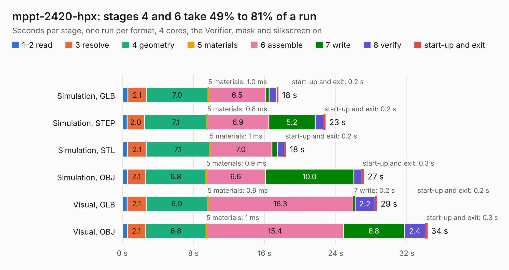

# 1501. mppt-2420-hpx

Board 1,501 of the 3,139 of [Corpus Testing](../Corpus-Testing.md), on [Corpus Page 14](../CorpusTestingPages/Corpus-Testing-14.md#1501-mppt-2420-hpx).

| Mode and format | 1–2 read | 3 resolve | 4 geometry | 5 materials | 6 assemble | 7 write | 8 verify | start-up and exit | Total |
|---|---:|---:|---:|---:|---:|---:|---:|---:|---:|
| Simulation, GLB | 0.6 | 2.1 | 7.0 | 1.0&nbsp;ms | 6.5 | 0.4 | 0.9 | 0.2 | 17.6 |
| Simulation, STEP | 0.5 | 2.0 | 7.1 | 0.8&nbsp;ms | 6.9 | 5.2 | 0.9 | 0.2 | 22.9 |
| Simulation, STL | 0.6 | 2.1 | 7.1 | 1&nbsp;ms | 7.0 | 0.6 | 0.8 | 0.2 | 18.4 |
| Simulation, OBJ | 0.6 | 2.1 | 6.8 | 0.9&nbsp;ms | 6.6 | 10.0 | 0.9 | 0.3 | 27.2 |
| Visual, GLB | 0.5 | 2.1 | 6.9 | 0.9&nbsp;ms | 16.3 | 0.2 | 2.2 | 0.2 | 28.6 |
| Visual, OBJ | 0.6 | 2.1 | 6.8 | 1&nbsp;ms | 15.4 | 6.8 | 2.4 | 0.3 | 34.3 |

<table align="center"><tr><td valign="top">

| Board | Repo: [libresolar/mppt-2420-hpx](https://github.com/libresolar/mppt-2420-hpx) Board: `mppt-2420-hpx.kicad_pcb` |
|---|---|
| Folder | kicad |
| Complexity | 301&nbsp;/&nbsp;1000 (size&nbsp;256, features&nbsp;45) |
| KESE&nbsp;features | through vias, rounded, trapezoid or chamfered pads, filled zones |
| Tested | 9th November 2026 |
| Copper&nbsp;layers | 4 |
| File&nbsp;format | KiCad 5 (20171130) |
| Parts,&nbsp;tracks,&nbsp;vias | 178, 1,413, 274 |
| Triangles,&nbsp;simulation | 2,395,966 in 170 parts |
| Verifier | PASS in all six runs |

</td><td valign="top">

<table>
<tr><th>File type</th><th>File size</th><th>Peak memory used</th></tr>
<tr><th colspan="3" align="left">Simulation</th></tr>
<tr><td>GLB</td><td align="right">82&nbsp;MB</td><td align="right">754&nbsp;MB</td></tr>
<tr><td>STEP</td><td align="right">300&nbsp;MB</td><td align="right">975&nbsp;MB</td></tr>
<tr><td>STL</td><td align="right">120&nbsp;MB</td><td align="right">789&nbsp;MB</td></tr>
<tr><td>OBJ</td><td align="right">250&nbsp;MB</td><td align="right">1.6&nbsp;GB</td></tr>
<tr><th colspan="3" align="left">Visual</th></tr>
<tr><td>GLB</td><td align="right">53&nbsp;MB</td><td align="right">1.0&nbsp;GB</td></tr>
<tr><td>OBJ</td><td align="right">163&nbsp;MB</td><td align="right">1.2&nbsp;GB</td></tr>
</table>

</td></tr></table>

| Previous | Next |
|:---|---:|
| [1500. mppt-2420-hc](b1500b_mppt-2420-hc_mppt-2420-hc.md) | [1502. cantact](b1502b_cantact-hw_cantact.md) |
