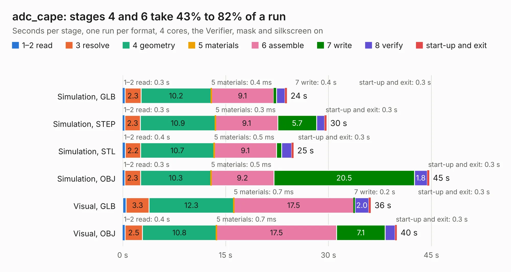

# 1502. adc_cape

Board 1,502 of the 3,129 of [Corpus Testing](../Corpus-Testing.md), on [Corpus Page 14](../CorpusTestingPages/Corpus-Testing-14.md#1502-adc_cape).

| Mode and format | 1–2 read | 3 resolve | 4 geometry | 5 materials | 6 assemble | 7 write | 8 verify | start-up and exit | Total |
|---|---:|---:|---:|---:|---:|---:|---:|---:|---:|
| Simulation, GLB | 0.3 | 2.3 | 10.2 | 0.4&nbsp;ms | 9.1 | 0.4 | 1.2 | 0.3 | 23.9 |
| Simulation, STEP | 0.3 | 2.3 | 10.9 | 0.3&nbsp;ms | 9.1 | 5.7 | 1.2 | 0.3 | 29.7 |
| Simulation, STL | 0.4 | 2.2 | 10.7 | 0.5&nbsp;ms | 9.1 | 0.8 | 1.5 | 0.3 | 24.9 |
| Simulation, OBJ | 0.3 | 2.3 | 10.3 | 0.5&nbsp;ms | 9.2 | 20.5 | 1.8 | 0.3 | 44.7 |
| Visual, GLB | 0.5 | 3.3 | 12.3 | 0.7&nbsp;ms | 17.5 | 0.2 | 2.0 | 0.3 | 36.2 |
| Visual, OBJ | 0.4 | 2.5 | 10.8 | 0.7&nbsp;ms | 17.5 | 7.1 | 1.4 | 0.3 | 40.0 |

<table align="center"><tr><td valign="top">

| Board | Repo: [loxodes/vna](https://github.com/loxodes/vna) Board: `adc_cape.kicad_pcb` |
|---|---|
| Folder | breakouts / adc_cape |
| Complexity | 231&nbsp;/&nbsp;1000 (size&nbsp;186, features&nbsp;45) |
| KESE&nbsp;features | through vias, filled zones, curved board outline |
| Tested | 9th November 2026 |
| Copper&nbsp;layers | 4 |
| File&nbsp;format | KiCad 4 (4) |
| Parts,&nbsp;tracks,&nbsp;vias | 22, 1,037, 129 |
| Triangles,&nbsp;simulation | 2,489,974 in 85 parts |
| Verifier | PASS in all six runs |

</td><td valign="top">

<table>
<tr><th>File type</th><th>File size</th><th>Peak memory used</th></tr>
<tr><th colspan="3" align="left">Simulation</th></tr>
<tr><td>GLB</td><td align="right">85&nbsp;MB</td><td align="right">740&nbsp;MB</td></tr>
<tr><td>STEP</td><td align="right">321&nbsp;MB</td><td align="right">859&nbsp;MB</td></tr>
<tr><td>STL</td><td align="right">125&nbsp;MB</td><td align="right">728&nbsp;MB</td></tr>
<tr><td>OBJ</td><td align="right">262&nbsp;MB</td><td align="right">1.7&nbsp;GB</td></tr>
<tr><th colspan="3" align="left">Visual</th></tr>
<tr><td>GLB</td><td align="right">37&nbsp;MB</td><td align="right">805&nbsp;MB</td></tr>
<tr><td>OBJ</td><td align="right">114&nbsp;MB</td><td align="right">835&nbsp;MB</td></tr>
</table>

</td></tr></table>

| Previous | Next |
|:---|---:|
| [1501. adc_32xx](b1501b_vna_adc-32xx.md) | [1503. adc_dual](b1503b_vna_adc-dual.md) |
