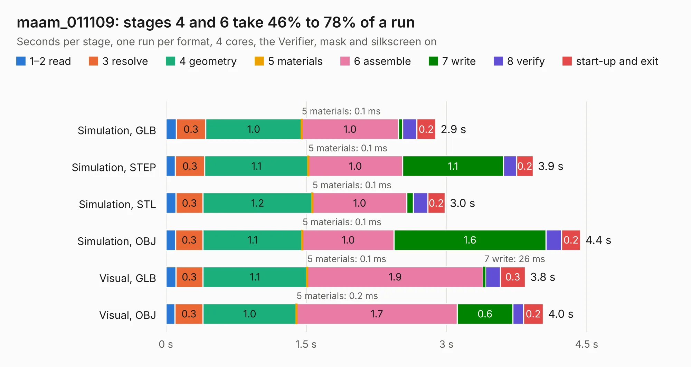

# 1502. maam_011109

Board 1,502 of the 3,103 of [Corpus Testing](../Corpus-Testing.md), on [Corpus Page 14](../CorpusTestingPages/Corpus-Testing-14.md#1502-maam_011109).

| Mode and format | 1–2 read | 3 resolve | 4 geometry | 5 materials | 6 assemble | 7 write | 8 verify | start-up and exit | Total |
|---|---:|---:|---:|---:|---:|---:|---:|---:|---:|
| Simulation, GLB | 0.1 | 0.3 | 1.0 | 0.1&nbsp;ms | 1.0 | 45&nbsp;ms | 0.2 | 0.2 | 2.9 |
| Simulation, STEP | 0.1 | 0.3 | 1.1 | 0.1&nbsp;ms | 1.0 | 1.1 | 0.1 | 0.2 | 3.9 |
| Simulation, STL | 0.1 | 0.3 | 1.2 | 0.1&nbsp;ms | 1.0 | 68&nbsp;ms | 0.2 | 0.2 | 3.0 |
| Simulation, OBJ | 0.1 | 0.3 | 1.1 | 0.1&nbsp;ms | 1.0 | 1.6 | 0.2 | 0.2 | 4.4 |
| Visual, GLB | 0.1 | 0.3 | 1.1 | 0.1&nbsp;ms | 1.9 | 26&nbsp;ms | 0.2 | 0.3 | 3.8 |
| Visual, OBJ | 97&nbsp;ms | 0.3 | 1.0 | 0.2&nbsp;ms | 1.7 | 0.6 | 0.1 | 0.2 | 4.0 |

<table align="center"><tr><td valign="top">

| Board | Repo: [loxodes/vna](https://github.com/loxodes/vna) Board: `maam_011109.kicad_pcb` |
|---|---|
| Folder | breakouts / maam_011109 / maam_011109 |
| Complexity | 188&nbsp;/&nbsp;1000 (size&nbsp;143, features&nbsp;45) |
| KESE&nbsp;features | through vias, rounded, trapezoid or chamfered pads, filled zones |
| Tested | 9th November 2026 |
| Copper&nbsp;layers | 4 |
| File&nbsp;format | KiCad 5 (20171130) |
| Parts,&nbsp;tracks,&nbsp;vias | 8, 51, 47 |
| Triangles,&nbsp;simulation | 316,726 in 23 parts |
| Verifier | PASS in all six runs |

</td><td valign="top">

<table>
<tr><th>File type</th><th>File size</th><th>Peak memory used</th></tr>
<tr><th colspan="3" align="left">Simulation</th></tr>
<tr><td>GLB</td><td align="right">11&nbsp;MB</td><td align="right">247&nbsp;MB</td></tr>
<tr><td>STEP</td><td align="right">31&nbsp;MB</td><td align="right">265&nbsp;MB</td></tr>
<tr><td>STL</td><td align="right">16&nbsp;MB</td><td align="right">268&nbsp;MB</td></tr>
<tr><td>OBJ</td><td align="right">31&nbsp;MB</td><td align="right">271&nbsp;MB</td></tr>
<tr><th colspan="3" align="left">Visual</th></tr>
<tr><td>GLB</td><td align="right">4.4&nbsp;MB</td><td align="right">210&nbsp;MB</td></tr>
<tr><td>OBJ</td><td align="right">12&nbsp;MB</td><td align="right">214&nbsp;MB</td></tr>
</table>

</td></tr></table>

| Previous | Next |
|:---|---:|
| [1501. launchpad_synthcontrol](b1501b_vna_launchpad-synthcontrol.md) | [1503. maam_011109_bias](b1503b_vna_maam-011109-bias.md) |
