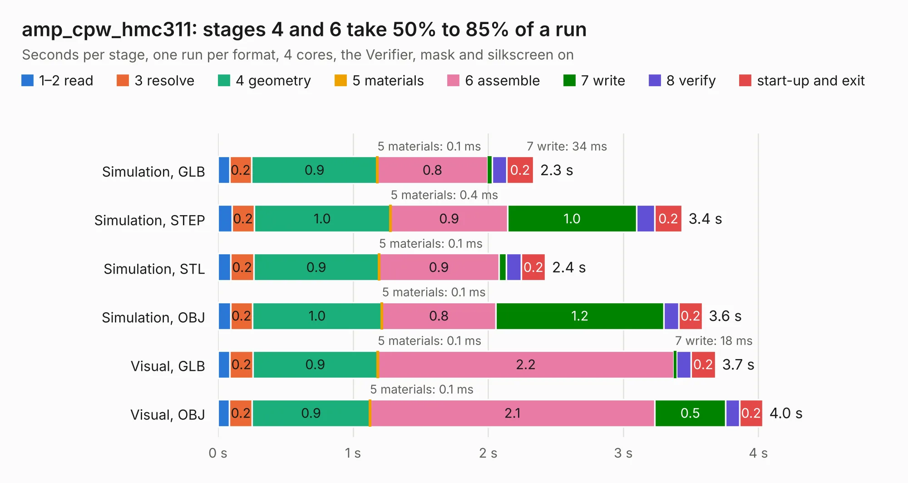

# 1503. amp_cpw_hmc311

Board 1,503 of the 3,122 of [Corpus Testing](../Corpus-Testing.md), on [Corpus Page 14](../CorpusTestingPages/Corpus-Testing-14.md#1503-amp_cpw_hmc311).

| Mode and format | 1–2 read | 3 resolve | 4 geometry | 5 materials | 6 assemble | 7 write | 8 verify | start-up and exit | Total |
|---|---:|---:|---:|---:|---:|---:|---:|---:|---:|
| Simulation, GLB | 86&nbsp;ms | 0.2 | 0.9 | 0.1&nbsp;ms | 0.8 | 34&nbsp;ms | 0.1 | 0.2 | 2.3 |
| Simulation, STEP | 0.1 | 0.2 | 1.0 | 0.4&nbsp;ms | 0.9 | 1.0 | 0.1 | 0.2 | 3.4 |
| Simulation, STL | 93&nbsp;ms | 0.2 | 0.9 | 0.1&nbsp;ms | 0.9 | 54&nbsp;ms | 0.1 | 0.2 | 2.4 |
| Simulation, OBJ | 93&nbsp;ms | 0.2 | 1.0 | 0.1&nbsp;ms | 0.8 | 1.2 | 0.1 | 0.2 | 3.6 |
| Visual, GLB | 89&nbsp;ms | 0.2 | 0.9 | 0.1&nbsp;ms | 2.2 | 18&nbsp;ms | 0.1 | 0.2 | 3.7 |
| Visual, OBJ | 86&nbsp;ms | 0.2 | 0.9 | 0.1&nbsp;ms | 2.1 | 0.5 | 0.1 | 0.2 | 4.0 |

<table align="center"><tr><td valign="top">

| Board | Repo: [loxodes/vna](https://github.com/loxodes/vna) Board: `amp_cpw_hmc311.kicad_pcb` |
|---|---|
| Folder | breakouts / amp_cpw_hmc311 |
| Complexity | 132&nbsp;/&nbsp;1000 (size&nbsp;112, features&nbsp;20) |
| KESE&nbsp;features | filled zones |
| Tested | 9th November 2026 |
| Copper&nbsp;layers | 4 |
| File&nbsp;format | KiCad 4 (4) |
| Parts,&nbsp;tracks,&nbsp;vias | 10, 24, 0 |
| Triangles,&nbsp;simulation | 250,288 in 19 parts |
| Verifier | PASS in all six runs |

</td><td valign="top">

<table>
<tr><th>File type</th><th>File size</th><th>Peak memory used</th></tr>
<tr><th colspan="3" align="left">Simulation</th></tr>
<tr><td>GLB</td><td align="right">8.5&nbsp;MB</td><td align="right">245&nbsp;MB</td></tr>
<tr><td>STEP</td><td align="right">26&nbsp;MB</td><td align="right">245&nbsp;MB</td></tr>
<tr><td>STL</td><td align="right">13&nbsp;MB</td><td align="right">243&nbsp;MB</td></tr>
<tr><td>OBJ</td><td align="right">24&nbsp;MB</td><td align="right">227&nbsp;MB</td></tr>
<tr><th colspan="3" align="left">Visual</th></tr>
<tr><td>GLB</td><td align="right">3.9&nbsp;MB</td><td align="right">190&nbsp;MB</td></tr>
<tr><td>OBJ</td><td align="right">11&nbsp;MB</td><td align="right">186&nbsp;MB</td></tr>
</table>

</td></tr></table>

| Previous | Next |
|:---|---:|
| [1502. amp_breakout](b1502b_vna_amp-breakout.md) | [1504. amp_macom](b1504b_vna_amp-macom.md) |
