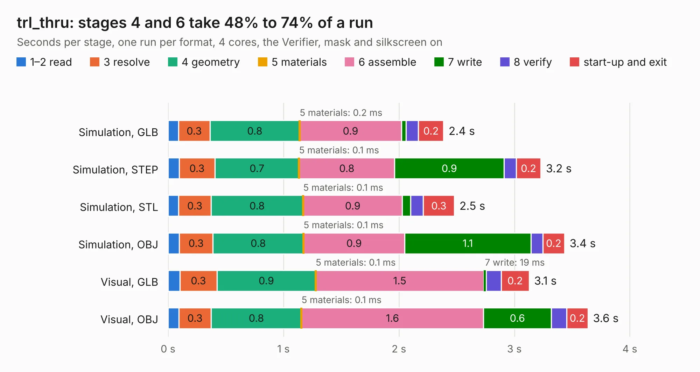

# 1505. trl_thru

Board 1,505 of the 3,109 of [Corpus Testing](../Corpus-Testing.md), on [Corpus Page 14](../CorpusTestingPages/Corpus-Testing-14.md#1505-trl_thru).

| Mode and format | 1–2 read | 3 resolve | 4 geometry | 5 materials | 6 assemble | 7 write | 8 verify | start-up and exit | Total |
|---|---:|---:|---:|---:|---:|---:|---:|---:|---:|
| Simulation, GLB | 91&nbsp;ms | 0.3 | 0.8 | 0.2&nbsp;ms | 0.9 | 39&nbsp;ms | 0.1 | 0.2 | 2.4 |
| Simulation, STEP | 96&nbsp;ms | 0.3 | 0.7 | 0.1&nbsp;ms | 0.8 | 0.9 | 0.1 | 0.2 | 3.2 |
| Simulation, STL | 92&nbsp;ms | 0.3 | 0.8 | 0.1&nbsp;ms | 0.9 | 70&nbsp;ms | 0.1 | 0.3 | 2.5 |
| Simulation, OBJ | 98&nbsp;ms | 0.3 | 0.8 | 0.1&nbsp;ms | 0.9 | 1.1 | 0.1 | 0.2 | 3.4 |
| Visual, GLB | 0.1 | 0.3 | 0.9 | 0.1&nbsp;ms | 1.5 | 19&nbsp;ms | 0.1 | 0.2 | 3.1 |
| Visual, OBJ | 93&nbsp;ms | 0.3 | 0.8 | 0.1&nbsp;ms | 1.6 | 0.6 | 0.1 | 0.2 | 3.6 |

<table align="center"><tr><td valign="top">

| Board | Repo: [loxodes/vna](https://github.com/loxodes/vna) Board: `trl_thru.kicad_pcb` |
|---|---|
| Folder | breakouts / hmc576_breakout |
| Complexity | 185&nbsp;/&nbsp;1000 (size&nbsp;140, features&nbsp;45) |
| KESE&nbsp;features | through vias, rounded, trapezoid or chamfered pads, filled zones |
| Tested | 9th November 2026 |
| Copper&nbsp;layers | 4 |
| File&nbsp;format | KiCad 5 (20171130) |
| Parts,&nbsp;tracks,&nbsp;vias | 10, 55, 27 |
| Triangles,&nbsp;simulation | 254,354 in 18 parts |
| Verifier | PASS in all six runs |

</td><td valign="top">

<table>
<tr><th>File type</th><th>File size</th><th>Peak memory used</th></tr>
<tr><th colspan="3" align="left">Simulation</th></tr>
<tr><td>GLB</td><td align="right">8.6&nbsp;MB</td><td align="right">236&nbsp;MB</td></tr>
<tr><td>STEP</td><td align="right">27&nbsp;MB</td><td align="right">244&nbsp;MB</td></tr>
<tr><td>STL</td><td align="right">13&nbsp;MB</td><td align="right">254&nbsp;MB</td></tr>
<tr><td>OBJ</td><td align="right">25&nbsp;MB</td><td align="right">229&nbsp;MB</td></tr>
<tr><th colspan="3" align="left">Visual</th></tr>
<tr><td>GLB</td><td align="right">4.1&nbsp;MB</td><td align="right">184&nbsp;MB</td></tr>
<tr><td>OBJ</td><td align="right">12&nbsp;MB</td><td align="right">184&nbsp;MB</td></tr>
</table>

</td></tr></table>

| Previous | Next |
|:---|---:|
| [1504. filter_bank](b1504b_vna_filter-bank.md) | [1506. hyperram_3p3v](b1506b_vna_hyperram-3p3v.md) |
