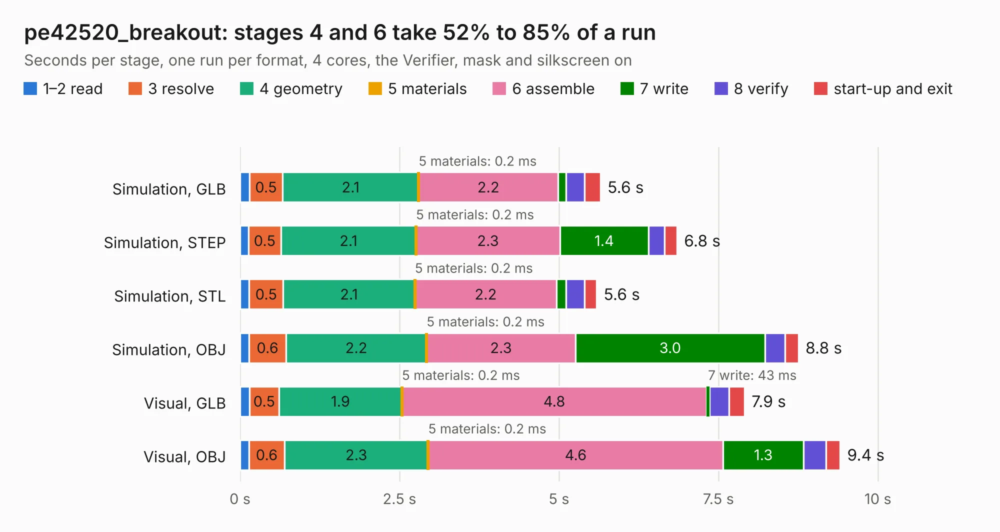

# 1505. pe42520_breakout

Board 1,505 of the 3,103 of [Corpus Testing](../Corpus-Testing.md), on [Corpus Page 14](../CorpusTestingPages/Corpus-Testing-14.md#1505-pe42520_breakout).

| Mode and format | 1–2 read | 3 resolve | 4 geometry | 5 materials | 6 assemble | 7 write | 8 verify | start-up and exit | Total |
|---|---:|---:|---:|---:|---:|---:|---:|---:|---:|
| Simulation, GLB | 0.1 | 0.5 | 2.1 | 0.2&nbsp;ms | 2.2 | 0.1 | 0.3 | 0.2 | 5.6 |
| Simulation, STEP | 0.1 | 0.5 | 2.1 | 0.2&nbsp;ms | 2.3 | 1.4 | 0.3 | 0.2 | 6.8 |
| Simulation, STL | 0.1 | 0.5 | 2.1 | 0.2&nbsp;ms | 2.2 | 0.1 | 0.3 | 0.2 | 5.6 |
| Simulation, OBJ | 0.1 | 0.6 | 2.2 | 0.2&nbsp;ms | 2.3 | 3.0 | 0.3 | 0.2 | 8.8 |
| Visual, GLB | 0.1 | 0.5 | 1.9 | 0.2&nbsp;ms | 4.8 | 43&nbsp;ms | 0.3 | 0.2 | 7.9 |
| Visual, OBJ | 0.1 | 0.6 | 2.3 | 0.2&nbsp;ms | 4.6 | 1.3 | 0.4 | 0.2 | 9.4 |

<table align="center"><tr><td valign="top">

| Board | Repo: [loxodes/vna](https://github.com/loxodes/vna) Board: `pe42520_breakout.kicad_pcb` |
|---|---|
| Folder | breakouts / pe42540_breakout |
| Complexity | 210&nbsp;/&nbsp;1000 (size&nbsp;190, features&nbsp;20) |
| KESE&nbsp;features | filled zones |
| Tested | 9th November 2026 |
| Copper&nbsp;layers | 4 |
| File&nbsp;format | KiCad 4 (4) |
| Parts,&nbsp;tracks,&nbsp;vias | 19, 83, 0 |
| Triangles,&nbsp;simulation | 614,274 in 30 parts |
| Verifier | PASS in all six runs |

</td><td valign="top">

<table>
<tr><th>File type</th><th>File size</th><th>Peak memory used</th></tr>
<tr><th colspan="3" align="left">Simulation</th></tr>
<tr><td>GLB</td><td align="right">21&nbsp;MB</td><td align="right">344&nbsp;MB</td></tr>
<tr><td>STEP</td><td align="right">46&nbsp;MB</td><td align="right">413&nbsp;MB</td></tr>
<tr><td>STL</td><td align="right">31&nbsp;MB</td><td align="right">348&nbsp;MB</td></tr>
<tr><td>OBJ</td><td align="right">61&nbsp;MB</td><td align="right">450&nbsp;MB</td></tr>
<tr><th colspan="3" align="left">Visual</th></tr>
<tr><td>GLB</td><td align="right">9.2&nbsp;MB</td><td align="right">314&nbsp;MB</td></tr>
<tr><td>OBJ</td><td align="right">27&nbsp;MB</td><td align="right">315&nbsp;MB</td></tr>
</table>

</td></tr></table>

| Previous | Next |
|:---|---:|
| [1504. mixer_breakout](b1504b_vna_mixer-breakout.md) | [1506. pe42543_breakout](b1506b_vna_pe42543-breakout.md) |
