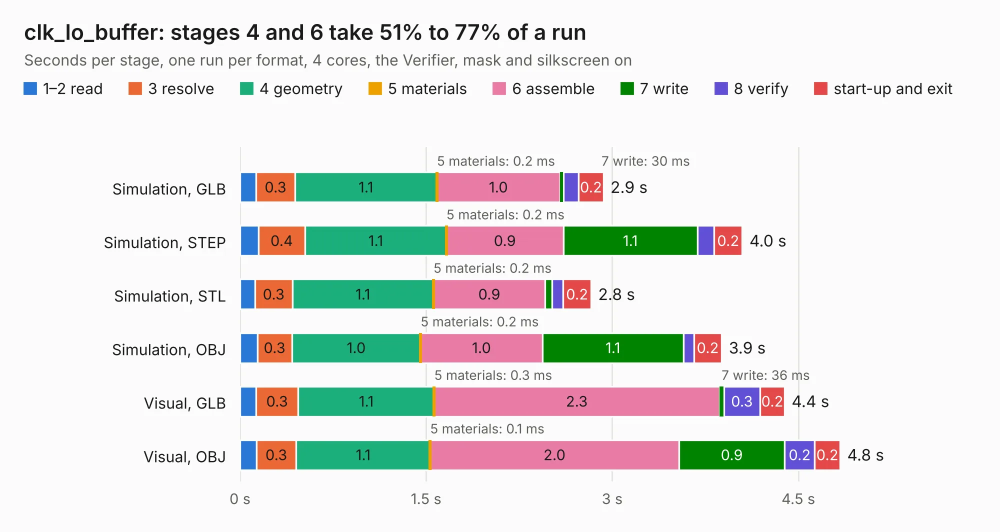

# 1509. clk_lo_buffer

Board 1,509 of the 3,120 of [Corpus Testing](../Corpus-Testing.md), on [Corpus Page 14](../CorpusTestingPages/Corpus-Testing-14.md#1509-clk_lo_buffer).

| Mode and format | 1–2 read | 3 resolve | 4 geometry | 5 materials | 6 assemble | 7 write | 8 verify | start-up and exit | Total |
|---|---:|---:|---:|---:|---:|---:|---:|---:|---:|
| Simulation, GLB | 0.1 | 0.3 | 1.1 | 0.2&nbsp;ms | 1.0 | 30&nbsp;ms | 0.1 | 0.2 | 2.9 |
| Simulation, STEP | 0.1 | 0.4 | 1.1 | 0.2&nbsp;ms | 0.9 | 1.1 | 0.1 | 0.2 | 4.0 |
| Simulation, STL | 0.1 | 0.3 | 1.1 | 0.2&nbsp;ms | 0.9 | 58&nbsp;ms | 88&nbsp;ms | 0.2 | 2.8 |
| Simulation, OBJ | 0.1 | 0.3 | 1.0 | 0.2&nbsp;ms | 1.0 | 1.1 | 84&nbsp;ms | 0.2 | 3.9 |
| Visual, GLB | 0.1 | 0.3 | 1.1 | 0.3&nbsp;ms | 2.3 | 36&nbsp;ms | 0.3 | 0.2 | 4.4 |
| Visual, OBJ | 0.1 | 0.3 | 1.1 | 0.1&nbsp;ms | 2.0 | 0.9 | 0.2 | 0.2 | 4.8 |

<table align="center"><tr><td valign="top">

| Board | Repo: [loxodes/vna](https://github.com/loxodes/vna) Board: `clk_lo_buffer.kicad_pcb` |
|---|---|
| Folder | breakouts / clk_lo_buffer |
| Complexity | 214&nbsp;/&nbsp;1000 (size&nbsp;159, features&nbsp;55) |
| KESE&nbsp;features | through vias, rounded, trapezoid or chamfered pads, filled zones, curved board outline |
| Tested | 9th November 2026 |
| Copper&nbsp;layers | 2 |
| File&nbsp;format | KiCad 4 (4) |
| Parts,&nbsp;tracks,&nbsp;vias | 44, 318, 48 |
| Triangles,&nbsp;simulation | 214,972 in 36 parts |
| Verifier | PASS in all six runs |

</td><td valign="top">

<table>
<tr><th>File type</th><th>File size</th><th>Peak memory used</th></tr>
<tr><th colspan="3" align="left">Simulation</th></tr>
<tr><td>GLB</td><td align="right">7.9&nbsp;MB</td><td align="right">239&nbsp;MB</td></tr>
<tr><td>STEP</td><td align="right">31&nbsp;MB</td><td align="right">258&nbsp;MB</td></tr>
<tr><td>STL</td><td align="right">11&nbsp;MB</td><td align="right">233&nbsp;MB</td></tr>
<tr><td>OBJ</td><td align="right">22&nbsp;MB</td><td align="right">237&nbsp;MB</td></tr>
<tr><th colspan="3" align="left">Visual</th></tr>
<tr><td>GLB</td><td align="right">6.6&nbsp;MB</td><td align="right">224&nbsp;MB</td></tr>
<tr><td>OBJ</td><td align="right">19&nbsp;MB</td><td align="right">225&nbsp;MB</td></tr>
</table>

</td></tr></table>

| Previous | Next |
|:---|---:|
| [1508. boosterpack](b1508b_vna_boosterpack.md) | [1510. coupler_test](b1510b_vna_coupler-test.md) |
