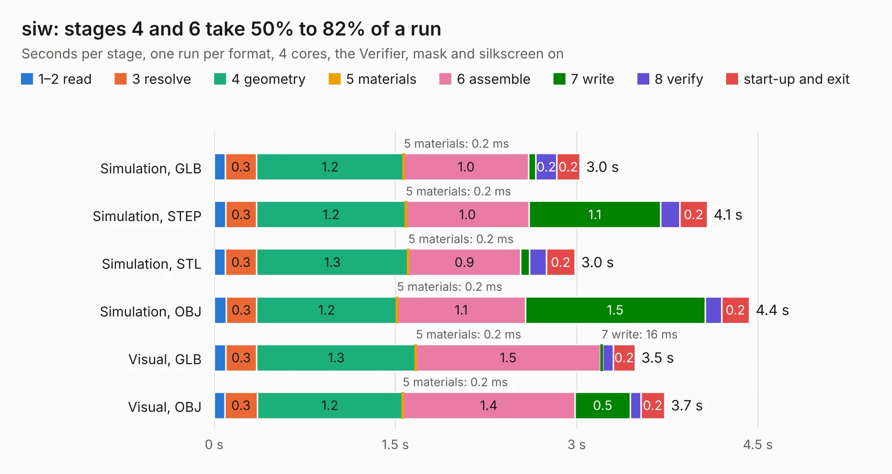

# 1512. siw

Board 1,512 of the 3,100 of [Corpus Testing](../Corpus-Testing.md), on [Corpus Page 14](../CorpusTestingPages/Corpus-Testing-14.md#1512-siw).

| Mode and format | 1–2 read | 3 resolve | 4 geometry | 5 materials | 6 assemble | 7 write | 8 verify | start-up and exit | Total |
|---|---:|---:|---:|---:|---:|---:|---:|---:|---:|
| Simulation, GLB | 91&nbsp;ms | 0.3 | 1.2 | 0.2&nbsp;ms | 1.0 | 60&nbsp;ms | 0.2 | 0.2 | 3.0 |
| Simulation, STEP | 96&nbsp;ms | 0.3 | 1.2 | 0.2&nbsp;ms | 1.0 | 1.1 | 0.2 | 0.2 | 4.1 |
| Simulation, STL | 94&nbsp;ms | 0.3 | 1.3 | 0.2&nbsp;ms | 0.9 | 73&nbsp;ms | 0.1 | 0.2 | 3.0 |
| Simulation, OBJ | 99&nbsp;ms | 0.3 | 1.2 | 0.2&nbsp;ms | 1.1 | 1.5 | 0.1 | 0.2 | 4.4 |
| Visual, GLB | 96&nbsp;ms | 0.3 | 1.3 | 0.2&nbsp;ms | 1.5 | 16&nbsp;ms | 90&nbsp;ms | 0.2 | 3.5 |
| Visual, OBJ | 88&nbsp;ms | 0.3 | 1.2 | 0.2&nbsp;ms | 1.4 | 0.5 | 86&nbsp;ms | 0.2 | 3.7 |

<table align="center"><tr><td valign="top">

| Board | Repo: [loxodes/vna](https://github.com/loxodes/vna) Board: `siw.kicad_pcb` |
|---|---|
| Folder | breakouts / sw_edge_fr408_oshpark / siw |
| Complexity | 105&nbsp;/&nbsp;1000 (size&nbsp;75, features&nbsp;30) |
| KESE&nbsp;features | rounded, trapezoid or chamfered pads, filled zones |
| Tested | 9th November 2026 |
| Copper&nbsp;layers | 4 |
| File&nbsp;format | KiCad 5 (20171130) |
| Parts,&nbsp;tracks,&nbsp;vias | 3, 4, 0 |
| Triangles,&nbsp;simulation | 305,108 in 16 parts |
| Verifier | PASS in all six runs |

</td><td valign="top">

<table>
<tr><th>File type</th><th>File size</th><th>Peak memory used</th></tr>
<tr><th colspan="3" align="left">Simulation</th></tr>
<tr><td>GLB</td><td align="right">10&nbsp;MB</td><td align="right">253&nbsp;MB</td></tr>
<tr><td>STEP</td><td align="right">32&nbsp;MB</td><td align="right">270&nbsp;MB</td></tr>
<tr><td>STL</td><td align="right">15&nbsp;MB</td><td align="right">255&nbsp;MB</td></tr>
<tr><td>OBJ</td><td align="right">30&nbsp;MB</td><td align="right">257&nbsp;MB</td></tr>
<tr><th colspan="3" align="left">Visual</th></tr>
<tr><td>GLB</td><td align="right">3.1&nbsp;MB</td><td align="right">186&nbsp;MB</td></tr>
<tr><td>OBJ</td><td align="right">8.9&nbsp;MB</td><td align="right">186&nbsp;MB</td></tr>
</table>

</td></tr></table>

| Previous | Next |
|:---|---:|
| [1511. siw](b1511b_vna_breakouts-sw-edge-fr408-oshpark-lpf-8ghz_siw.md) | [1513. siw](b1513b_vna_breakouts-sw-edge-fr408-oshpark-trl-0402-series_siw.md) |
