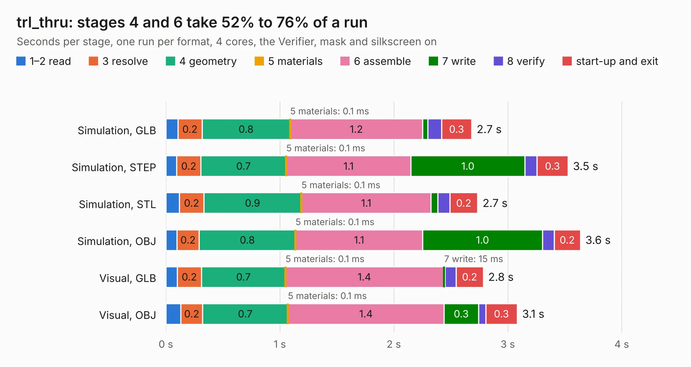

# 1513. trl_thru

Board 1,513 of the 3,107 of [Corpus Testing](../Corpus-Testing.md), on [Corpus Page 15](../CorpusTestingPages/Corpus-Testing-15.md#1513-trl_thru).

| Mode and format | 1–2 read | 3 resolve | 4 geometry | 5 materials | 6 assemble | 7 write | 8 verify | start-up and exit | Total |
|---|---:|---:|---:|---:|---:|---:|---:|---:|---:|
| Simulation, GLB | 0.1 | 0.2 | 0.8 | 0.1&nbsp;ms | 1.2 | 47&nbsp;ms | 0.1 | 0.3 | 2.7 |
| Simulation, STEP | 95&nbsp;ms | 0.2 | 0.7 | 0.1&nbsp;ms | 1.1 | 1.0 | 0.1 | 0.3 | 3.5 |
| Simulation, STL | 0.1 | 0.2 | 0.9 | 0.1&nbsp;ms | 1.1 | 59&nbsp;ms | 0.1 | 0.2 | 2.7 |
| Simulation, OBJ | 97&nbsp;ms | 0.2 | 0.8 | 0.1&nbsp;ms | 1.1 | 1.0 | 0.1 | 0.2 | 3.6 |
| Visual, GLB | 99&nbsp;ms | 0.2 | 0.7 | 0.1&nbsp;ms | 1.4 | 15&nbsp;ms | 97&nbsp;ms | 0.2 | 2.8 |
| Visual, OBJ | 0.1 | 0.2 | 0.7 | 0.1&nbsp;ms | 1.4 | 0.3 | 64&nbsp;ms | 0.3 | 3.1 |

<table align="center"><tr><td valign="top">

| Board | Repo: [loxodes/vna](https://github.com/loxodes/vna) Board: `trl_thru.kicad_pcb` |
|---|---|
| Folder | breakouts / res_splitter |
| Complexity | 147&nbsp;/&nbsp;1000 (size&nbsp;102, features&nbsp;45) |
| KESE&nbsp;features | through vias, rounded, trapezoid or chamfered pads, filled zones |
| Tested | 9th November 2026 |
| Copper&nbsp;layers | 4 |
| File&nbsp;format | KiCad 5 (20171130) |
| Parts,&nbsp;tracks,&nbsp;vias | 4, 13, 3 |
| Triangles,&nbsp;simulation | 174,854 in 17 parts |
| Verifier | PASS in all six runs |

</td><td valign="top">

<table>
<tr><th>File type</th><th>File size</th><th>Peak memory used</th></tr>
<tr><th colspan="3" align="left">Simulation</th></tr>
<tr><td>GLB</td><td align="right">5.9&nbsp;MB</td><td align="right">209&nbsp;MB</td></tr>
<tr><td>STEP</td><td align="right">15&nbsp;MB</td><td align="right">227&nbsp;MB</td></tr>
<tr><td>STL</td><td align="right">8.7&nbsp;MB</td><td align="right">206&nbsp;MB</td></tr>
<tr><td>OBJ</td><td align="right">17&nbsp;MB</td><td align="right">208&nbsp;MB</td></tr>
<tr><th colspan="3" align="left">Visual</th></tr>
<tr><td>GLB</td><td align="right">1.8&nbsp;MB</td><td align="right">166&nbsp;MB</td></tr>
<tr><td>OBJ</td><td align="right">5.1&nbsp;MB</td><td align="right">169&nbsp;MB</td></tr>
</table>

</td></tr></table>

| Previous | Next |
|:---|---:|
| [1512. refclk_breakout](b1512b_vna_refclk-breakout.md) | [1514. sequencing_ltc2937](b1514b_vna_sequencing-ltc2937.md) |
