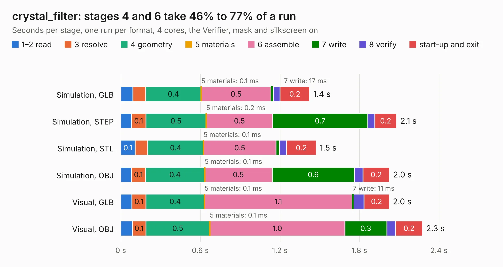

# 1514. crystal_filter

Board 1,514 of the 3,123 of [Corpus Testing](../Corpus-Testing.md), on [Corpus Page 15](../CorpusTestingPages/Corpus-Testing-15.md#1514-crystal_filter).

| Mode and format | 1–2 read | 3 resolve | 4 geometry | 5 materials | 6 assemble | 7 write | 8 verify | start-up and exit | Total |
|---|---:|---:|---:|---:|---:|---:|---:|---:|---:|
| Simulation, GLB | 91&nbsp;ms | 96&nbsp;ms | 0.4 | 0.1&nbsp;ms | 0.5 | 17&nbsp;ms | 51&nbsp;ms | 0.2 | 1.4 |
| Simulation, STEP | 81&nbsp;ms | 0.1 | 0.5 | 0.2&nbsp;ms | 0.5 | 0.7 | 53&nbsp;ms | 0.2 | 2.1 |
| Simulation, STL | 0.1 | 96&nbsp;ms | 0.4 | 0.1&nbsp;ms | 0.5 | 23&nbsp;ms | 57&nbsp;ms | 0.2 | 1.5 |
| Simulation, OBJ | 80&nbsp;ms | 0.1 | 0.4 | 0.1&nbsp;ms | 0.5 | 0.6 | 63&nbsp;ms | 0.2 | 2.0 |
| Visual, GLB | 84&nbsp;ms | 0.1 | 0.4 | 0.1&nbsp;ms | 1.1 | 11&nbsp;ms | 77&nbsp;ms | 0.2 | 2.0 |
| Visual, OBJ | 86&nbsp;ms | 0.1 | 0.5 | 0.1&nbsp;ms | 1.0 | 0.3 | 67&nbsp;ms | 0.2 | 2.3 |

<table align="center"><tr><td valign="top">

| Board | Repo: [loxodes/vna](https://github.com/loxodes/vna) Board: `crystal_filter.kicad_pcb` |
|---|---|
| Folder | breakouts / crystal_filter |
| Complexity | 146&nbsp;/&nbsp;1000 (size&nbsp;111, features&nbsp;35) |
| KESE&nbsp;features | through vias, filled zones |
| Tested | 9th November 2026 |
| Copper&nbsp;layers | 2 |
| File&nbsp;format | KiCad 4 (4) |
| Parts,&nbsp;tracks,&nbsp;vias | 9, 31, 12 |
| Triangles,&nbsp;simulation | 99,888 in 15 parts |
| Verifier | PASS in all six runs |

</td><td valign="top">

<table>
<tr><th>File type</th><th>File size</th><th>Peak memory used</th></tr>
<tr><th colspan="3" align="left">Simulation</th></tr>
<tr><td>GLB</td><td align="right">3.6&nbsp;MB</td><td align="right">178&nbsp;MB</td></tr>
<tr><td>STEP</td><td align="right">15&nbsp;MB</td><td align="right">185&nbsp;MB</td></tr>
<tr><td>STL</td><td align="right">5.0&nbsp;MB</td><td align="right">179&nbsp;MB</td></tr>
<tr><td>OBJ</td><td align="right">9.8&nbsp;MB</td><td align="right">181&nbsp;MB</td></tr>
<tr><th colspan="3" align="left">Visual</th></tr>
<tr><td>GLB</td><td align="right">2.2&nbsp;MB</td><td align="right">157&nbsp;MB</td></tr>
<tr><td>OBJ</td><td align="right">6.1&nbsp;MB</td><td align="right">158&nbsp;MB</td></tr>
</table>

</td></tr></table>

| Previous | Next |
|:---|---:|
| [1513. cpw_test](b1513b_vna_breakouts-cpw-test_cpw-test.md) | [1515. demod_breakout](b1515b_vna_demod-breakout.md) |
