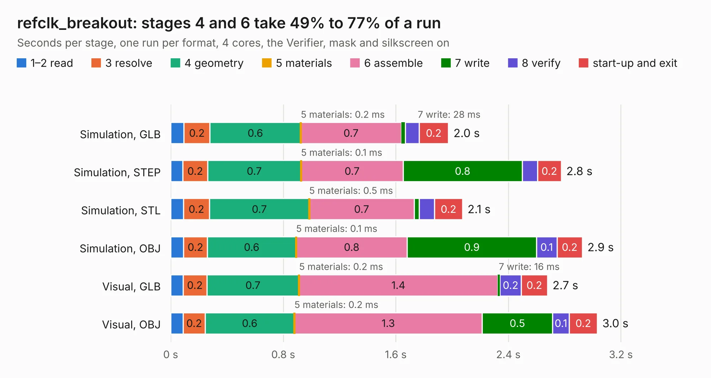

# 1514. refclk_breakout

Board 1,514 of the 3,109 of [Corpus Testing](../Corpus-Testing.md), on [Corpus Page 15](../CorpusTestingPages/Corpus-Testing-15.md#1514-refclk_breakout).

| Mode and format | 1–2 read | 3 resolve | 4 geometry | 5 materials | 6 assemble | 7 write | 8 verify | start-up and exit | Total |
|---|---:|---:|---:|---:|---:|---:|---:|---:|---:|
| Simulation, GLB | 94&nbsp;ms | 0.2 | 0.6 | 0.2&nbsp;ms | 0.7 | 28&nbsp;ms | 99&nbsp;ms | 0.2 | 2.0 |
| Simulation, STEP | 87&nbsp;ms | 0.2 | 0.7 | 0.1&nbsp;ms | 0.7 | 0.8 | 0.1 | 0.2 | 2.8 |
| Simulation, STL | 90&nbsp;ms | 0.2 | 0.7 | 0.5&nbsp;ms | 0.7 | 37&nbsp;ms | 0.1 | 0.2 | 2.1 |
| Simulation, OBJ | 92&nbsp;ms | 0.2 | 0.6 | 0.1&nbsp;ms | 0.8 | 0.9 | 0.1 | 0.2 | 2.9 |
| Visual, GLB | 87&nbsp;ms | 0.2 | 0.7 | 0.2&nbsp;ms | 1.4 | 16&nbsp;ms | 0.2 | 0.2 | 2.7 |
| Visual, OBJ | 89&nbsp;ms | 0.2 | 0.6 | 0.2&nbsp;ms | 1.3 | 0.5 | 0.1 | 0.2 | 3.0 |

<table align="center"><tr><td valign="top">

| Board | Repo: [loxodes/vna](https://github.com/loxodes/vna) Board: `refclk_breakout.kicad_pcb` |
|---|---|
| Folder | breakouts / refclk_breakout |
| Complexity | 176&nbsp;/&nbsp;1000 (size&nbsp;141, features&nbsp;35) |
| KESE&nbsp;features | through vias, filled zones |
| Tested | 9th November 2026 |
| Copper&nbsp;layers | 4 |
| File&nbsp;format | KiCad 4 (4) |
| Parts,&nbsp;tracks,&nbsp;vias | 13, 92, 10 |
| Triangles,&nbsp;simulation | 184,948 in 22 parts |
| Verifier | PASS in all six runs |

</td><td valign="top">

<table>
<tr><th>File type</th><th>File size</th><th>Peak memory used</th></tr>
<tr><th colspan="3" align="left">Simulation</th></tr>
<tr><td>GLB</td><td align="right">6.3&nbsp;MB</td><td align="right">194&nbsp;MB</td></tr>
<tr><td>STEP</td><td align="right">26&nbsp;MB</td><td align="right">208&nbsp;MB</td></tr>
<tr><td>STL</td><td align="right">9.2&nbsp;MB</td><td align="right">196&nbsp;MB</td></tr>
<tr><td>OBJ</td><td align="right">18&nbsp;MB</td><td align="right">195&nbsp;MB</td></tr>
<tr><th colspan="3" align="left">Visual</th></tr>
<tr><td>GLB</td><td align="right">3.5&nbsp;MB</td><td align="right">163&nbsp;MB</td></tr>
<tr><td>OBJ</td><td align="right">9.9&nbsp;MB</td><td align="right">162&nbsp;MB</td></tr>
</table>

</td></tr></table>

| Previous | Next |
|:---|---:|
| [1513. powerdet_breakout](b1513b_vna_powerdet-breakout.md) | [1515. trl_thru](b1515b_vna_breakouts-res-splitter_trl-thru.md) |
