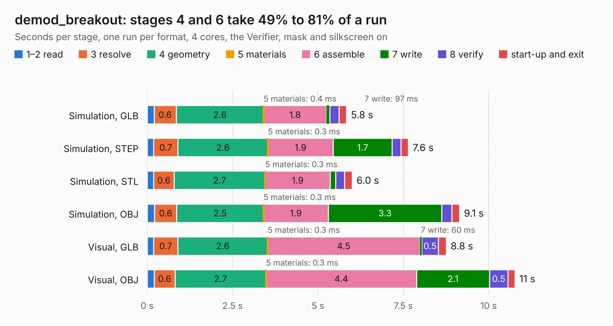

# 1516. demod_breakout

Board 1,516 of the 3,125 of [Corpus Testing](../Corpus-Testing.md), on [Corpus Page 15](../CorpusTestingPages/Corpus-Testing-15.md#1516-demod_breakout).

| Mode and format | 1–2 read | 3 resolve | 4 geometry | 5 materials | 6 assemble | 7 write | 8 verify | start-up and exit | Total |
|---|---:|---:|---:|---:|---:|---:|---:|---:|---:|
| Simulation, GLB | 0.2 | 0.6 | 2.6 | 0.4&nbsp;ms | 1.8 | 97&nbsp;ms | 0.3 | 0.2 | 5.8 |
| Simulation, STEP | 0.2 | 0.7 | 2.6 | 0.3&nbsp;ms | 1.9 | 1.7 | 0.3 | 0.2 | 7.6 |
| Simulation, STL | 0.2 | 0.6 | 2.7 | 0.3&nbsp;ms | 1.9 | 0.2 | 0.3 | 0.2 | 6.0 |
| Simulation, OBJ | 0.2 | 0.6 | 2.5 | 0.3&nbsp;ms | 1.9 | 3.3 | 0.3 | 0.2 | 9.1 |
| Visual, GLB | 0.2 | 0.7 | 2.6 | 0.3&nbsp;ms | 4.5 | 60&nbsp;ms | 0.5 | 0.2 | 8.8 |
| Visual, OBJ | 0.2 | 0.6 | 2.7 | 0.3&nbsp;ms | 4.4 | 2.1 | 0.5 | 0.2 | 10.8 |

<table align="center"><tr><td valign="top">

| Board | Repo: [loxodes/vna](https://github.com/loxodes/vna) Board: `demod_breakout.kicad_pcb` |
|---|---|
| Folder | breakouts / demod_breakout |
| Complexity | 220&nbsp;/&nbsp;1000 (size&nbsp;185, features&nbsp;35) |
| KESE&nbsp;features | through vias, filled zones |
| Tested | 9th November 2026 |
| Copper&nbsp;layers | 4 |
| File&nbsp;format | KiCad 4 (4) |
| Parts,&nbsp;tracks,&nbsp;vias | 67, 417, 72 |
| Triangles,&nbsp;simulation | 649,436 in 62 parts |
| Verifier | PASS in all six runs |

</td><td valign="top">

<table>
<tr><th>File type</th><th>File size</th><th>Peak memory used</th></tr>
<tr><th colspan="3" align="left">Simulation</th></tr>
<tr><td>GLB</td><td align="right">23&nbsp;MB</td><td align="right">330&nbsp;MB</td></tr>
<tr><td>STEP</td><td align="right">85&nbsp;MB</td><td align="right">374&nbsp;MB</td></tr>
<tr><td>STL</td><td align="right">32&nbsp;MB</td><td align="right">340&nbsp;MB</td></tr>
<tr><td>OBJ</td><td align="right">67&nbsp;MB</td><td align="right">482&nbsp;MB</td></tr>
<tr><th colspan="3" align="left">Visual</th></tr>
<tr><td>GLB</td><td align="right">14&nbsp;MB</td><td align="right">371&nbsp;MB</td></tr>
<tr><td>OBJ</td><td align="right">41&nbsp;MB</td><td align="right">371&nbsp;MB</td></tr>
</table>

</td></tr></table>

| Previous | Next |
|:---|---:|
| [1515. crystal_filter](b1515b_vna_crystal-filter.md) | [1517. filter_bank](b1517b_vna_filter-bank.md) |
