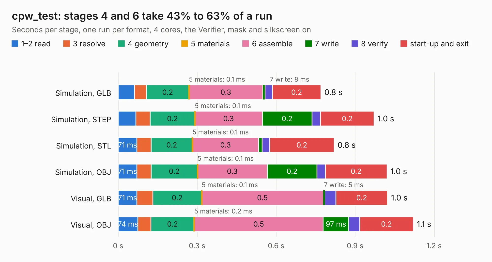

# 1518. cpw_test

Board 1,518 of the 3,131 of [Corpus Testing](../Corpus-Testing.md), on [Corpus Page 15](../CorpusTestingPages/Corpus-Testing-15.md#1518-cpw_test).

| Mode and format | 1–2 read | 3 resolve | 4 geometry | 5 materials | 6 assemble | 7 write | 8 verify | start-up and exit | Total |
|---|---:|---:|---:|---:|---:|---:|---:|---:|---:|
| Simulation, GLB | 62&nbsp;ms | 46&nbsp;ms | 0.2 | 0.1&nbsp;ms | 0.3 | 8&nbsp;ms | 29&nbsp;ms | 0.2 | 0.8 |
| Simulation, STEP | 67&nbsp;ms | 55&nbsp;ms | 0.2 | 0.1&nbsp;ms | 0.3 | 0.2 | 32&nbsp;ms | 0.2 | 1.0 |
| Simulation, STL | 71&nbsp;ms | 54&nbsp;ms | 0.2 | 0.1&nbsp;ms | 0.3 | 13&nbsp;ms | 29&nbsp;ms | 0.2 | 0.8 |
| Simulation, OBJ | 71&nbsp;ms | 54&nbsp;ms | 0.2 | 0.1&nbsp;ms | 0.3 | 0.2 | 32&nbsp;ms | 0.2 | 1.0 |
| Visual, GLB | 71&nbsp;ms | 60&nbsp;ms | 0.2 | 0.1&nbsp;ms | 0.5 | 5&nbsp;ms | 43&nbsp;ms | 0.2 | 1.0 |
| Visual, OBJ | 74&nbsp;ms | 50&nbsp;ms | 0.2 | 0.2&nbsp;ms | 0.5 | 97&nbsp;ms | 41&nbsp;ms | 0.2 | 1.1 |

<table align="center"><tr><td valign="top">

| Board | Repo: [loxodes/vna](https://github.com/loxodes/vna) Board: `cpw_test.kicad_pcb` |
|---|---|
| Folder | breakouts / cpw_test |
| Complexity | 78&nbsp;/&nbsp;1000 (size&nbsp;68, features&nbsp;10) |
| KESE&nbsp;features | rounded, trapezoid or chamfered pads |
| Tested | 9th November 2026 |
| Copper&nbsp;layers | 4 |
| File&nbsp;format | KiCad 4 (4) |
| Parts,&nbsp;tracks,&nbsp;vias | 2, 3, 0 |
| Triangles,&nbsp;simulation | 40,844 in 14 parts |
| Verifier | PASS in all six runs |

</td><td valign="top">

<table>
<tr><th>File type</th><th>File size</th><th>Peak memory used</th></tr>
<tr><th colspan="3" align="left">Simulation</th></tr>
<tr><td>GLB</td><td align="right">1.3&nbsp;MB</td><td align="right">65&nbsp;MB</td></tr>
<tr><td>STEP</td><td align="right">4.1&nbsp;MB</td><td align="right">69&nbsp;MB</td></tr>
<tr><td>STL</td><td align="right">2.0&nbsp;MB</td><td align="right">66&nbsp;MB</td></tr>
<tr><td>OBJ</td><td align="right">3.7&nbsp;MB</td><td align="right">74&nbsp;MB</td></tr>
<tr><th colspan="3" align="left">Visual</th></tr>
<tr><td>GLB</td><td align="right">731&nbsp;kB</td><td align="right">95&nbsp;MB</td></tr>
<tr><td>OBJ</td><td align="right">2.0&nbsp;MB</td><td align="right">94&nbsp;MB</td></tr>
</table>

</td></tr></table>

| Previous | Next |
|:---|---:|
| [1517. coupler_test](b1517b_vna_coupler-test.md) | [1519. crystal_filter](b1519b_vna_crystal-filter.md) |
