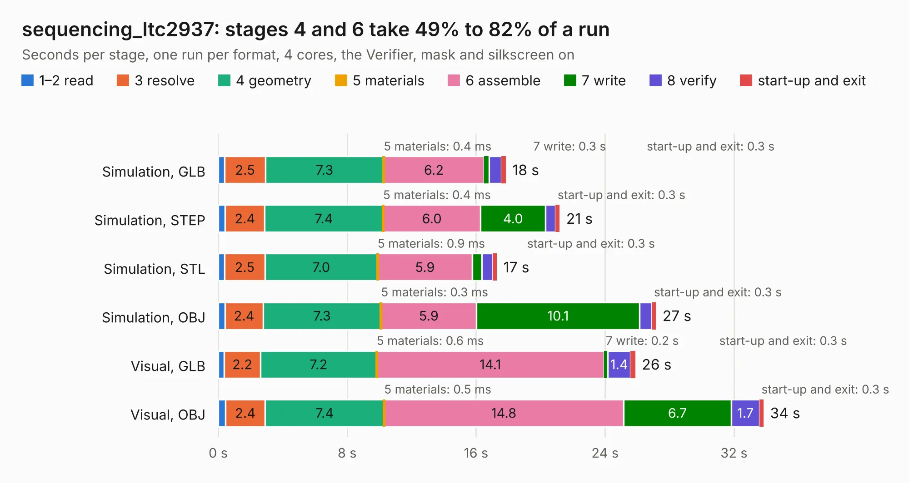

# 1518. sequencing_ltc2937

Board 1,518 of the 3,111 of [Corpus Testing](../Corpus-Testing.md), on [Corpus Page 15](../CorpusTestingPages/Corpus-Testing-15.md#1518-sequencing_ltc2937).

| Mode and format | 1–2 read | 3 resolve | 4 geometry | 5 materials | 6 assemble | 7 write | 8 verify | start-up and exit | Total |
|---|---:|---:|---:|---:|---:|---:|---:|---:|---:|
| Simulation, GLB | 0.4 | 2.5 | 7.3 | 0.4&nbsp;ms | 6.2 | 0.3 | 0.8 | 0.3 | 17.8 |
| Simulation, STEP | 0.4 | 2.4 | 7.4 | 0.4&nbsp;ms | 6.0 | 4.0 | 0.6 | 0.3 | 21.2 |
| Simulation, STL | 0.4 | 2.5 | 7.0 | 0.9&nbsp;ms | 5.9 | 0.6 | 0.7 | 0.3 | 17.3 |
| Simulation, OBJ | 0.4 | 2.4 | 7.3 | 0.3&nbsp;ms | 5.9 | 10.1 | 0.8 | 0.3 | 27.2 |
| Visual, GLB | 0.4 | 2.2 | 7.2 | 0.6&nbsp;ms | 14.1 | 0.2 | 1.4 | 0.3 | 25.9 |
| Visual, OBJ | 0.5 | 2.4 | 7.4 | 0.5&nbsp;ms | 14.8 | 6.7 | 1.7 | 0.3 | 33.8 |

<table align="center"><tr><td valign="top">

| Board | Repo: [loxodes/vna](https://github.com/loxodes/vna) Board: `sequencing_ltc2937.kicad_pcb` |
|---|---|
| Folder | breakouts / sequencing_ltc2937 |
| Complexity | 308&nbsp;/&nbsp;1000 (size&nbsp;263, features&nbsp;45) |
| KESE&nbsp;features | through vias, filled zones, curved board outline |
| Tested | 9th November 2026 |
| Copper&nbsp;layers | 4 |
| File&nbsp;format | KiCad 5 (20171130) |
| Parts,&nbsp;tracks,&nbsp;vias | 127, 1,208, 292 |
| Triangles,&nbsp;simulation | 1,853,264 in 101 parts |
| Verifier | PASS in all six runs |

</td><td valign="top">

<table>
<tr><th>File type</th><th>File size</th><th>Peak memory used</th></tr>
<tr><th colspan="3" align="left">Simulation</th></tr>
<tr><td>GLB</td><td align="right">65&nbsp;MB</td><td align="right">678&nbsp;MB</td></tr>
<tr><td>STEP</td><td align="right">232&nbsp;MB</td><td align="right">793&nbsp;MB</td></tr>
<tr><td>STL</td><td align="right">93&nbsp;MB</td><td align="right">692&nbsp;MB</td></tr>
<tr><td>OBJ</td><td align="right">195&nbsp;MB</td><td align="right">1.3&nbsp;GB</td></tr>
<tr><th colspan="3" align="left">Visual</th></tr>
<tr><td>GLB</td><td align="right">40&nbsp;MB</td><td align="right">792&nbsp;MB</td></tr>
<tr><td>OBJ</td><td align="right">122&nbsp;MB</td><td align="right">909&nbsp;MB</td></tr>
</table>

</td></tr></table>

| Previous | Next |
|:---|---:|
| [1517. trl_thru](b1517b_vna_breakouts-res-splitter_trl-thru.md) | [1519. sot89_amp_test](b1519b_vna_sot89-amp-test.md) |
