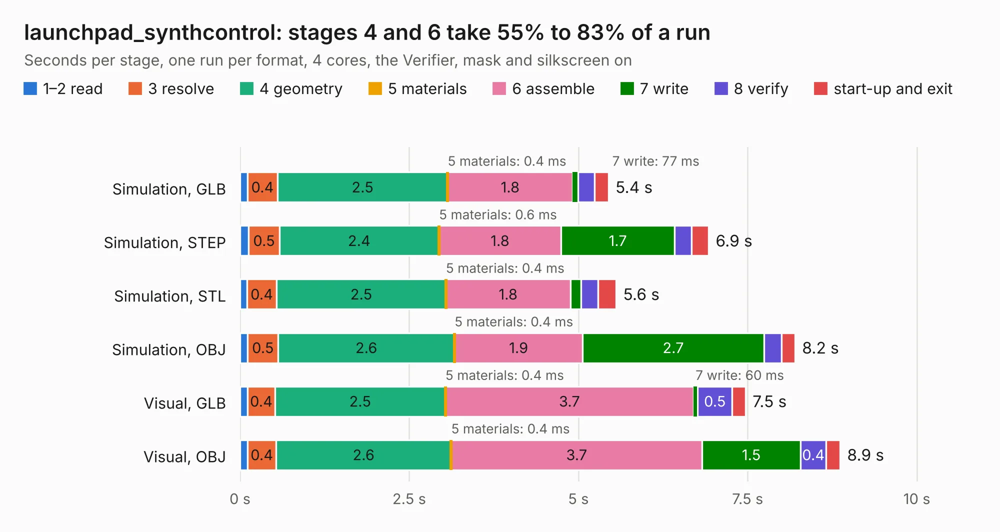

# 1519. launchpad_synthcontrol

Board 1,519 of the 3,123 of [Corpus Testing](../Corpus-Testing.md), on [Corpus Page 15](../CorpusTestingPages/Corpus-Testing-15.md#1519-launchpad_synthcontrol).

| Mode and format | 1–2 read | 3 resolve | 4 geometry | 5 materials | 6 assemble | 7 write | 8 verify | start-up and exit | Total |
|---|---:|---:|---:|---:|---:|---:|---:|---:|---:|
| Simulation, GLB | 0.1 | 0.4 | 2.5 | 0.4&nbsp;ms | 1.8 | 77&nbsp;ms | 0.2 | 0.2 | 5.4 |
| Simulation, STEP | 0.1 | 0.5 | 2.4 | 0.6&nbsp;ms | 1.8 | 1.7 | 0.2 | 0.3 | 6.9 |
| Simulation, STL | 0.1 | 0.4 | 2.5 | 0.4&nbsp;ms | 1.8 | 0.2 | 0.3 | 0.3 | 5.6 |
| Simulation, OBJ | 0.1 | 0.5 | 2.6 | 0.4&nbsp;ms | 1.9 | 2.7 | 0.3 | 0.2 | 8.2 |
| Visual, GLB | 0.1 | 0.4 | 2.5 | 0.4&nbsp;ms | 3.7 | 60&nbsp;ms | 0.5 | 0.2 | 7.5 |
| Visual, OBJ | 0.1 | 0.4 | 2.6 | 0.4&nbsp;ms | 3.7 | 1.5 | 0.4 | 0.2 | 8.9 |

<table align="center"><tr><td valign="top">

| Board | Repo: [loxodes/vna](https://github.com/loxodes/vna) Board: `launchpad_synthcontrol.kicad_pcb` |
|---|---|
| Folder | breakouts / launchpad_synthcontrol |
| Complexity | 147&nbsp;/&nbsp;1000 (size&nbsp;132, features&nbsp;15) |
| KESE&nbsp;features | through vias |
| Tested | 9th November 2026 |
| Copper&nbsp;layers | 2 |
| File&nbsp;format | KiCad 4 (4) |
| Parts,&nbsp;tracks,&nbsp;vias | 2, 308, 84 |
| Triangles,&nbsp;simulation | 603,278 in 50 parts |
| Verifier | PASS in all six runs |

</td><td valign="top">

<table>
<tr><th>File type</th><th>File size</th><th>Peak memory used</th></tr>
<tr><th colspan="3" align="left">Simulation</th></tr>
<tr><td>GLB</td><td align="right">21&nbsp;MB</td><td align="right">306&nbsp;MB</td></tr>
<tr><td>STEP</td><td align="right">92&nbsp;MB</td><td align="right">354&nbsp;MB</td></tr>
<tr><td>STL</td><td align="right">30&nbsp;MB</td><td align="right">309&nbsp;MB</td></tr>
<tr><td>OBJ</td><td align="right">61&nbsp;MB</td><td align="right">435&nbsp;MB</td></tr>
<tr><th colspan="3" align="left">Visual</th></tr>
<tr><td>GLB</td><td align="right">12&nbsp;MB</td><td align="right">342&nbsp;MB</td></tr>
<tr><td>OBJ</td><td align="right">35&nbsp;MB</td><td align="right">345&nbsp;MB</td></tr>
</table>

</td></tr></table>

| Previous | Next |
|:---|---:|
| [1518. hyperram_3p3v](b1518b_vna_hyperram-3p3v.md) | [1520. maam_011109](b1520b_vna_maam-011109.md) |
