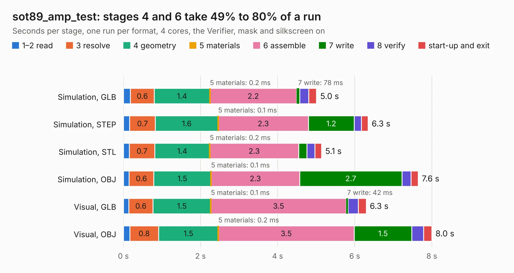

# 1519. sot89_amp_test

Board 1,519 of the 3,111 of [Corpus Testing](../Corpus-Testing.md), on [Corpus Page 15](../CorpusTestingPages/Corpus-Testing-15.md#1519-sot89_amp_test).

| Mode and format | 1–2 read | 3 resolve | 4 geometry | 5 materials | 6 assemble | 7 write | 8 verify | start-up and exit | Total |
|---|---:|---:|---:|---:|---:|---:|---:|---:|---:|
| Simulation, GLB | 0.2 | 0.6 | 1.4 | 0.2&nbsp;ms | 2.2 | 78&nbsp;ms | 0.2 | 0.2 | 5.0 |
| Simulation, STEP | 0.2 | 0.7 | 1.6 | 0.1&nbsp;ms | 2.3 | 1.2 | 0.2 | 0.2 | 6.3 |
| Simulation, STL | 0.2 | 0.7 | 1.4 | 0.2&nbsp;ms | 2.3 | 0.2 | 0.2 | 0.2 | 5.1 |
| Simulation, OBJ | 0.1 | 0.6 | 1.5 | 0.1&nbsp;ms | 2.3 | 2.7 | 0.2 | 0.2 | 7.6 |
| Visual, GLB | 0.1 | 0.6 | 1.5 | 0.1&nbsp;ms | 3.5 | 42&nbsp;ms | 0.3 | 0.2 | 6.3 |
| Visual, OBJ | 0.2 | 0.8 | 1.5 | 0.2&nbsp;ms | 3.5 | 1.5 | 0.3 | 0.2 | 8.0 |

<table align="center"><tr><td valign="top">

| Board | Repo: [loxodes/vna](https://github.com/loxodes/vna) Board: `sot89_amp_test.kicad_pcb` |
|---|---|
| Folder | breakouts / sot89_amp_test |
| Complexity | 180&nbsp;/&nbsp;1000 (size&nbsp;135, features&nbsp;45) |
| KESE&nbsp;features | through vias, rounded, trapezoid or chamfered pads, filled zones |
| Tested | 9th November 2026 |
| Copper&nbsp;layers | 4 |
| File&nbsp;format | KiCad 4 (4) |
| Parts,&nbsp;tracks,&nbsp;vias | 20, 38, 9 |
| Triangles,&nbsp;simulation | 549,398 in 25 parts |
| Verifier | PASS in all six runs |

</td><td valign="top">

<table>
<tr><th>File type</th><th>File size</th><th>Peak memory used</th></tr>
<tr><th colspan="3" align="left">Simulation</th></tr>
<tr><td>GLB</td><td align="right">19&nbsp;MB</td><td align="right">353&nbsp;MB</td></tr>
<tr><td>STEP</td><td align="right">27&nbsp;MB</td><td align="right">399&nbsp;MB</td></tr>
<tr><td>STL</td><td align="right">27&nbsp;MB</td><td align="right">352&nbsp;MB</td></tr>
<tr><td>OBJ</td><td align="right">54&nbsp;MB</td><td align="right">404&nbsp;MB</td></tr>
<tr><th colspan="3" align="left">Visual</th></tr>
<tr><td>GLB</td><td align="right">9.9&nbsp;MB</td><td align="right">350&nbsp;MB</td></tr>
<tr><td>OBJ</td><td align="right">29&nbsp;MB</td><td align="right">354&nbsp;MB</td></tr>
</table>

</td></tr></table>

| Previous | Next |
|:---|---:|
| [1518. sequencing_ltc2937](b1518b_vna_sequencing-ltc2937.md) | [1520. splitter_breakout](b1520b_vna_splitter-breakout.md) |
