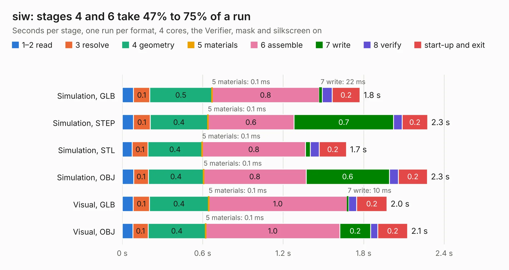

# 1520. siw

Board 1,520 of the 3,104 of [Corpus Testing](../Corpus-Testing.md), on [Corpus Page 15](../CorpusTestingPages/Corpus-Testing-15.md#1520-siw).

| Mode and format | 1–2 read | 3 resolve | 4 geometry | 5 materials | 6 assemble | 7 write | 8 verify | start-up and exit | Total |
|---|---:|---:|---:|---:|---:|---:|---:|---:|---:|
| Simulation, GLB | 84&nbsp;ms | 0.1 | 0.5 | 0.1&nbsp;ms | 0.8 | 22&nbsp;ms | 76&nbsp;ms | 0.2 | 1.8 |
| Simulation, STEP | 84&nbsp;ms | 0.1 | 0.4 | 0.1&nbsp;ms | 0.6 | 0.7 | 65&nbsp;ms | 0.2 | 2.3 |
| Simulation, STL | 75&nbsp;ms | 0.1 | 0.4 | 0.1&nbsp;ms | 0.8 | 35&nbsp;ms | 68&nbsp;ms | 0.2 | 1.7 |
| Simulation, OBJ | 86&nbsp;ms | 0.1 | 0.4 | 0.1&nbsp;ms | 0.8 | 0.6 | 68&nbsp;ms | 0.2 | 2.3 |
| Visual, GLB | 81&nbsp;ms | 0.1 | 0.4 | 0.1&nbsp;ms | 1.0 | 10&nbsp;ms | 62&nbsp;ms | 0.2 | 2.0 |
| Visual, OBJ | 80&nbsp;ms | 0.1 | 0.4 | 0.1&nbsp;ms | 1.0 | 0.2 | 54&nbsp;ms | 0.2 | 2.1 |

<table align="center"><tr><td valign="top">

| Board | Repo: [loxodes/vna](https://github.com/loxodes/vna) Board: `siw.kicad_pcb` |
|---|---|
| Folder | breakouts / sw_edge_fr408_oshpark / trl_att_hmc |
| Complexity | 114&nbsp;/&nbsp;1000 (size&nbsp;84, features&nbsp;30) |
| KESE&nbsp;features | rounded, trapezoid or chamfered pads, filled zones |
| Tested | 9th November 2026 |
| Copper&nbsp;layers | 4 |
| File&nbsp;format | KiCad 5 (20171130) |
| Parts,&nbsp;tracks,&nbsp;vias | 3, 8, 0 |
| Triangles,&nbsp;simulation | 139,976 in 15 parts |
| Verifier | PASS in all six runs |

</td><td valign="top">

<table>
<tr><th>File type</th><th>File size</th><th>Peak memory used</th></tr>
<tr><th colspan="3" align="left">Simulation</th></tr>
<tr><td>GLB</td><td align="right">4.7&nbsp;MB</td><td align="right">194&nbsp;MB</td></tr>
<tr><td>STEP</td><td align="right">11&nbsp;MB</td><td align="right">203&nbsp;MB</td></tr>
<tr><td>STL</td><td align="right">7.0&nbsp;MB</td><td align="right">194&nbsp;MB</td></tr>
<tr><td>OBJ</td><td align="right">13&nbsp;MB</td><td align="right">194&nbsp;MB</td></tr>
<tr><th colspan="3" align="left">Visual</th></tr>
<tr><td>GLB</td><td align="right">1.6&nbsp;MB</td><td align="right">157&nbsp;MB</td></tr>
<tr><td>OBJ</td><td align="right">4.5&nbsp;MB</td><td align="right">157&nbsp;MB</td></tr>
</table>

</td></tr></table>

| Previous | Next |
|:---|---:|
| [1519. siw](b1519b_vna_breakouts-sw-edge-fr408-oshpark-trl-admv_siw.md) | [1521. siw](b1521b_vna_breakouts-sw-edge-fr408-oshpark-trl-line-10p5mm_siw.md) |
