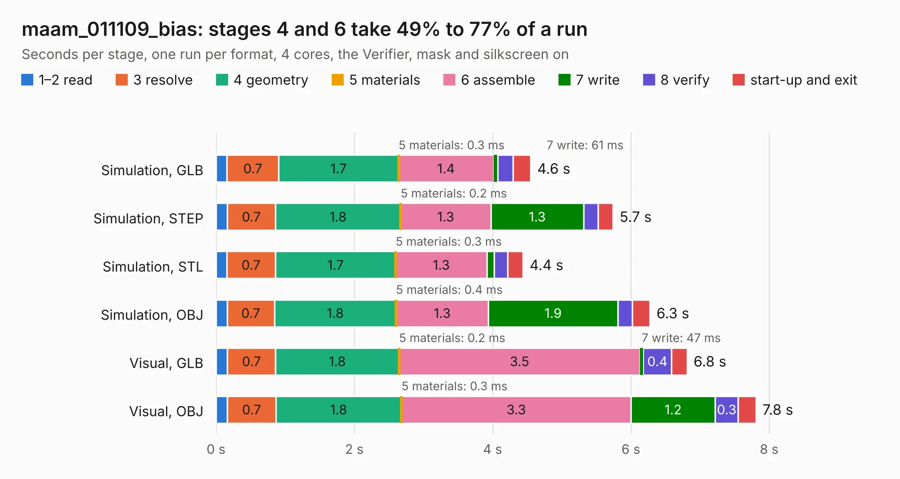

# 1520. maam_011109_bias

Board 1,520 of the 3,122 of [Corpus Testing](../Corpus-Testing.md), on [Corpus Page 15](../CorpusTestingPages/Corpus-Testing-15.md#1520-maam_011109_bias).

| Mode and format | 1–2 read | 3 resolve | 4 geometry | 5 materials | 6 assemble | 7 write | 8 verify | start-up and exit | Total |
|---|---:|---:|---:|---:|---:|---:|---:|---:|---:|
| Simulation, GLB | 0.2 | 0.7 | 1.7 | 0.3&nbsp;ms | 1.4 | 61&nbsp;ms | 0.2 | 0.3 | 4.6 |
| Simulation, STEP | 0.2 | 0.7 | 1.8 | 0.2&nbsp;ms | 1.3 | 1.3 | 0.2 | 0.2 | 5.7 |
| Simulation, STL | 0.2 | 0.7 | 1.7 | 0.3&nbsp;ms | 1.3 | 0.1 | 0.2 | 0.2 | 4.4 |
| Simulation, OBJ | 0.2 | 0.7 | 1.8 | 0.4&nbsp;ms | 1.3 | 1.9 | 0.2 | 0.3 | 6.3 |
| Visual, GLB | 0.2 | 0.7 | 1.8 | 0.2&nbsp;ms | 3.5 | 47&nbsp;ms | 0.4 | 0.2 | 6.8 |
| Visual, OBJ | 0.2 | 0.7 | 1.8 | 0.3&nbsp;ms | 3.3 | 1.2 | 0.3 | 0.3 | 7.8 |

<table align="center"><tr><td valign="top">

| Board | Repo: [loxodes/vna](https://github.com/loxodes/vna) Board: `maam_011109_bias.kicad_pcb` |
|---|---|
| Folder | breakouts / maam_011109_bias |
| Complexity | 202&nbsp;/&nbsp;1000 (size&nbsp;157, features&nbsp;45) |
| KESE&nbsp;features | through vias, filled zones, curved board outline |
| Tested | 9th November 2026 |
| Copper&nbsp;layers | 2 |
| File&nbsp;format | KiCad 5 (20171130) |
| Parts,&nbsp;tracks,&nbsp;vias | 48, 287, 36 |
| Triangles,&nbsp;simulation | 368,514 in 38 parts |
| Verifier | PASS in all six runs |

</td><td valign="top">

<table>
<tr><th>File type</th><th>File size</th><th>Peak memory used</th></tr>
<tr><th colspan="3" align="left">Simulation</th></tr>
<tr><td>GLB</td><td align="right">13&nbsp;MB</td><td align="right">279&nbsp;MB</td></tr>
<tr><td>STEP</td><td align="right">63&nbsp;MB</td><td align="right">305&nbsp;MB</td></tr>
<tr><td>STL</td><td align="right">18&nbsp;MB</td><td align="right">288&nbsp;MB</td></tr>
<tr><td>OBJ</td><td align="right">38&nbsp;MB</td><td align="right">315&nbsp;MB</td></tr>
<tr><th colspan="3" align="left">Visual</th></tr>
<tr><td>GLB</td><td align="right">9.6&nbsp;MB</td><td align="right">274&nbsp;MB</td></tr>
<tr><td>OBJ</td><td align="right">28&nbsp;MB</td><td align="right">281&nbsp;MB</td></tr>
</table>

</td></tr></table>

| Previous | Next |
|:---|---:|
| [1519. maam_011109](b1519b_vna_maam-011109.md) | [1521. mixer_breakout](b1521b_vna_mixer-breakout.md) |
