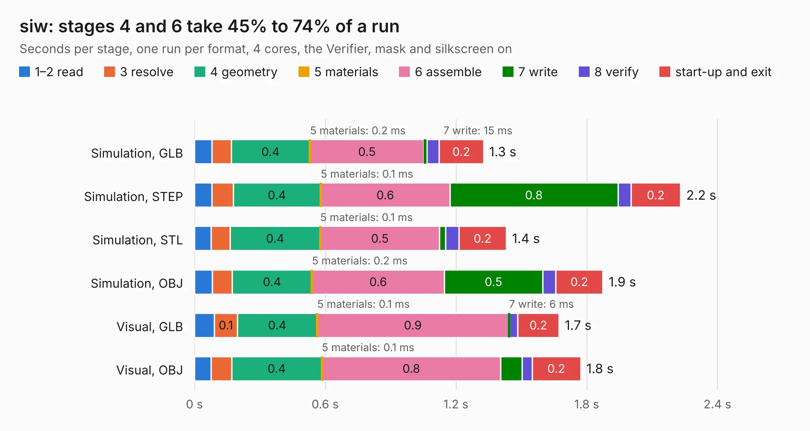

# 1522. siw

Board 1,522 of the 3,101 of [Corpus Testing](../Corpus-Testing.md), on [Corpus Page 15](../CorpusTestingPages/Corpus-Testing-15.md#1522-siw).

| Mode and format | 1–2 read | 3 resolve | 4 geometry | 5 materials | 6 assemble | 7 write | 8 verify | start-up and exit | Total |
|---|---:|---:|---:|---:|---:|---:|---:|---:|---:|
| Simulation, GLB | 80&nbsp;ms | 88&nbsp;ms | 0.4 | 0.2&nbsp;ms | 0.5 | 15&nbsp;ms | 55&nbsp;ms | 0.2 | 1.3 |
| Simulation, STEP | 80&nbsp;ms | 97&nbsp;ms | 0.4 | 0.1&nbsp;ms | 0.6 | 0.8 | 60&nbsp;ms | 0.2 | 2.2 |
| Simulation, STL | 76&nbsp;ms | 88&nbsp;ms | 0.4 | 0.1&nbsp;ms | 0.5 | 28&nbsp;ms | 60&nbsp;ms | 0.2 | 1.4 |
| Simulation, OBJ | 81&nbsp;ms | 92&nbsp;ms | 0.4 | 0.2&nbsp;ms | 0.6 | 0.5 | 60&nbsp;ms | 0.2 | 1.9 |
| Visual, GLB | 92&nbsp;ms | 0.1 | 0.4 | 0.1&nbsp;ms | 0.9 | 6&nbsp;ms | 37&nbsp;ms | 0.2 | 1.7 |
| Visual, OBJ | 77&nbsp;ms | 93&nbsp;ms | 0.4 | 0.1&nbsp;ms | 0.8 | 98&nbsp;ms | 45&nbsp;ms | 0.2 | 1.8 |

<table align="center"><tr><td valign="top">

| Board | Repo: [loxodes/vna](https://github.com/loxodes/vna) Board: `siw.kicad_pcb` |
|---|---|
| Folder | breakouts / sw_edge_fr408_oshpark / trl_thru |
| Complexity | 102&nbsp;/&nbsp;1000 (size&nbsp;72, features&nbsp;30) |
| KESE&nbsp;features | rounded, trapezoid or chamfered pads, filled zones |
| Tested | 9th November 2026 |
| Copper&nbsp;layers | 4 |
| File&nbsp;format | KiCad 5 (20171130) |
| Parts,&nbsp;tracks,&nbsp;vias | 2, 4, 0 |
| Triangles,&nbsp;simulation | 103,060 in 16 parts |
| Verifier | PASS in all six runs |

</td><td valign="top">

<table>
<tr><th>File type</th><th>File size</th><th>Peak memory used</th></tr>
<tr><th colspan="3" align="left">Simulation</th></tr>
<tr><td>GLB</td><td align="right">3.4&nbsp;MB</td><td align="right">188&nbsp;MB</td></tr>
<tr><td>STEP</td><td align="right">8.0&nbsp;MB</td><td align="right">191&nbsp;MB</td></tr>
<tr><td>STL</td><td align="right">5.2&nbsp;MB</td><td align="right">190&nbsp;MB</td></tr>
<tr><td>OBJ</td><td align="right">9.6&nbsp;MB</td><td align="right">192&nbsp;MB</td></tr>
<tr><th colspan="3" align="left">Visual</th></tr>
<tr><td>GLB</td><td align="right">927&nbsp;kB</td><td align="right">154&nbsp;MB</td></tr>
<tr><td>OBJ</td><td align="right">2.6&nbsp;MB</td><td align="right">155&nbsp;MB</td></tr>
</table>

</td></tr></table>

| Previous | Next |
|:---|---:|
| [1521. siw](b1521b_vna_breakouts-sw-edge-fr408-oshpark-trl-reflect_siw.md) | [1523. siw](b1523b_vna_breakouts-sw-edge-fr408-oshpark-trl-vatt_siw.md) |
