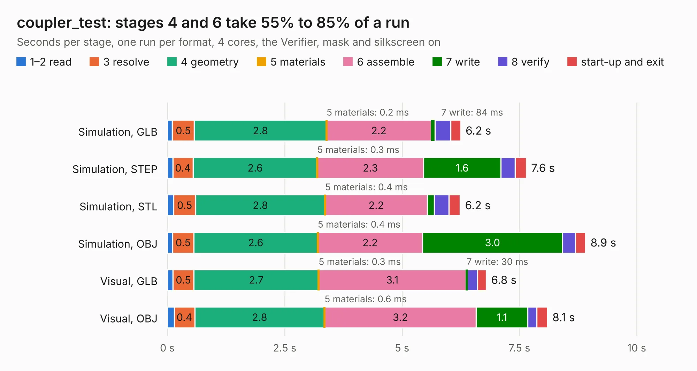

# 1522 coupler_test

Board 1,522 of the 3,138 of [Corpus Testing](../Corpus-Testing.md), on [Corpus Page 15](../CorpusTestingPages/Corpus-Testing-15.md#1522-coupler_test).

| Mode and format | 1–2 read | 3 resolve | 4 geometry | 5 materials | 6 assemble | 7 write | 8 verify | start-up and exit | Total |
|---|---:|---:|---:|---:|---:|---:|---:|---:|---:|
| Simulation, GLB | 0.1 | 0.5 | 2.8 | 0.2&nbsp;ms | 2.2 | 84&nbsp;ms | 0.3 | 0.2 | 6.2 |
| Simulation, STEP | 0.1 | 0.4 | 2.6 | 0.3&nbsp;ms | 2.3 | 1.6 | 0.3 | 0.2 | 7.6 |
| Simulation, STL | 0.1 | 0.5 | 2.8 | 0.4&nbsp;ms | 2.2 | 0.1 | 0.3 | 0.2 | 6.2 |
| Simulation, OBJ | 0.1 | 0.5 | 2.6 | 0.4&nbsp;ms | 2.2 | 3.0 | 0.3 | 0.2 | 8.9 |
| Visual, GLB | 0.1 | 0.5 | 2.7 | 0.3&nbsp;ms | 3.1 | 30&nbsp;ms | 0.2 | 0.2 | 6.8 |
| Visual, OBJ | 0.1 | 0.4 | 2.8 | 0.6&nbsp;ms | 3.2 | 1.1 | 0.2 | 0.2 | 8.1 |

<table align="center"><tr><td valign="top">

| Board | Repo: [loxodes/vna](https://github.com/loxodes/vna) Board: `coupler_test.kicad_pcb` |
|---|---|
| Folder | breakouts / coupler_test |
| Complexity | 120&nbsp;/&nbsp;1000 (size&nbsp;90, features&nbsp;30) |
| KESE&nbsp;features | rounded, trapezoid or chamfered pads, filled zones |
| Tested | 9th November 2026 |
| Copper&nbsp;layers | 4 |
| File&nbsp;format | KiCad 4 (4) |
| Parts,&nbsp;tracks,&nbsp;vias | 4, 10, 0 |
| Triangles,&nbsp;simulation | 592,560 in 19 parts |
| Verifier | PASS in all six runs |

</td><td valign="top">

<table>
<tr><th>File type</th><th>File size</th><th>Peak memory used</th></tr>
<tr><th colspan="3" align="left">Simulation</th></tr>
<tr><td>GLB</td><td align="right">20&nbsp;MB</td><td align="right">354&nbsp;MB</td></tr>
<tr><td>STEP</td><td align="right">60&nbsp;MB</td><td align="right">389&nbsp;MB</td></tr>
<tr><td>STL</td><td align="right">30&nbsp;MB</td><td align="right">345&nbsp;MB</td></tr>
<tr><td>OBJ</td><td align="right">58&nbsp;MB</td><td align="right">409&nbsp;MB</td></tr>
<tr><th colspan="3" align="left">Visual</th></tr>
<tr><td>GLB</td><td align="right">7.2&nbsp;MB</td><td align="right">296&nbsp;MB</td></tr>
<tr><td>OBJ</td><td align="right">21&nbsp;MB</td><td align="right">290&nbsp;MB</td></tr>
</table>

</td></tr></table>

| Previous | Next |
|:---|---:|
| [1521 clk_lo_buffer](b1521b_vna_clk-lo-buffer.md) | [1523 cpw_test](b1523b_vna_breakouts-cpw-test_cpw-test.md) |
