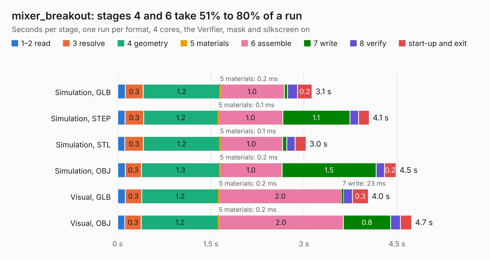

# 1525. mixer_breakout

Board 1,525 of the 3,129 of [Corpus Testing](../Corpus-Testing.md), on [Corpus Page 15](../CorpusTestingPages/Corpus-Testing-15.md#1525-mixer_breakout).

| Mode and format | 1–2 read | 3 resolve | 4 geometry | 5 materials | 6 assemble | 7 write | 8 verify | start-up and exit | Total |
|---|---:|---:|---:|---:|---:|---:|---:|---:|---:|
| Simulation, GLB | 0.1 | 0.3 | 1.2 | 0.2&nbsp;ms | 1.0 | 52&nbsp;ms | 0.2 | 0.2 | 3.1 |
| Simulation, STEP | 0.1 | 0.3 | 1.2 | 0.1&nbsp;ms | 1.0 | 1.1 | 0.1 | 0.2 | 4.1 |
| Simulation, STL | 0.1 | 0.3 | 1.2 | 0.1&nbsp;ms | 1.0 | 68&nbsp;ms | 0.1 | 0.2 | 3.0 |
| Simulation, OBJ | 0.1 | 0.3 | 1.3 | 0.2&nbsp;ms | 1.0 | 1.5 | 0.1 | 0.2 | 4.5 |
| Visual, GLB | 0.1 | 0.3 | 1.2 | 0.2&nbsp;ms | 2.0 | 23&nbsp;ms | 0.1 | 0.3 | 4.0 |
| Visual, OBJ | 0.1 | 0.3 | 1.2 | 0.2&nbsp;ms | 2.0 | 0.8 | 0.2 | 0.2 | 4.7 |

<table align="center"><tr><td valign="top">

| Board | Repo: [loxodes/vna](https://github.com/loxodes/vna) Board: `mixer_breakout.kicad_pcb` |
|---|---|
| Folder | breakouts / mixer_breakout |
| Complexity | 170&nbsp;/&nbsp;1000 (size&nbsp;135, features&nbsp;35) |
| KESE&nbsp;features | through vias, filled zones |
| Tested | 9th November 2026 |
| Copper&nbsp;layers | 4 |
| File&nbsp;format | KiCad 4 (4) |
| Parts,&nbsp;tracks,&nbsp;vias | 11, 88, 2 |
| Triangles,&nbsp;simulation | 306,878 in 24 parts |
| Verifier | PASS in all six runs |

</td><td valign="top">

<table>
<tr><th>File type</th><th>File size</th><th>Peak memory used</th></tr>
<tr><th colspan="3" align="left">Simulation</th></tr>
<tr><td>GLB</td><td align="right">10&nbsp;MB</td><td align="right">244&nbsp;MB</td></tr>
<tr><td>STEP</td><td align="right">35&nbsp;MB</td><td align="right">267&nbsp;MB</td></tr>
<tr><td>STL</td><td align="right">15&nbsp;MB</td><td align="right">242&nbsp;MB</td></tr>
<tr><td>OBJ</td><td align="right">31&nbsp;MB</td><td align="right">253&nbsp;MB</td></tr>
<tr><th colspan="3" align="left">Visual</th></tr>
<tr><td>GLB</td><td align="right">5.3&nbsp;MB</td><td align="right">211&nbsp;MB</td></tr>
<tr><td>OBJ</td><td align="right">15&nbsp;MB</td><td align="right">214&nbsp;MB</td></tr>
</table>

</td></tr></table>

| Previous | Next |
|:---|---:|
| [1524. maam_011109_bias](b1524b_vna_maam-011109-bias.md) | [1526. pe42520_breakout](b1526b_vna_pe42520-breakout.md) |
