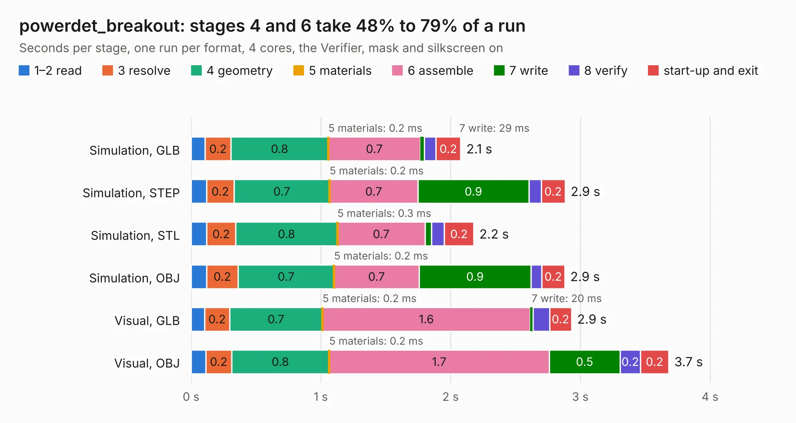

# 1528. powerdet_breakout

Board 1,528 of the 3,129 of [Corpus Testing](../Corpus-Testing.md), on [Corpus Page 15](../CorpusTestingPages/Corpus-Testing-15.md#1528-powerdet_breakout).

| Mode and format | 1–2 read | 3 resolve | 4 geometry | 5 materials | 6 assemble | 7 write | 8 verify | start-up and exit | Total |
|---|---:|---:|---:|---:|---:|---:|---:|---:|---:|
| Simulation, GLB | 0.1 | 0.2 | 0.8 | 0.2&nbsp;ms | 0.7 | 29&nbsp;ms | 91&nbsp;ms | 0.2 | 2.1 |
| Simulation, STEP | 0.1 | 0.2 | 0.7 | 0.2&nbsp;ms | 0.7 | 0.9 | 93&nbsp;ms | 0.2 | 2.9 |
| Simulation, STL | 0.1 | 0.2 | 0.8 | 0.3&nbsp;ms | 0.7 | 49&nbsp;ms | 0.1 | 0.2 | 2.2 |
| Simulation, OBJ | 0.1 | 0.2 | 0.7 | 0.2&nbsp;ms | 0.7 | 0.9 | 83&nbsp;ms | 0.2 | 2.9 |
| Visual, GLB | 0.1 | 0.2 | 0.7 | 0.2&nbsp;ms | 1.6 | 20&nbsp;ms | 0.1 | 0.2 | 2.9 |
| Visual, OBJ | 0.1 | 0.2 | 0.8 | 0.2&nbsp;ms | 1.7 | 0.5 | 0.2 | 0.2 | 3.7 |

<table align="center"><tr><td valign="top">

| Board | Repo: [loxodes/vna](https://github.com/loxodes/vna) Board: `powerdet_breakout.kicad_pcb` |
|---|---|
| Folder | breakouts / powerdet_breakout |
| Complexity | 193&nbsp;/&nbsp;1000 (size&nbsp;158, features&nbsp;35) |
| KESE&nbsp;features | through vias, filled zones |
| Tested | 9th November 2026 |
| Copper&nbsp;layers | 4 |
| File&nbsp;format | KiCad 4 (4) |
| Parts,&nbsp;tracks,&nbsp;vias | 26, 157, 25 |
| Triangles,&nbsp;simulation | 202,000 in 30 parts |
| Verifier | PASS in all six runs |

</td><td valign="top">

<table>
<tr><th>File type</th><th>File size</th><th>Peak memory used</th></tr>
<tr><th colspan="3" align="left">Simulation</th></tr>
<tr><td>GLB</td><td align="right">7.2&nbsp;MB</td><td align="right">210&nbsp;MB</td></tr>
<tr><td>STEP</td><td align="right">26&nbsp;MB</td><td align="right">223&nbsp;MB</td></tr>
<tr><td>STL</td><td align="right">10&nbsp;MB</td><td align="right">208&nbsp;MB</td></tr>
<tr><td>OBJ</td><td align="right">20&nbsp;MB</td><td align="right">209&nbsp;MB</td></tr>
<tr><th colspan="3" align="left">Visual</th></tr>
<tr><td>GLB</td><td align="right">4.7&nbsp;MB</td><td align="right">186&nbsp;MB</td></tr>
<tr><td>OBJ</td><td align="right">13&nbsp;MB</td><td align="right">187&nbsp;MB</td></tr>
</table>

</td></tr></table>

| Previous | Next |
|:---|---:|
| [1527. pe42543_breakout](b1527b_vna_pe42543-breakout.md) | [1529. refclk_breakout](b1529b_vna_refclk-breakout.md) |
