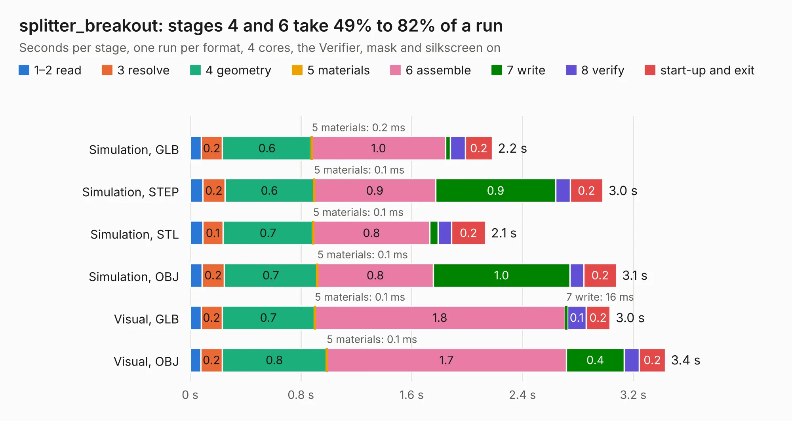

# 1528. splitter_breakout

Board 1,528 of the 3,121 of [Corpus Testing](../Corpus-Testing.md), on [Corpus Page 15](../CorpusTestingPages/Corpus-Testing-15.md#1528-splitter_breakout).

| Mode and format | 1–2 read | 3 resolve | 4 geometry | 5 materials | 6 assemble | 7 write | 8 verify | start-up and exit | Total |
|---|---:|---:|---:|---:|---:|---:|---:|---:|---:|
| Simulation, GLB | 80&nbsp;ms | 0.2 | 0.6 | 0.2&nbsp;ms | 1.0 | 35&nbsp;ms | 0.1 | 0.2 | 2.2 |
| Simulation, STEP | 92&nbsp;ms | 0.2 | 0.6 | 0.1&nbsp;ms | 0.9 | 0.9 | 0.1 | 0.2 | 3.0 |
| Simulation, STL | 91&nbsp;ms | 0.1 | 0.7 | 0.1&nbsp;ms | 0.8 | 58&nbsp;ms | 99&nbsp;ms | 0.2 | 2.1 |
| Simulation, OBJ | 86&nbsp;ms | 0.2 | 0.7 | 0.1&nbsp;ms | 0.8 | 1.0 | 0.1 | 0.2 | 3.1 |
| Visual, GLB | 79&nbsp;ms | 0.2 | 0.7 | 0.1&nbsp;ms | 1.8 | 16&nbsp;ms | 0.1 | 0.2 | 3.0 |
| Visual, OBJ | 78&nbsp;ms | 0.2 | 0.8 | 0.1&nbsp;ms | 1.7 | 0.4 | 0.1 | 0.2 | 3.4 |

<table align="center"><tr><td valign="top">

| Board | Repo: [loxodes/vna](https://github.com/loxodes/vna) Board: `splitter_breakout.kicad_pcb` |
|---|---|
| Folder | breakouts / splitter_breakout |
| Complexity | 115&nbsp;/&nbsp;1000 (size&nbsp;95, features&nbsp;20) |
| KESE&nbsp;features | filled zones |
| Tested | 9th November 2026 |
| Copper&nbsp;layers | 4 |
| File&nbsp;format | KiCad 4 (4) |
| Parts,&nbsp;tracks,&nbsp;vias | 4, 14, 0 |
| Triangles,&nbsp;simulation | 257,954 in 16 parts |
| Verifier | PASS in all six runs |

</td><td valign="top">

<table>
<tr><th>File type</th><th>File size</th><th>Peak memory used</th></tr>
<tr><th colspan="3" align="left">Simulation</th></tr>
<tr><td>GLB</td><td align="right">8.6&nbsp;MB</td><td align="right">230&nbsp;MB</td></tr>
<tr><td>STEP</td><td align="right">23&nbsp;MB</td><td align="right">256&nbsp;MB</td></tr>
<tr><td>STL</td><td align="right">13&nbsp;MB</td><td align="right">244&nbsp;MB</td></tr>
<tr><td>OBJ</td><td align="right">25&nbsp;MB</td><td align="right">246&nbsp;MB</td></tr>
<tr><th colspan="3" align="left">Visual</th></tr>
<tr><td>GLB</td><td align="right">3.6&nbsp;MB</td><td align="right">189&nbsp;MB</td></tr>
<tr><td>OBJ</td><td align="right">10&nbsp;MB</td><td align="right">185&nbsp;MB</td></tr>
</table>

</td></tr></table>

| Previous | Next |
|:---|---:|
| [1527. sot89_amp_test](b1527b_vna_sot89-amp-test.md) | [1529. siw](b1529b_vna_breakouts-sw-edge-fr408-oshpark-lpf-20ghz_siw.md) |
