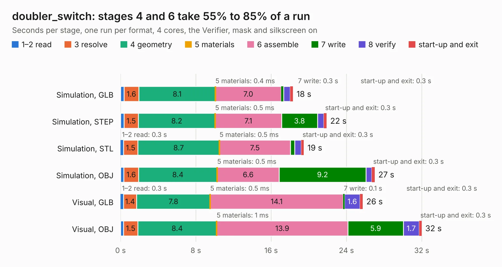

# 1531. doubler_switch

Board 1,531 of the 3,103 of [Corpus Testing](../Corpus-Testing.md), on [Corpus Page 15](../CorpusTestingPages/Corpus-Testing-15.md#1531-doubler_switch).

| Mode and format | 1–2 read | 3 resolve | 4 geometry | 5 materials | 6 assemble | 7 write | 8 verify | start-up and exit | Total |
|---|---:|---:|---:|---:|---:|---:|---:|---:|---:|
| Simulation, GLB | 0.4 | 1.6 | 8.1 | 0.4&nbsp;ms | 7.0 | 0.3 | 0.7 | 0.3 | 18.3 |
| Simulation, STEP | 0.4 | 1.5 | 8.2 | 0.5&nbsp;ms | 7.1 | 3.8 | 0.7 | 0.3 | 21.9 |
| Simulation, STL | 0.3 | 1.5 | 8.7 | 0.5&nbsp;ms | 7.5 | 0.5 | 0.7 | 0.3 | 19.5 |
| Simulation, OBJ | 0.3 | 1.6 | 8.4 | 0.5&nbsp;ms | 6.6 | 9.2 | 0.6 | 0.3 | 27.0 |
| Visual, GLB | 0.3 | 1.4 | 7.8 | 0.5&nbsp;ms | 14.1 | 0.1 | 1.6 | 0.3 | 25.7 |
| Visual, OBJ | 0.3 | 1.5 | 8.4 | 1&nbsp;ms | 13.9 | 5.9 | 1.7 | 0.3 | 32.0 |

<table align="center"><tr><td valign="top">

| Board | Repo: [loxodes/vna](https://github.com/loxodes/vna) Board: `doubler_switch.kicad_pcb` |
|---|---|
| Folder | hardware / archive / doubler_switch |
| Complexity | 215&nbsp;/&nbsp;1000 (size&nbsp;180, features&nbsp;35) |
| KESE&nbsp;features | through vias, filled zones |
| Tested | 9th November 2026 |
| Copper&nbsp;layers | 4 |
| File&nbsp;format | KiCad 4 (4) |
| Parts,&nbsp;tracks,&nbsp;vias | 50, 457, 42 |
| Triangles,&nbsp;simulation | 1,500,280 in 54 parts |
| Verifier | PASS in all six runs |

</td><td valign="top">

<table>
<tr><th>File type</th><th>File size</th><th>Peak memory used</th></tr>
<tr><th colspan="3" align="left">Simulation</th></tr>
<tr><td>GLB</td><td align="right">51&nbsp;MB</td><td align="right">641&nbsp;MB</td></tr>
<tr><td>STEP</td><td align="right">171&nbsp;MB</td><td align="right">725&nbsp;MB</td></tr>
<tr><td>STL</td><td align="right">75&nbsp;MB</td><td align="right">653&nbsp;MB</td></tr>
<tr><td>OBJ</td><td align="right">154&nbsp;MB</td><td align="right">994&nbsp;MB</td></tr>
<tr><th colspan="3" align="left">Visual</th></tr>
<tr><td>GLB</td><td align="right">31&nbsp;MB</td><td align="right">747&nbsp;MB</td></tr>
<tr><td>OBJ</td><td align="right">93&nbsp;MB</td><td align="right">695&nbsp;MB</td></tr>
</table>

</td></tr></table>

| Previous | Next |
|:---|---:|
| [1530. demod_module](b1530b_vna_demod-module.md) | [1532. frequency_synth](b1532b_vna_frequency-synth.md) |
