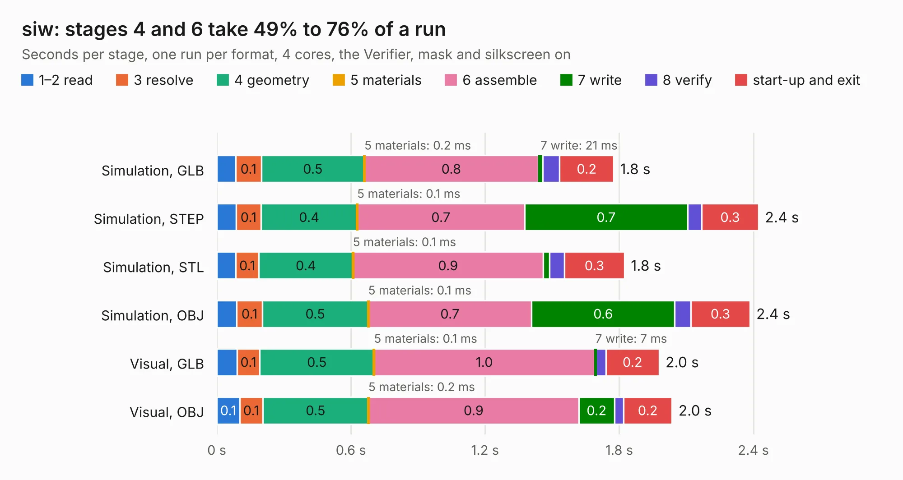

# 1532. siw

Board 1,532 of the 3,120 of [Corpus Testing](../Corpus-Testing.md), on [Corpus Page 15](../CorpusTestingPages/Corpus-Testing-15.md#1532-siw).

| Mode and format | 1–2 read | 3 resolve | 4 geometry | 5 materials | 6 assemble | 7 write | 8 verify | start-up and exit | Total |
|---|---:|---:|---:|---:|---:|---:|---:|---:|---:|
| Simulation, GLB | 85&nbsp;ms | 0.1 | 0.5 | 0.2&nbsp;ms | 0.8 | 21&nbsp;ms | 75&nbsp;ms | 0.2 | 1.8 |
| Simulation, STEP | 86&nbsp;ms | 0.1 | 0.4 | 0.1&nbsp;ms | 0.7 | 0.7 | 63&nbsp;ms | 0.3 | 2.4 |
| Simulation, STL | 85&nbsp;ms | 0.1 | 0.4 | 0.1&nbsp;ms | 0.9 | 29&nbsp;ms | 66&nbsp;ms | 0.3 | 1.8 |
| Simulation, OBJ | 90&nbsp;ms | 0.1 | 0.5 | 0.1&nbsp;ms | 0.7 | 0.6 | 72&nbsp;ms | 0.3 | 2.4 |
| Visual, GLB | 91&nbsp;ms | 0.1 | 0.5 | 0.1&nbsp;ms | 1.0 | 7&nbsp;ms | 44&nbsp;ms | 0.2 | 2.0 |
| Visual, OBJ | 0.1 | 0.1 | 0.5 | 0.2&nbsp;ms | 0.9 | 0.2 | 41&nbsp;ms | 0.2 | 2.0 |

<table align="center"><tr><td valign="top">

| Board | Repo: [loxodes/vna](https://github.com/loxodes/vna) Board: `siw.kicad_pcb` |
|---|---|
| Folder | breakouts / sw_edge_fr408_oshpark / trl_0402_series |
| Complexity | 110&nbsp;/&nbsp;1000 (size&nbsp;80, features&nbsp;30) |
| KESE&nbsp;features | rounded, trapezoid or chamfered pads, filled zones |
| Tested | 9th November 2026 |
| Copper&nbsp;layers | 4 |
| File&nbsp;format | KiCad 5 (20171130) |
| Parts,&nbsp;tracks,&nbsp;vias | 3, 6, 0 |
| Triangles,&nbsp;simulation | 106,076 in 15 parts |
| Verifier | PASS in all six runs |

</td><td valign="top">

<table>
<tr><th>File type</th><th>File size</th><th>Peak memory used</th></tr>
<tr><th colspan="3" align="left">Simulation</th></tr>
<tr><td>GLB</td><td align="right">3.6&nbsp;MB</td><td align="right">186&nbsp;MB</td></tr>
<tr><td>STEP</td><td align="right">8.5&nbsp;MB</td><td align="right">197&nbsp;MB</td></tr>
<tr><td>STL</td><td align="right">5.3&nbsp;MB</td><td align="right">181&nbsp;MB</td></tr>
<tr><td>OBJ</td><td align="right">9.9&nbsp;MB</td><td align="right">186&nbsp;MB</td></tr>
<tr><th colspan="3" align="left">Visual</th></tr>
<tr><td>GLB</td><td align="right">985&nbsp;kB</td><td align="right">156&nbsp;MB</td></tr>
<tr><td>OBJ</td><td align="right">2.8&nbsp;MB</td><td align="right">156&nbsp;MB</td></tr>
</table>

</td></tr></table>

| Previous | Next |
|:---|---:|
| [1531. siw](b1531b_vna_breakouts-sw-edge-fr408-oshpark-siw_siw.md) | [1533. siw](b1533b_vna_breakouts-sw-edge-fr408-oshpark-trl-0402-shunt_siw.md) |
