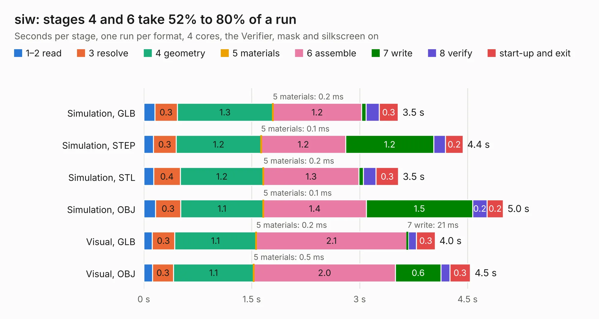

# 1533. siw

Board 1,533 of the 3,111 of [Corpus Testing](../Corpus-Testing.md), on [Corpus Page 15](../CorpusTestingPages/Corpus-Testing-15.md#1533-siw).

| Mode and format | 1–2 read | 3 resolve | 4 geometry | 5 materials | 6 assemble | 7 write | 8 verify | start-up and exit | Total |
|---|---:|---:|---:|---:|---:|---:|---:|---:|---:|
| Simulation, GLB | 0.2 | 0.3 | 1.3 | 0.2&nbsp;ms | 1.2 | 61&nbsp;ms | 0.2 | 0.3 | 3.5 |
| Simulation, STEP | 0.1 | 0.3 | 1.2 | 0.1&nbsp;ms | 1.2 | 1.2 | 0.2 | 0.2 | 4.4 |
| Simulation, STL | 0.1 | 0.4 | 1.2 | 0.2&nbsp;ms | 1.3 | 62&nbsp;ms | 0.2 | 0.3 | 3.5 |
| Simulation, OBJ | 0.2 | 0.3 | 1.1 | 0.1&nbsp;ms | 1.4 | 1.5 | 0.2 | 0.2 | 5.0 |
| Visual, GLB | 0.1 | 0.3 | 1.1 | 0.2&nbsp;ms | 2.1 | 21&nbsp;ms | 0.1 | 0.3 | 4.0 |
| Visual, OBJ | 0.1 | 0.3 | 1.1 | 0.5&nbsp;ms | 2.0 | 0.6 | 0.1 | 0.3 | 4.5 |

<table align="center"><tr><td valign="top">

| Board | Repo: [loxodes/vna](https://github.com/loxodes/vna) Board: `siw.kicad_pcb` |
|---|---|
| Folder | breakouts / sw_edge_fr408_oshpark / trl_vatt |
| Complexity | 177&nbsp;/&nbsp;1000 (size&nbsp;132, features&nbsp;45) |
| KESE&nbsp;features | through vias, rounded, trapezoid or chamfered pads, filled zones |
| Tested | 9th November 2026 |
| Copper&nbsp;layers | 4 |
| File&nbsp;format | KiCad 5 (20171130) |
| Parts,&nbsp;tracks,&nbsp;vias | 7, 95, 3 |
| Triangles,&nbsp;simulation | 234,680 in 23 parts |
| Verifier | PASS in all six runs |

</td><td valign="top">

<table>
<tr><th>File type</th><th>File size</th><th>Peak memory used</th></tr>
<tr><th colspan="3" align="left">Simulation</th></tr>
<tr><td>GLB</td><td align="right">8.0&nbsp;MB</td><td align="right">214&nbsp;MB</td></tr>
<tr><td>STEP</td><td align="right">25&nbsp;MB</td><td align="right">235&nbsp;MB</td></tr>
<tr><td>STL</td><td align="right">12&nbsp;MB</td><td align="right">215&nbsp;MB</td></tr>
<tr><td>OBJ</td><td align="right">23&nbsp;MB</td><td align="right">214&nbsp;MB</td></tr>
<tr><th colspan="3" align="left">Visual</th></tr>
<tr><td>GLB</td><td align="right">3.3&nbsp;MB</td><td align="right">172&nbsp;MB</td></tr>
<tr><td>OBJ</td><td align="right">9.3&nbsp;MB</td><td align="right">171&nbsp;MB</td></tr>
</table>

</td></tr></table>

| Previous | Next |
|:---|---:|
| [1532. siw](b1532b_vna_breakouts-sw-edge-fr408-oshpark-trl-thru_siw.md) | [1534. switch_breakout](b1534b_vna_switch-breakout.md) |
