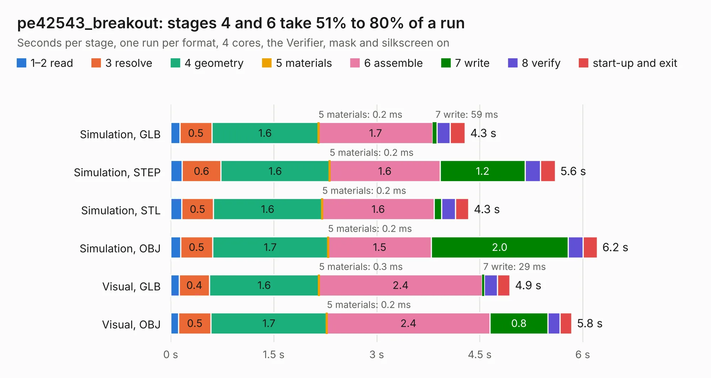

# 1534. pe42543_breakout

Board 1,534 of the 3,138 of [Corpus Testing](../Corpus-Testing.md), on [Corpus Page 15](../CorpusTestingPages/Corpus-Testing-15.md#1534-pe42543_breakout).

| Mode and format | 1–2 read | 3 resolve | 4 geometry | 5 materials | 6 assemble | 7 write | 8 verify | start-up and exit | Total |
|---|---:|---:|---:|---:|---:|---:|---:|---:|---:|
| Simulation, GLB | 0.1 | 0.5 | 1.6 | 0.2&nbsp;ms | 1.7 | 59&nbsp;ms | 0.2 | 0.2 | 4.3 |
| Simulation, STEP | 0.2 | 0.6 | 1.6 | 0.2&nbsp;ms | 1.6 | 1.2 | 0.2 | 0.2 | 5.6 |
| Simulation, STL | 0.2 | 0.5 | 1.6 | 0.2&nbsp;ms | 1.6 | 0.1 | 0.2 | 0.2 | 4.3 |
| Simulation, OBJ | 0.1 | 0.5 | 1.7 | 0.2&nbsp;ms | 1.5 | 2.0 | 0.2 | 0.2 | 6.2 |
| Visual, GLB | 0.1 | 0.4 | 1.6 | 0.3&nbsp;ms | 2.4 | 29&nbsp;ms | 0.2 | 0.2 | 4.9 |
| Visual, OBJ | 0.1 | 0.5 | 1.7 | 0.2&nbsp;ms | 2.4 | 0.8 | 0.2 | 0.2 | 5.8 |

<table align="center"><tr><td valign="top">

| Board | Repo: [loxodes/vna](https://github.com/loxodes/vna) Board: `pe42543_breakout.kicad_pcb` |
|---|---|
| Folder | breakouts / pe42543_breakout |
| Complexity | 197&nbsp;/&nbsp;1000 (size&nbsp;152, features&nbsp;45) |
| KESE&nbsp;features | through vias, rounded, trapezoid or chamfered pads, filled zones |
| Tested | 9th November 2026 |
| Copper&nbsp;layers | 4 |
| File&nbsp;format | KiCad 5 (20171130) |
| Parts,&nbsp;tracks,&nbsp;vias | 21, 106, 23 |
| Triangles,&nbsp;simulation | 427,902 in 35 parts |
| Verifier | PASS in all six runs |

</td><td valign="top">

<table>
<tr><th>File type</th><th>File size</th><th>Peak memory used</th></tr>
<tr><th colspan="3" align="left">Simulation</th></tr>
<tr><td>GLB</td><td align="right">15&nbsp;MB</td><td align="right">279&nbsp;MB</td></tr>
<tr><td>STEP</td><td align="right">45&nbsp;MB</td><td align="right">315&nbsp;MB</td></tr>
<tr><td>STL</td><td align="right">21&nbsp;MB</td><td align="right">276&nbsp;MB</td></tr>
<tr><td>OBJ</td><td align="right">43&nbsp;MB</td><td align="right">345&nbsp;MB</td></tr>
<tr><th colspan="3" align="left">Visual</th></tr>
<tr><td>GLB</td><td align="right">6.0&nbsp;MB</td><td align="right">240&nbsp;MB</td></tr>
<tr><td>OBJ</td><td align="right">18&nbsp;MB</td><td align="right">238&nbsp;MB</td></tr>
</table>

</td></tr></table>

| Previous | Next |
|:---|---:|
| [1533. pe42520_breakout](b1533b_vna_pe42520-breakout.md) | [1535. powerdet_breakout](b1535b_vna_powerdet-breakout.md) |
