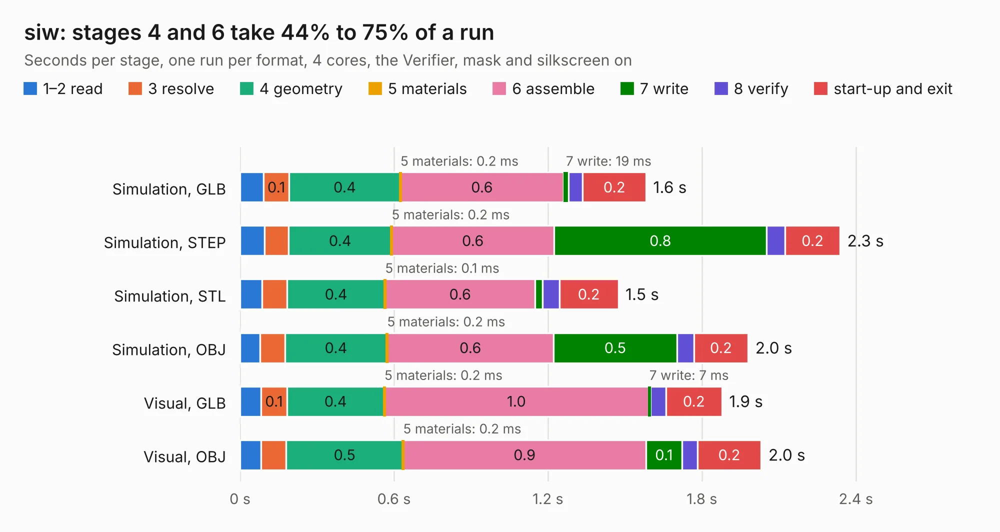

# 1537. siw

Board 1,537 of the 3,131 of [Corpus Testing](../Corpus-Testing.md), on [Corpus Page 15](../CorpusTestingPages/Corpus-Testing-15.md#1537-siw).

| Mode and format | 1–2 read | 3 resolve | 4 geometry | 5 materials | 6 assemble | 7 write | 8 verify | start-up and exit | Total |
|---|---:|---:|---:|---:|---:|---:|---:|---:|---:|
| Simulation, GLB | 92&nbsp;ms | 0.1 | 0.4 | 0.2&nbsp;ms | 0.6 | 19&nbsp;ms | 56&nbsp;ms | 0.2 | 1.6 |
| Simulation, STEP | 95&nbsp;ms | 95&nbsp;ms | 0.4 | 0.2&nbsp;ms | 0.6 | 0.8 | 71&nbsp;ms | 0.2 | 2.3 |
| Simulation, STL | 85&nbsp;ms | 98&nbsp;ms | 0.4 | 0.1&nbsp;ms | 0.6 | 29&nbsp;ms | 66&nbsp;ms | 0.2 | 1.5 |
| Simulation, OBJ | 79&nbsp;ms | 96&nbsp;ms | 0.4 | 0.2&nbsp;ms | 0.6 | 0.5 | 66&nbsp;ms | 0.2 | 2.0 |
| Visual, GLB | 83&nbsp;ms | 0.1 | 0.4 | 0.2&nbsp;ms | 1.0 | 7&nbsp;ms | 61&nbsp;ms | 0.2 | 1.9 |
| Visual, OBJ | 81&nbsp;ms | 98&nbsp;ms | 0.5 | 0.2&nbsp;ms | 0.9 | 0.1 | 60&nbsp;ms | 0.2 | 2.0 |

<table align="center"><tr><td valign="top">

| Board | Repo: [loxodes/vna](https://github.com/loxodes/vna) Board: `siw.kicad_pcb` |
|---|---|
| Folder | breakouts / sw_edge_fr408_oshpark / lpf_8ghz |
| Complexity | 108&nbsp;/&nbsp;1000 (size&nbsp;78, features&nbsp;30) |
| KESE&nbsp;features | rounded, trapezoid or chamfered pads, filled zones |
| Tested | 9th November 2026 |
| Copper&nbsp;layers | 4 |
| File&nbsp;format | KiCad 5 (20171130) |
| Parts,&nbsp;tracks,&nbsp;vias | 3, 5, 0 |
| Triangles,&nbsp;simulation | 104,500 in 18 parts |
| Verifier | PASS in all six runs |

</td><td valign="top">

<table>
<tr><th>File type</th><th>File size</th><th>Peak memory used</th></tr>
<tr><th colspan="3" align="left">Simulation</th></tr>
<tr><td>GLB</td><td align="right">3.5&nbsp;MB</td><td align="right">183&nbsp;MB</td></tr>
<tr><td>STEP</td><td align="right">8.4&nbsp;MB</td><td align="right">197&nbsp;MB</td></tr>
<tr><td>STL</td><td align="right">5.2&nbsp;MB</td><td align="right">191&nbsp;MB</td></tr>
<tr><td>OBJ</td><td align="right">9.7&nbsp;MB</td><td align="right">191&nbsp;MB</td></tr>
<tr><th colspan="3" align="left">Visual</th></tr>
<tr><td>GLB</td><td align="right">969&nbsp;kB</td><td align="right">156&nbsp;MB</td></tr>
<tr><td>OBJ</td><td align="right">2.7&nbsp;MB</td><td align="right">154&nbsp;MB</td></tr>
</table>

</td></tr></table>

| Previous | Next |
|:---|---:|
| [1536. siw](b1536b_vna_breakouts-sw-edge-fr408-oshpark-lpf-20ghz_siw.md) | [1538. siw](b1538b_vna_breakouts-sw-edge-fr408-oshpark-siw_siw.md) |
