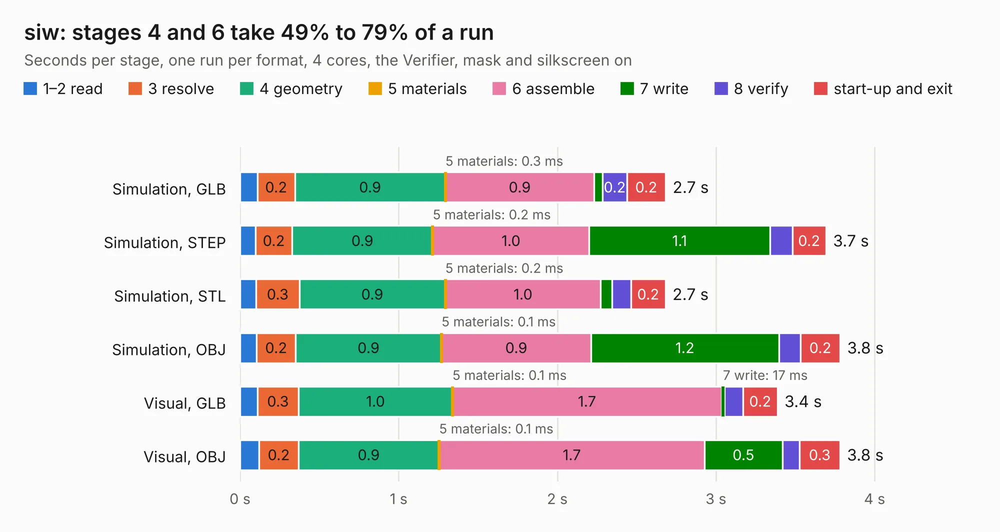

# 1538. siw

Board 1,538 of the 3,126 of [Corpus Testing](../Corpus-Testing.md), on [Corpus Page 15](../CorpusTestingPages/Corpus-Testing-15.md#1538-siw).

| Mode and format | 1–2 read | 3 resolve | 4 geometry | 5 materials | 6 assemble | 7 write | 8 verify | start-up and exit | Total |
|---|---:|---:|---:|---:|---:|---:|---:|---:|---:|
| Simulation, GLB | 0.1 | 0.2 | 0.9 | 0.3&nbsp;ms | 0.9 | 53&nbsp;ms | 0.2 | 0.2 | 2.7 |
| Simulation, STEP | 98&nbsp;ms | 0.2 | 0.9 | 0.2&nbsp;ms | 1.0 | 1.1 | 0.1 | 0.2 | 3.7 |
| Simulation, STL | 0.1 | 0.3 | 0.9 | 0.2&nbsp;ms | 1.0 | 70&nbsp;ms | 0.1 | 0.2 | 2.7 |
| Simulation, OBJ | 0.1 | 0.2 | 0.9 | 0.1&nbsp;ms | 0.9 | 1.2 | 0.1 | 0.2 | 3.8 |
| Visual, GLB | 0.1 | 0.3 | 1.0 | 0.1&nbsp;ms | 1.7 | 17&nbsp;ms | 0.1 | 0.2 | 3.4 |
| Visual, OBJ | 0.1 | 0.2 | 0.9 | 0.1&nbsp;ms | 1.7 | 0.5 | 0.1 | 0.3 | 3.8 |

<table align="center"><tr><td valign="top">

| Board | Repo: [loxodes/vna](https://github.com/loxodes/vna) Board: `siw.kicad_pcb` |
|---|---|
| Folder | breakouts / sw_edge_fr408_oshpark / trl_admv |
| Complexity | 214&nbsp;/&nbsp;1000 (size&nbsp;169, features&nbsp;45) |
| KESE&nbsp;features | through vias, rounded, trapezoid or chamfered pads, filled zones |
| Tested | 9th November 2026 |
| Copper&nbsp;layers | 4 |
| File&nbsp;format | KiCad 5 (20171130) |
| Parts,&nbsp;tracks,&nbsp;vias | 5, 98, 2 |
| Triangles,&nbsp;simulation | 276,854 in 19 parts |
| Verifier | PASS in all six runs |

</td><td valign="top">

<table>
<tr><th>File type</th><th>File size</th><th>Peak memory used</th></tr>
<tr><th colspan="3" align="left">Simulation</th></tr>
<tr><td>GLB</td><td align="right">9.5&nbsp;MB</td><td align="right">247&nbsp;MB</td></tr>
<tr><td>STEP</td><td align="right">29&nbsp;MB</td><td align="right">254&nbsp;MB</td></tr>
<tr><td>STL</td><td align="right">14&nbsp;MB</td><td align="right">244&nbsp;MB</td></tr>
<tr><td>OBJ</td><td align="right">27&nbsp;MB</td><td align="right">241&nbsp;MB</td></tr>
<tr><th colspan="3" align="left">Visual</th></tr>
<tr><td>GLB</td><td align="right">4.0&nbsp;MB</td><td align="right">193&nbsp;MB</td></tr>
<tr><td>OBJ</td><td align="right">11&nbsp;MB</td><td align="right">190&nbsp;MB</td></tr>
</table>

</td></tr></table>

| Previous | Next |
|:---|---:|
| [1537. siw](b1537b_vna_breakouts-sw-edge-fr408-oshpark-trl-0402-shunt_siw.md) | [1539. siw](b1539b_vna_breakouts-sw-edge-fr408-oshpark-trl-att-hmc_siw.md) |
