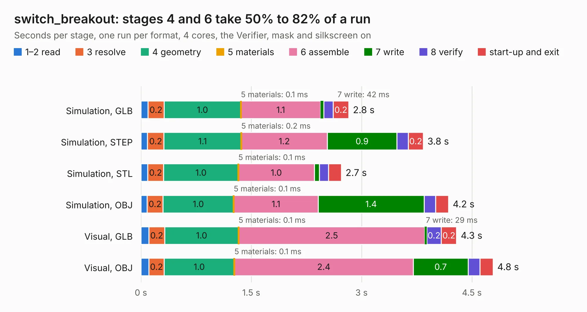

# 1539. switch_breakout

Board 1,539 of the 3,117 of [Corpus Testing](../Corpus-Testing.md), on [Corpus Page 15](../CorpusTestingPages/Corpus-Testing-15.md#1539-switch_breakout).

| Mode and format | 1–2 read | 3 resolve | 4 geometry | 5 materials | 6 assemble | 7 write | 8 verify | start-up and exit | Total |
|---|---:|---:|---:|---:|---:|---:|---:|---:|---:|
| Simulation, GLB | 95&nbsp;ms | 0.2 | 1.0 | 0.1&nbsp;ms | 1.1 | 42&nbsp;ms | 0.1 | 0.2 | 2.8 |
| Simulation, STEP | 89&nbsp;ms | 0.2 | 1.1 | 0.2&nbsp;ms | 1.2 | 0.9 | 0.2 | 0.2 | 3.8 |
| Simulation, STL | 90&nbsp;ms | 0.2 | 1.0 | 0.1&nbsp;ms | 1.0 | 70&nbsp;ms | 0.1 | 0.2 | 2.7 |
| Simulation, OBJ | 86&nbsp;ms | 0.2 | 1.0 | 0.1&nbsp;ms | 1.1 | 1.4 | 0.2 | 0.2 | 4.2 |
| Visual, GLB | 0.1 | 0.2 | 1.0 | 0.1&nbsp;ms | 2.5 | 29&nbsp;ms | 0.2 | 0.2 | 4.3 |
| Visual, OBJ | 0.1 | 0.2 | 1.0 | 0.1&nbsp;ms | 2.4 | 0.7 | 0.2 | 0.2 | 4.8 |

<table align="center"><tr><td valign="top">

| Board | Repo: [loxodes/vna](https://github.com/loxodes/vna) Board: `switch_breakout.kicad_pcb` |
|---|---|
| Folder | breakouts / switch_breakout |
| Complexity | 163&nbsp;/&nbsp;1000 (size&nbsp;128, features&nbsp;35) |
| KESE&nbsp;features | through vias, filled zones |
| Tested | 9th November 2026 |
| Copper&nbsp;layers | 4 |
| File&nbsp;format | KiCad 4 (4) |
| Parts,&nbsp;tracks,&nbsp;vias | 10, 54, 4 |
| Triangles,&nbsp;simulation | 371,498 in 22 parts |
| Verifier | PASS in all six runs |

</td><td valign="top">

<table>
<tr><th>File type</th><th>File size</th><th>Peak memory used</th></tr>
<tr><th colspan="3" align="left">Simulation</th></tr>
<tr><td>GLB</td><td align="right">12&nbsp;MB</td><td align="right">279&nbsp;MB</td></tr>
<tr><td>STEP</td><td align="right">35&nbsp;MB</td><td align="right">311&nbsp;MB</td></tr>
<tr><td>STL</td><td align="right">19&nbsp;MB</td><td align="right">279&nbsp;MB</td></tr>
<tr><td>OBJ</td><td align="right">36&nbsp;MB</td><td align="right">280&nbsp;MB</td></tr>
<tr><th colspan="3" align="left">Visual</th></tr>
<tr><td>GLB</td><td align="right">6.2&nbsp;MB</td><td align="right">262&nbsp;MB</td></tr>
<tr><td>OBJ</td><td align="right">18&nbsp;MB</td><td align="right">256&nbsp;MB</td></tr>
</table>

</td></tr></table>

| Previous | Next |
|:---|---:|
| [1538. siw](b1538b_vna_breakouts-sw-edge-fr408-oshpark-trl-vatt_siw.md) | [1540. synth](b1540b_vna_synth.md) |
