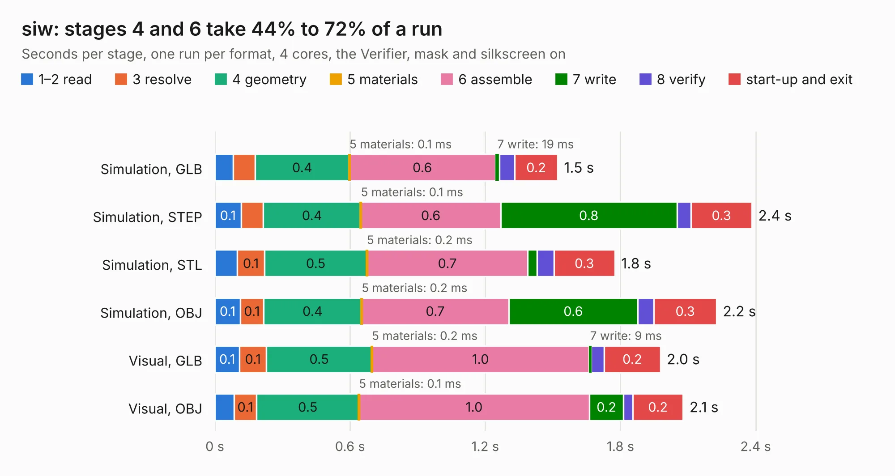

# 1542. siw

Board 1,542 of the 3,126 of [Corpus Testing](../Corpus-Testing.md), on [Corpus Page 15](../CorpusTestingPages/Corpus-Testing-15.md#1542-siw).

| Mode and format | 1–2 read | 3 resolve | 4 geometry | 5 materials | 6 assemble | 7 write | 8 verify | start-up and exit | Total |
|---|---:|---:|---:|---:|---:|---:|---:|---:|---:|
| Simulation, GLB | 82&nbsp;ms | 97&nbsp;ms | 0.4 | 0.1&nbsp;ms | 0.6 | 19&nbsp;ms | 68&nbsp;ms | 0.2 | 1.5 |
| Simulation, STEP | 0.1 | 98&nbsp;ms | 0.4 | 0.1&nbsp;ms | 0.6 | 0.8 | 63&nbsp;ms | 0.3 | 2.4 |
| Simulation, STL | 98&nbsp;ms | 0.1 | 0.5 | 0.2&nbsp;ms | 0.7 | 40&nbsp;ms | 76&nbsp;ms | 0.3 | 1.8 |
| Simulation, OBJ | 0.1 | 0.1 | 0.4 | 0.2&nbsp;ms | 0.7 | 0.6 | 72&nbsp;ms | 0.3 | 2.2 |
| Visual, GLB | 0.1 | 0.1 | 0.5 | 0.2&nbsp;ms | 1.0 | 9&nbsp;ms | 58&nbsp;ms | 0.2 | 2.0 |
| Visual, OBJ | 85&nbsp;ms | 0.1 | 0.5 | 0.1&nbsp;ms | 1.0 | 0.2 | 41&nbsp;ms | 0.2 | 2.1 |

<table align="center"><tr><td valign="top">

| Board | Repo: [loxodes/vna](https://github.com/loxodes/vna) Board: `siw.kicad_pcb` |
|---|---|
| Folder | breakouts / sw_edge_fr408_oshpark / trl_line_2mm |
| Complexity | 105&nbsp;/&nbsp;1000 (size&nbsp;75, features&nbsp;30) |
| KESE&nbsp;features | rounded, trapezoid or chamfered pads, filled zones |
| Tested | 9th November 2026 |
| Copper&nbsp;layers | 4 |
| File&nbsp;format | KiCad 5 (20171130) |
| Parts,&nbsp;tracks,&nbsp;vias | 2, 5, 0 |
| Triangles,&nbsp;simulation | 104,412 in 16 parts |
| Verifier | PASS in all six runs |

</td><td valign="top">

<table>
<tr><th>File type</th><th>File size</th><th>Peak memory used</th></tr>
<tr><th colspan="3" align="left">Simulation</th></tr>
<tr><td>GLB</td><td align="right">3.5&nbsp;MB</td><td align="right">183&nbsp;MB</td></tr>
<tr><td>STEP</td><td align="right">8.2&nbsp;MB</td><td align="right">195&nbsp;MB</td></tr>
<tr><td>STL</td><td align="right">5.2&nbsp;MB</td><td align="right">184&nbsp;MB</td></tr>
<tr><td>OBJ</td><td align="right">9.7&nbsp;MB</td><td align="right">188&nbsp;MB</td></tr>
<tr><th colspan="3" align="left">Visual</th></tr>
<tr><td>GLB</td><td align="right">932&nbsp;kB</td><td align="right">155&nbsp;MB</td></tr>
<tr><td>OBJ</td><td align="right">2.6&nbsp;MB</td><td align="right">157&nbsp;MB</td></tr>
</table>

</td></tr></table>

| Previous | Next |
|:---|---:|
| [1541. siw](b1541b_vna_breakouts-sw-edge-fr408-oshpark-trl-line-20mm_siw.md) | [1543. siw](b1543b_vna_breakouts-sw-edge-fr408-oshpark-trl-reflect_siw.md) |
