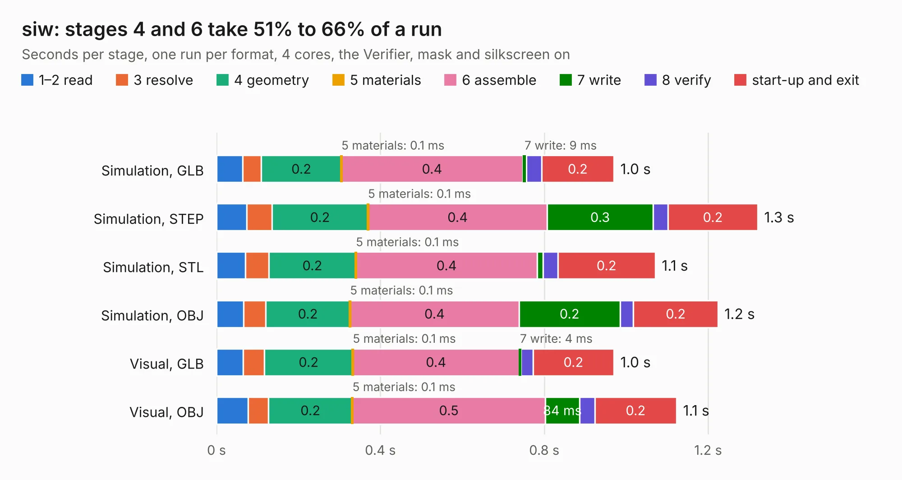

# 1543. siw

Board 1,543 of the 3,128 of [Corpus Testing](../Corpus-Testing.md), on [Corpus Page 15](../CorpusTestingPages/Corpus-Testing-15.md#1543-siw).

| Mode and format | 1–2 read | 3 resolve | 4 geometry | 5 materials | 6 assemble | 7 write | 8 verify | start-up and exit | Total |
|---|---:|---:|---:|---:|---:|---:|---:|---:|---:|
| Simulation, GLB | 63&nbsp;ms | 46&nbsp;ms | 0.2 | 0.1&nbsp;ms | 0.4 | 9&nbsp;ms | 37&nbsp;ms | 0.2 | 1.0 |
| Simulation, STEP | 74&nbsp;ms | 61&nbsp;ms | 0.2 | 0.1&nbsp;ms | 0.4 | 0.3 | 37&nbsp;ms | 0.2 | 1.3 |
| Simulation, STL | 70&nbsp;ms | 57&nbsp;ms | 0.2 | 0.1&nbsp;ms | 0.4 | 14&nbsp;ms | 36&nbsp;ms | 0.2 | 1.1 |
| Simulation, OBJ | 66&nbsp;ms | 54&nbsp;ms | 0.2 | 0.1&nbsp;ms | 0.4 | 0.2 | 33&nbsp;ms | 0.2 | 1.2 |
| Visual, GLB | 65&nbsp;ms | 52&nbsp;ms | 0.2 | 0.1&nbsp;ms | 0.4 | 4&nbsp;ms | 29&nbsp;ms | 0.2 | 1.0 |
| Visual, OBJ | 77&nbsp;ms | 49&nbsp;ms | 0.2 | 0.1&nbsp;ms | 0.5 | 84&nbsp;ms | 37&nbsp;ms | 0.2 | 1.1 |

<table align="center"><tr><td valign="top">

| Board | Repo: [loxodes/vna](https://github.com/loxodes/vna) Board: `siw.kicad_pcb` |
|---|---|
| Folder | breakouts / sw_edge_fr408_oshpark / trl_reflect |
| Complexity | 97&nbsp;/&nbsp;1000 (size&nbsp;67, features&nbsp;30) |
| KESE&nbsp;features | rounded, trapezoid or chamfered pads, filled zones |
| Tested | 9th November 2026 |
| Copper&nbsp;layers | 4 |
| File&nbsp;format | KiCad 5 (20171130) |
| Parts,&nbsp;tracks,&nbsp;vias | 1, 4, 0 |
| Triangles,&nbsp;simulation | 53,820 in 14 parts |
| Verifier | PASS in all six runs |

</td><td valign="top">

<table>
<tr><th>File type</th><th>File size</th><th>Peak memory used</th></tr>
<tr><th colspan="3" align="left">Simulation</th></tr>
<tr><td>GLB</td><td align="right">1.8&nbsp;MB</td><td align="right">70&nbsp;MB</td></tr>
<tr><td>STEP</td><td align="right">4.3&nbsp;MB</td><td align="right">74&nbsp;MB</td></tr>
<tr><td>STL</td><td align="right">2.7&nbsp;MB</td><td align="right">71&nbsp;MB</td></tr>
<tr><td>OBJ</td><td align="right">5.0&nbsp;MB</td><td align="right">82&nbsp;MB</td></tr>
<tr><th colspan="3" align="left">Visual</th></tr>
<tr><td>GLB</td><td align="right">514&nbsp;kB</td><td align="right">89&nbsp;MB</td></tr>
<tr><td>OBJ</td><td align="right">1.4&nbsp;MB</td><td align="right">90&nbsp;MB</td></tr>
</table>

</td></tr></table>

| Previous | Next |
|:---|---:|
| [1542. siw](b1542b_vna_breakouts-sw-edge-fr408-oshpark-trl-line-2mm_siw.md) | [1544. siw](b1544b_vna_breakouts-sw-edge-fr408-oshpark-trl-thru_siw.md) |
