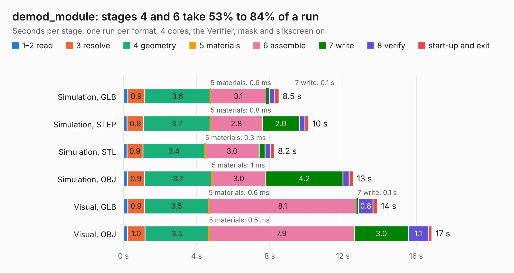

# 1546. demod_module

Board 1,546 of the 3,121 of [Corpus Testing](../Corpus-Testing.md), on [Corpus Page 15](../CorpusTestingPages/Corpus-Testing-15.md#1546-demod_module).

| Mode and format | 1–2 read | 3 resolve | 4 geometry | 5 materials | 6 assemble | 7 write | 8 verify | start-up and exit | Total |
|---|---:|---:|---:|---:|---:|---:|---:|---:|---:|
| Simulation, GLB | 0.2 | 0.9 | 3.6 | 0.6&nbsp;ms | 3.1 | 0.1 | 0.3 | 0.2 | 8.5 |
| Simulation, STEP | 0.2 | 0.9 | 3.7 | 0.8&nbsp;ms | 2.8 | 2.0 | 0.3 | 0.2 | 10.1 |
| Simulation, STL | 0.2 | 0.9 | 3.4 | 0.3&nbsp;ms | 3.0 | 0.3 | 0.3 | 0.2 | 8.2 |
| Simulation, OBJ | 0.2 | 0.9 | 3.7 | 1&nbsp;ms | 3.0 | 4.2 | 0.3 | 0.2 | 12.6 |
| Visual, GLB | 0.2 | 0.9 | 3.5 | 0.6&nbsp;ms | 8.1 | 0.1 | 0.8 | 0.2 | 13.9 |
| Visual, OBJ | 0.2 | 1.0 | 3.5 | 0.5&nbsp;ms | 7.9 | 3.0 | 1.1 | 0.2 | 16.9 |

<table align="center"><tr><td valign="top">

| Board | Repo: [loxodes/vna](https://github.com/loxodes/vna) Board: `demod_module.kicad_pcb` |
|---|---|
| Folder | hardware / archive / demod_module |
| Complexity | 279&nbsp;/&nbsp;1000 (size&nbsp;234, features&nbsp;45) |
| KESE&nbsp;features | through vias, filled zones, curved board outline |
| Tested | 9th November 2026 |
| Copper&nbsp;layers | 4 |
| File&nbsp;format | KiCad 4 (4) |
| Parts,&nbsp;tracks,&nbsp;vias | 99, 554, 95 |
| Triangles,&nbsp;simulation | 1,061,928 in 84 parts |
| Verifier | PASS in all six runs |

</td><td valign="top">

<table>
<tr><th>File type</th><th>File size</th><th>Peak memory used</th></tr>
<tr><th colspan="3" align="left">Simulation</th></tr>
<tr><td>GLB</td><td align="right">37&nbsp;MB</td><td align="right">478&nbsp;MB</td></tr>
<tr><td>STEP</td><td align="right">131&nbsp;MB</td><td align="right">540&nbsp;MB</td></tr>
<tr><td>STL</td><td align="right">53&nbsp;MB</td><td align="right">464&nbsp;MB</td></tr>
<tr><td>OBJ</td><td align="right">109&nbsp;MB</td><td align="right">756&nbsp;MB</td></tr>
<tr><th colspan="3" align="left">Visual</th></tr>
<tr><td>GLB</td><td align="right">24&nbsp;MB</td><td align="right">548&nbsp;MB</td></tr>
<tr><td>OBJ</td><td align="right">71&nbsp;MB</td><td align="right">550&nbsp;MB</td></tr>
</table>

</td></tr></table>

| Previous | Next |
|:---|---:|
| [1545. usb_pd](b1545b_vna_usb-pd.md) | [1547. doubler_switch](b1547b_vna_doubler-switch.md) |
