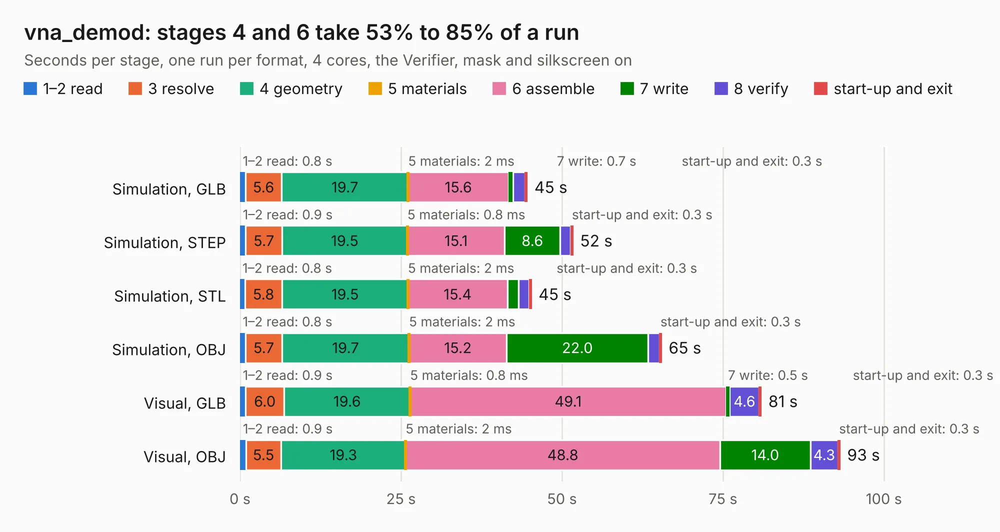

# 1546. vna_demod

Board 1,546 of the 3,107 of [Corpus Testing](../Corpus-Testing.md), on [Corpus Page 15](../CorpusTestingPages/Corpus-Testing-15.md#1546-vna_demod).

| Mode and format | 1–2 read | 3 resolve | 4 geometry | 5 materials | 6 assemble | 7 write | 8 verify | start-up and exit | Total |
|---|---:|---:|---:|---:|---:|---:|---:|---:|---:|
| Simulation, GLB | 0.8 | 5.6 | 19.7 | 2&nbsp;ms | 15.6 | 0.7 | 1.9 | 0.3 | 44.6 |
| Simulation, STEP | 0.9 | 5.7 | 19.5 | 0.8&nbsp;ms | 15.1 | 8.6 | 1.6 | 0.3 | 51.7 |
| Simulation, STL | 0.8 | 5.8 | 19.5 | 2&nbsp;ms | 15.4 | 1.7 | 1.7 | 0.3 | 45.2 |
| Simulation, OBJ | 0.8 | 5.7 | 19.7 | 2&nbsp;ms | 15.2 | 22.0 | 1.8 | 0.3 | 65.5 |
| Visual, GLB | 0.9 | 6.0 | 19.6 | 0.8&nbsp;ms | 49.1 | 0.5 | 4.6 | 0.3 | 80.9 |
| Visual, OBJ | 0.9 | 5.5 | 19.3 | 2&nbsp;ms | 48.8 | 14.0 | 4.3 | 0.3 | 93.2 |

<table align="center"><tr><td valign="top">

| Board | Repo: [loxodes/vna](https://github.com/loxodes/vna) Board: `vna_demod.kicad_pcb` |
|---|---|
| Folder | hardware / archive / vna_r0 / vna_demod |
| Complexity | 330&nbsp;/&nbsp;1000 (size&nbsp;285, features&nbsp;45) |
| KESE&nbsp;features | through vias, filled zones, curved board outline |
| Tested | 10th November 2026 |
| Copper&nbsp;layers | 4 |
| File&nbsp;format | KiCad 4 (4) |
| Parts,&nbsp;tracks,&nbsp;vias | 303, 2,447, 408 |
| Triangles,&nbsp;simulation | 4,214,150 in 243 parts |
| Verifier | PASS in all six runs |
| Run&nbsp;again | Simulation, GLB; Simulation, STEP; Simulation, STL; Simulation, OBJ; Visual, GLB; Visual, OBJ: failed in the corpus run, run again with fixes to KESE made after the corpus run, and passed |

</td><td valign="top">

<table>
<tr><th>File type</th><th>File size</th><th>Peak memory used</th></tr>
<tr><th colspan="3" align="left">Simulation</th></tr>
<tr><td>GLB</td><td align="right">146&nbsp;MB</td><td align="right">1.4&nbsp;GB</td></tr>
<tr><td>STEP</td><td align="right">498&nbsp;MB</td><td align="right">1.6&nbsp;GB</td></tr>
<tr><td>STL</td><td align="right">211&nbsp;MB</td><td align="right">1.3&nbsp;GB</td></tr>
<tr><td>OBJ</td><td align="right">451&nbsp;MB</td><td align="right">2.8&nbsp;GB</td></tr>
<tr><th colspan="3" align="left">Visual</th></tr>
<tr><td>GLB</td><td align="right">93&nbsp;MB</td><td align="right">1.5&nbsp;GB</td></tr>
<tr><td>OBJ</td><td align="right">294&nbsp;MB</td><td align="right">2.0&nbsp;GB</td></tr>
</table>

</td></tr></table>

| Previous | Next |
|:---|---:|
| [1545. vna_control](b1545b_vna_vna-control.md) | [1547. vna_rf](b1547b_vna_vna-rf.md) |
