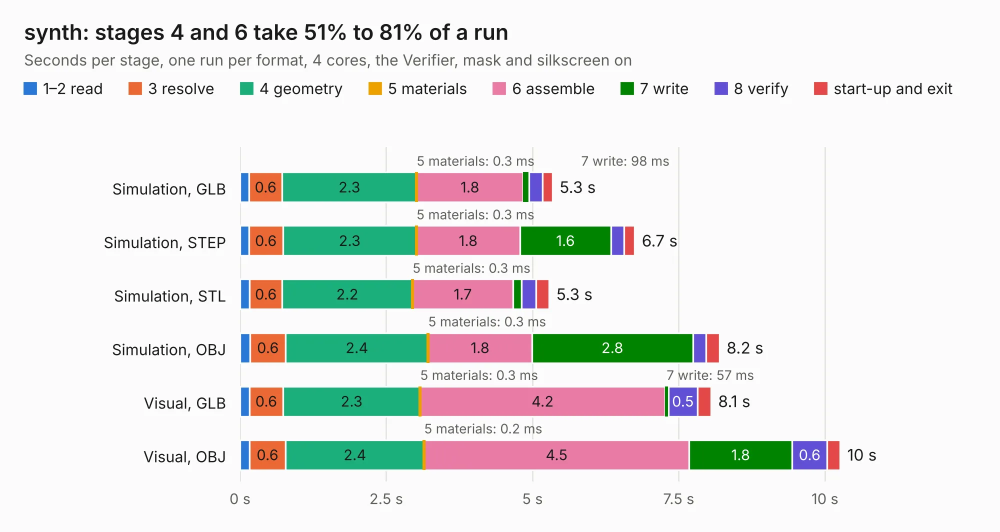

# 1547. synth

Board 1,547 of the 3,127 of [Corpus Testing](../Corpus-Testing.md), on [Corpus Page 15](../CorpusTestingPages/Corpus-Testing-15.md#1547-synth).

| Mode and format | 1–2 read | 3 resolve | 4 geometry | 5 materials | 6 assemble | 7 write | 8 verify | start-up and exit | Total |
|---|---:|---:|---:|---:|---:|---:|---:|---:|---:|
| Simulation, GLB | 0.2 | 0.6 | 2.3 | 0.3&nbsp;ms | 1.8 | 98&nbsp;ms | 0.2 | 0.2 | 5.3 |
| Simulation, STEP | 0.2 | 0.6 | 2.3 | 0.3&nbsp;ms | 1.8 | 1.6 | 0.2 | 0.2 | 6.7 |
| Simulation, STL | 0.2 | 0.6 | 2.2 | 0.3&nbsp;ms | 1.7 | 0.1 | 0.2 | 0.2 | 5.3 |
| Simulation, OBJ | 0.2 | 0.6 | 2.4 | 0.3&nbsp;ms | 1.8 | 2.8 | 0.2 | 0.2 | 8.2 |
| Visual, GLB | 0.2 | 0.6 | 2.3 | 0.3&nbsp;ms | 4.2 | 57&nbsp;ms | 0.5 | 0.2 | 8.1 |
| Visual, OBJ | 0.2 | 0.6 | 2.4 | 0.2&nbsp;ms | 4.5 | 1.8 | 0.6 | 0.2 | 10.3 |

<table align="center"><tr><td valign="top">

| Board | Repo: [loxodes/vna](https://github.com/loxodes/vna) Board: `synth.kicad_pcb` |
|---|---|
| Folder | breakouts / synth |
| Complexity | 261&nbsp;/&nbsp;1000 (size&nbsp;226, features&nbsp;35) |
| KESE&nbsp;features | through vias, filled zones |
| Tested | 9th November 2026 |
| Copper&nbsp;layers | 4 |
| File&nbsp;format | KiCad 4 (4) |
| Parts,&nbsp;tracks,&nbsp;vias | 79, 391, 73 |
| Triangles,&nbsp;simulation | 656,202 in 59 parts |
| Verifier | PASS in all six runs |

</td><td valign="top">

<table>
<tr><th>File type</th><th>File size</th><th>Peak memory used</th></tr>
<tr><th colspan="3" align="left">Simulation</th></tr>
<tr><td>GLB</td><td align="right">23&nbsp;MB</td><td align="right">339&nbsp;MB</td></tr>
<tr><td>STEP</td><td align="right">88&nbsp;MB</td><td align="right">377&nbsp;MB</td></tr>
<tr><td>STL</td><td align="right">33&nbsp;MB</td><td align="right">352&nbsp;MB</td></tr>
<tr><td>OBJ</td><td align="right">68&nbsp;MB</td><td align="right">467&nbsp;MB</td></tr>
<tr><th colspan="3" align="left">Visual</th></tr>
<tr><td>GLB</td><td align="right">14&nbsp;MB</td><td align="right">389&nbsp;MB</td></tr>
<tr><td>OBJ</td><td align="right">42&nbsp;MB</td><td align="right">389&nbsp;MB</td></tr>
</table>

</td></tr></table>

| Previous | Next |
|:---|---:|
| [1546. switch_breakout](b1546b_vna_switch-breakout.md) | [1548. cpw_test](b1548b_vna_breakouts-ufl-test_cpw-test.md) |
