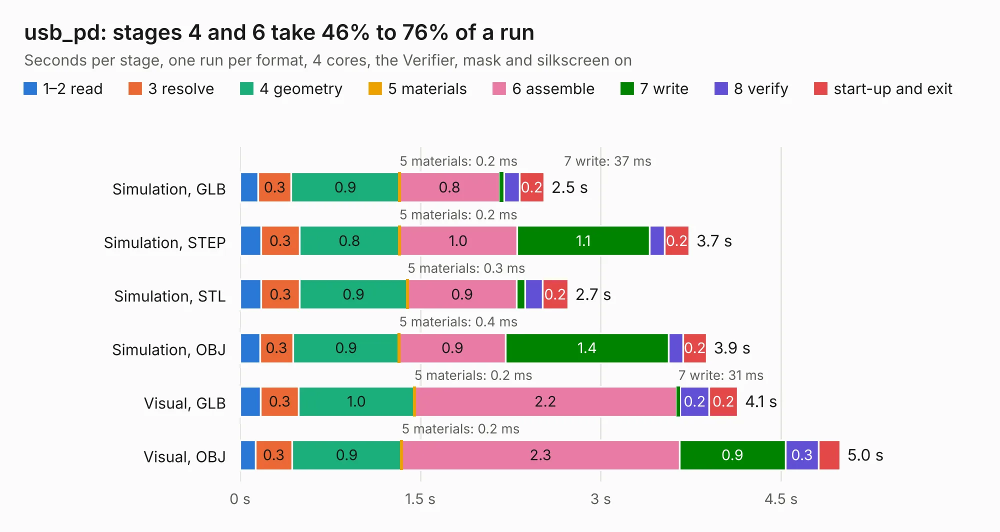

# 1548. usb_pd

Board 1,548 of the 3,125 of [Corpus Testing](../Corpus-Testing.md), on [Corpus Page 15](../CorpusTestingPages/Corpus-Testing-15.md#1548-usb_pd).

| Mode and format | 1–2 read | 3 resolve | 4 geometry | 5 materials | 6 assemble | 7 write | 8 verify | start-up and exit | Total |
|---|---:|---:|---:|---:|---:|---:|---:|---:|---:|
| Simulation, GLB | 0.2 | 0.3 | 0.9 | 0.2&nbsp;ms | 0.8 | 37&nbsp;ms | 0.1 | 0.2 | 2.5 |
| Simulation, STEP | 0.2 | 0.3 | 0.8 | 0.2&nbsp;ms | 1.0 | 1.1 | 0.1 | 0.2 | 3.7 |
| Simulation, STL | 0.2 | 0.3 | 0.9 | 0.3&nbsp;ms | 0.9 | 70&nbsp;ms | 0.1 | 0.2 | 2.7 |
| Simulation, OBJ | 0.2 | 0.3 | 0.9 | 0.4&nbsp;ms | 0.9 | 1.4 | 0.1 | 0.2 | 3.9 |
| Visual, GLB | 0.2 | 0.3 | 1.0 | 0.2&nbsp;ms | 2.2 | 31&nbsp;ms | 0.2 | 0.2 | 4.1 |
| Visual, OBJ | 0.1 | 0.3 | 0.9 | 0.2&nbsp;ms | 2.3 | 0.9 | 0.3 | 0.2 | 5.0 |

<table align="center"><tr><td valign="top">

| Board | Repo: [loxodes/vna](https://github.com/loxodes/vna) Board: `usb_pd.kicad_pcb` |
|---|---|
| Folder | breakouts / usb_pd / usb_pd |
| Complexity | 263&nbsp;/&nbsp;1000 (size&nbsp;163, features&nbsp;100) |
| KESE&nbsp;features | through vias, slotted holes, rounded, trapezoid or chamfered pads, filled zones, curved board outline, stack-up, dielectric εr and tanδ, mask and silkscreen colours |
| Tested | 9th November 2026 |
| Copper&nbsp;layers | 4 |
| File&nbsp;format | KiCad 6 (20210606) |
| Parts,&nbsp;tracks,&nbsp;vias | 29, 149, 43 |
| Triangles,&nbsp;simulation | 294,948 in 34 parts |
| Verifier | PASS in all six runs |

</td><td valign="top">

<table>
<tr><th>File type</th><th>File size</th><th>Peak memory used</th></tr>
<tr><th colspan="3" align="left">Simulation</th></tr>
<tr><td>GLB</td><td align="right">9.9&nbsp;MB</td><td align="right">232&nbsp;MB</td></tr>
<tr><td>STEP</td><td align="right">39&nbsp;MB</td><td align="right">270&nbsp;MB</td></tr>
<tr><td>STL</td><td align="right">15&nbsp;MB</td><td align="right">245&nbsp;MB</td></tr>
<tr><td>OBJ</td><td align="right">29&nbsp;MB</td><td align="right">258&nbsp;MB</td></tr>
<tr><th colspan="3" align="left">Visual</th></tr>
<tr><td>GLB</td><td align="right">7.0&nbsp;MB</td><td align="right">240&nbsp;MB</td></tr>
<tr><td>OBJ</td><td align="right">20&nbsp;MB</td><td align="right">237&nbsp;MB</td></tr>
</table>

</td></tr></table>

| Previous | Next |
|:---|---:|
| [1547. cpw_test](b1547b_vna_breakouts-ufl-test_cpw-test.md) | [1549. demod_module](b1549b_vna_demod-module.md) |
