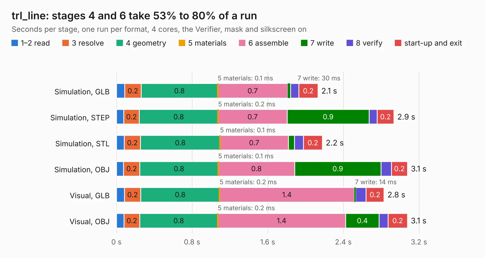

# 1549. trl_line

Board 1,549 of the 3,119 of [Corpus Testing](../Corpus-Testing.md), on [Corpus Page 15](../CorpusTestingPages/Corpus-Testing-15.md#1549-trl_line).

| Mode and format | 1–2 read | 3 resolve | 4 geometry | 5 materials | 6 assemble | 7 write | 8 verify | start-up and exit | Total |
|---|---:|---:|---:|---:|---:|---:|---:|---:|---:|
| Simulation, GLB | 86&nbsp;ms | 0.2 | 0.8 | 0.1&nbsp;ms | 0.7 | 30&nbsp;ms | 87&nbsp;ms | 0.2 | 2.1 |
| Simulation, STEP | 77&nbsp;ms | 0.2 | 0.8 | 0.2&nbsp;ms | 0.7 | 0.9 | 84&nbsp;ms | 0.2 | 2.9 |
| Simulation, STL | 83&nbsp;ms | 0.2 | 0.8 | 0.1&nbsp;ms | 0.7 | 65&nbsp;ms | 95&nbsp;ms | 0.2 | 2.2 |
| Simulation, OBJ | 75&nbsp;ms | 0.2 | 0.8 | 0.1&nbsp;ms | 0.8 | 0.9 | 0.1 | 0.2 | 3.1 |
| Visual, GLB | 84&nbsp;ms | 0.2 | 0.8 | 0.2&nbsp;ms | 1.4 | 14&nbsp;ms | 0.1 | 0.2 | 2.8 |
| Visual, OBJ | 81&nbsp;ms | 0.2 | 0.8 | 0.2&nbsp;ms | 1.4 | 0.4 | 94&nbsp;ms | 0.2 | 3.1 |

<table align="center"><tr><td valign="top">

| Board | Repo: [loxodes/vna](https://github.com/loxodes/vna) Board: `trl_line.kicad_pcb` |
|---|---|
| Folder | hardware / archive / oshpark_4layer_trl_cal / cap_0402 |
| Complexity | 86&nbsp;/&nbsp;1000 (size&nbsp;66, features&nbsp;20) |
| KESE&nbsp;features | filled zones |
| Tested | 9th November 2026 |
| Copper&nbsp;layers | 4 |
| File&nbsp;format | KiCad 4 (4) |
| Parts,&nbsp;tracks,&nbsp;vias | 3, 2, 0 |
| Triangles,&nbsp;simulation | 226,556 in 15 parts |
| Verifier | PASS in all six runs |

</td><td valign="top">

<table>
<tr><th>File type</th><th>File size</th><th>Peak memory used</th></tr>
<tr><th colspan="3" align="left">Simulation</th></tr>
<tr><td>GLB</td><td align="right">7.5&nbsp;MB</td><td align="right">234&nbsp;MB</td></tr>
<tr><td>STEP</td><td align="right">22&nbsp;MB</td><td align="right">238&nbsp;MB</td></tr>
<tr><td>STL</td><td align="right">11&nbsp;MB</td><td align="right">233&nbsp;MB</td></tr>
<tr><td>OBJ</td><td align="right">22&nbsp;MB</td><td align="right">220&nbsp;MB</td></tr>
<tr><th colspan="3" align="left">Visual</th></tr>
<tr><td>GLB</td><td align="right">3.2&nbsp;MB</td><td align="right">168&nbsp;MB</td></tr>
<tr><td>OBJ</td><td align="right">9.0&nbsp;MB</td><td align="right">167&nbsp;MB</td></tr>
</table>

</td></tr></table>

| Previous | Next |
|:---|---:|
| [1548. trl_line](b1548b_vna_hardware-archive-oshpark-4layer-trl-cal-cap-0201_trl-line.md) | [1550. trl_line](b1550b_vna_hardware-archive-oshpark-4layer-trl-cal-shunt-0402_trl-line.md) |
