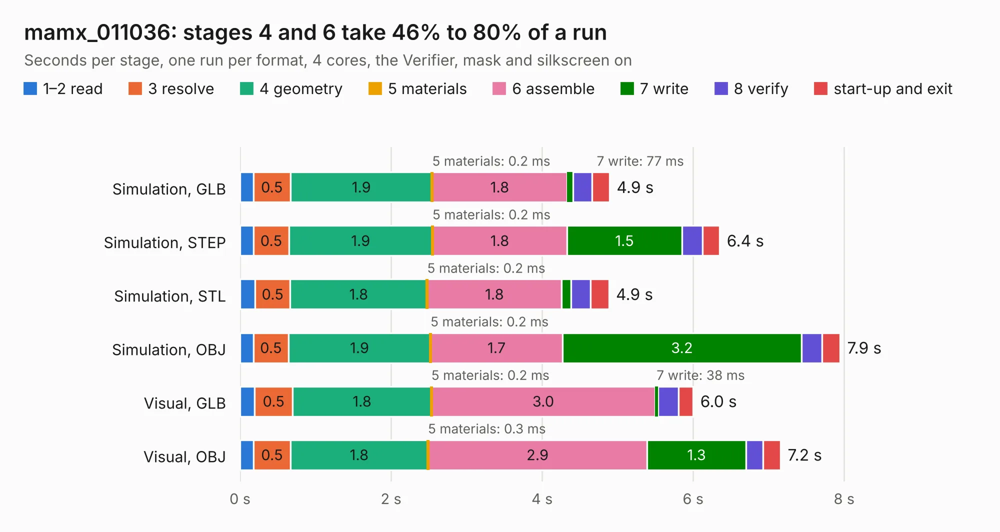

# 1549. mamx_011036

Board 1,549 of the 3,103 of [Corpus Testing](../Corpus-Testing.md), on [Corpus Page 15](../CorpusTestingPages/Corpus-Testing-15.md#1549-mamx_011036).

| Mode and format | 1–2 read | 3 resolve | 4 geometry | 5 materials | 6 assemble | 7 write | 8 verify | start-up and exit | Total |
|---|---:|---:|---:|---:|---:|---:|---:|---:|---:|
| Simulation, GLB | 0.2 | 0.5 | 1.9 | 0.2&nbsp;ms | 1.8 | 77&nbsp;ms | 0.3 | 0.2 | 4.9 |
| Simulation, STEP | 0.2 | 0.5 | 1.9 | 0.2&nbsp;ms | 1.8 | 1.5 | 0.3 | 0.2 | 6.4 |
| Simulation, STL | 0.2 | 0.5 | 1.8 | 0.2&nbsp;ms | 1.8 | 0.1 | 0.3 | 0.2 | 4.9 |
| Simulation, OBJ | 0.2 | 0.5 | 1.9 | 0.2&nbsp;ms | 1.7 | 3.2 | 0.3 | 0.2 | 7.9 |
| Visual, GLB | 0.2 | 0.5 | 1.8 | 0.2&nbsp;ms | 3.0 | 38&nbsp;ms | 0.3 | 0.2 | 6.0 |
| Visual, OBJ | 0.2 | 0.5 | 1.8 | 0.3&nbsp;ms | 2.9 | 1.3 | 0.2 | 0.2 | 7.2 |

<table align="center"><tr><td valign="top">

| Board | Repo: [loxodes/vna](https://github.com/loxodes/vna) Board: `mamx_011036.kicad_pcb` |
|---|---|
| Folder | hardware / mm_reflectometer / evalboards / mamx_011036 |
| Complexity | 266&nbsp;/&nbsp;1000 (size&nbsp;171, features&nbsp;95) |
| KESE&nbsp;features | through vias, rounded, trapezoid or chamfered pads, filled zones, stack-up, dielectric εr and tanδ, copper finish, mask and silkscreen colours |
| Tested | 9th November 2026 |
| Copper&nbsp;layers | 4 |
| File&nbsp;format | KiCad 6 (20201220) |
| Parts,&nbsp;tracks,&nbsp;vias | 31, 178, 90 |
| Triangles,&nbsp;simulation | 507,438 in 37 parts |
| Verifier | PASS in all six runs |

</td><td valign="top">

<table>
<tr><th>File type</th><th>File size</th><th>Peak memory used</th></tr>
<tr><th colspan="3" align="left">Simulation</th></tr>
<tr><td>GLB</td><td align="right">17&nbsp;MB</td><td align="right">305&nbsp;MB</td></tr>
<tr><td>STEP</td><td align="right">50&nbsp;MB</td><td align="right">345&nbsp;MB</td></tr>
<tr><td>STL</td><td align="right">25&nbsp;MB</td><td align="right">322&nbsp;MB</td></tr>
<tr><td>OBJ</td><td align="right">53&nbsp;MB</td><td align="right">343&nbsp;MB</td></tr>
<tr><th colspan="3" align="left">Visual</th></tr>
<tr><td>GLB</td><td align="right">7.9&nbsp;MB</td><td align="right">284&nbsp;MB</td></tr>
<tr><td>OBJ</td><td align="right">24&nbsp;MB</td><td align="right">286&nbsp;MB</td></tr>
</table>

</td></tr></table>

| Previous | Next |
|:---|---:|
| [1548. maam_011101](b1548b_vna_maam-011101.md) | [1550. sumusu_ats2012](b1550b_vna_sumusu-ats2012.md) |
