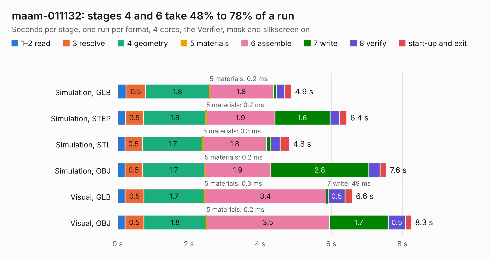

# 1551. maam-011132

Board 1,551 of the 3,107 of [Corpus Testing](../Corpus-Testing.md), on [Corpus Page 15](../CorpusTestingPages/Corpus-Testing-15.md#1551-maam-011132).

| Mode and format | 1–2 read | 3 resolve | 4 geometry | 5 materials | 6 assemble | 7 write | 8 verify | start-up and exit | Total |
|---|---:|---:|---:|---:|---:|---:|---:|---:|---:|
| Simulation, GLB | 0.2 | 0.5 | 1.8 | 0.2&nbsp;ms | 1.8 | 84&nbsp;ms | 0.2 | 0.2 | 4.9 |
| Simulation, STEP | 0.2 | 0.5 | 1.8 | 0.2&nbsp;ms | 1.9 | 1.6 | 0.3 | 0.2 | 6.4 |
| Simulation, STL | 0.2 | 0.5 | 1.7 | 0.3&nbsp;ms | 1.8 | 0.1 | 0.3 | 0.3 | 4.8 |
| Simulation, OBJ | 0.2 | 0.5 | 1.7 | 0.2&nbsp;ms | 1.9 | 2.8 | 0.3 | 0.2 | 7.6 |
| Visual, GLB | 0.2 | 0.5 | 1.7 | 0.3&nbsp;ms | 3.4 | 49&nbsp;ms | 0.5 | 0.2 | 6.6 |
| Visual, OBJ | 0.2 | 0.5 | 1.8 | 0.2&nbsp;ms | 3.5 | 1.7 | 0.5 | 0.2 | 8.3 |

<table align="center"><tr><td valign="top">

| Board | Repo: [loxodes/vna](https://github.com/loxodes/vna) Board: `maam-011132.kicad_pcb` |
|---|---|
| Folder | hardware / mm_reflectometer / evalboards / maam-011132 |
| Complexity | 290&nbsp;/&nbsp;1000 (size&nbsp;185, features&nbsp;105) |
| KESE&nbsp;features | through vias, rounded, trapezoid or chamfered pads, filled zones, curved board outline, stack-up, dielectric εr and tanδ, copper finish, mask and silkscreen colours |
| Tested | 9th November 2026 |
| Copper&nbsp;layers | 4 |
| File&nbsp;format | KiCad 6 (20210228) |
| Parts,&nbsp;tracks,&nbsp;vias | 66, 379, 89 |
| Triangles,&nbsp;simulation | 574,998 in 46 parts |
| Verifier | PASS in all six runs |

</td><td valign="top">

<table>
<tr><th>File type</th><th>File size</th><th>Peak memory used</th></tr>
<tr><th colspan="3" align="left">Simulation</th></tr>
<tr><td>GLB</td><td align="right">19&nbsp;MB</td><td align="right">332&nbsp;MB</td></tr>
<tr><td>STEP</td><td align="right">66&nbsp;MB</td><td align="right">385&nbsp;MB</td></tr>
<tr><td>STL</td><td align="right">29&nbsp;MB</td><td align="right">327&nbsp;MB</td></tr>
<tr><td>OBJ</td><td align="right">60&nbsp;MB</td><td align="right">438&nbsp;MB</td></tr>
<tr><th colspan="3" align="left">Visual</th></tr>
<tr><td>GLB</td><td align="right">11&nbsp;MB</td><td align="right">332&nbsp;MB</td></tr>
<tr><td>OBJ</td><td align="right">35&nbsp;MB</td><td align="right">337&nbsp;MB</td></tr>
</table>

</td></tr></table>

| Previous | Next |
|:---|---:|
| [1550. fpc07181](b1550b_vna_fpc07181.md) | [1552. maam_011101](b1552b_vna_maam-011101.md) |
