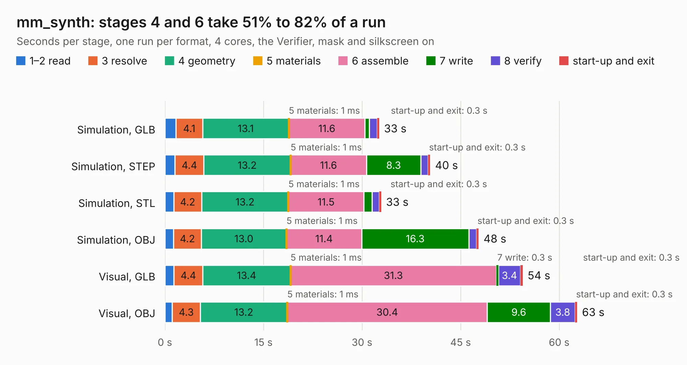

# 1551. mm_synth

Board 1,551 of the 3,102 of [Corpus Testing](../Corpus-Testing.md), on [Corpus Page 15](../CorpusTestingPages/Corpus-Testing-15.md#1551-mm_synth).

| Mode and format | 1–2 read | 3 resolve | 4 geometry | 5 materials | 6 assemble | 7 write | 8 verify | start-up and exit | Total |
|---|---:|---:|---:|---:|---:|---:|---:|---:|---:|
| Simulation, GLB | 1.7 | 4.1 | 13.1 | 1&nbsp;ms | 11.6 | 0.6 | 1.2 | 0.3 | 32.6 |
| Simulation, STEP | 1.5 | 4.4 | 13.2 | 1&nbsp;ms | 11.6 | 8.3 | 1.1 | 0.3 | 40.4 |
| Simulation, STL | 1.3 | 4.2 | 13.2 | 1&nbsp;ms | 11.5 | 1.2 | 1.1 | 0.3 | 32.9 |
| Simulation, OBJ | 1.3 | 4.2 | 13.0 | 1&nbsp;ms | 11.4 | 16.3 | 1.1 | 0.3 | 47.7 |
| Visual, GLB | 1.4 | 4.4 | 13.4 | 1&nbsp;ms | 31.3 | 0.3 | 3.4 | 0.3 | 54.4 |
| Visual, OBJ | 1.1 | 4.3 | 13.2 | 1&nbsp;ms | 30.4 | 9.6 | 3.8 | 0.3 | 62.7 |

<table align="center"><tr><td valign="top">

| Board | Repo: [loxodes/vna](https://github.com/loxodes/vna) Board: `mm_synth.kicad_pcb` |
|---|---|
| Folder | hardware / mm_reflectometer / synth / mm_synth |
| Complexity | 297&nbsp;/&nbsp;1000 (size&nbsp;192, features&nbsp;105) |
| KESE&nbsp;features | slotted holes, custom pads, rounded, trapezoid or chamfered pads, drill offsets, copper drawings, stack-up, dielectric εr and tanδ, copper finish, mask and silkscreen colours |
| Tested | 9th November 2026 |
| Copper&nbsp;layers | 8 |
| File&nbsp;format | KiCad 6 (20211014) |
| Parts,&nbsp;tracks,&nbsp;vias | 679, 0, 0 |
| Triangles,&nbsp;simulation | 3,436,034 in 332 parts |
| Note | mostly unrouted |
| Verifier | PASS in all six runs |

</td><td valign="top">

<table>
<tr><th>File type</th><th>File size</th><th>Peak memory used</th></tr>
<tr><th colspan="3" align="left">Simulation</th></tr>
<tr><td>GLB</td><td align="right">111&nbsp;MB</td><td align="right">1.3&nbsp;GB</td></tr>
<tr><td>STEP</td><td align="right">488&nbsp;MB</td><td align="right">1.4&nbsp;GB</td></tr>
<tr><td>STL</td><td align="right">172&nbsp;MB</td><td align="right">1.2&nbsp;GB</td></tr>
<tr><td>OBJ</td><td align="right">358&nbsp;MB</td><td align="right">2.2&nbsp;GB</td></tr>
<tr><th colspan="3" align="left">Visual</th></tr>
<tr><td>GLB</td><td align="right">68&nbsp;MB</td><td align="right">1.3&nbsp;GB</td></tr>
<tr><td>OBJ</td><td align="right">211&nbsp;MB</td><td align="right">1.4&nbsp;GB</td></tr>
</table>

</td></tr></table>

| Previous | Next |
|:---|---:|
| [1550. xx1000-qt](b1550b_vna_xx1000-qt.md) | [1552. synth_pod](b1552b_vna_synth-pod.md) |
