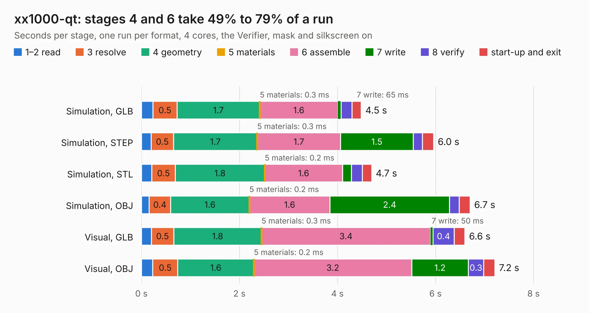

# 1551. xx1000-qt

Board 1,551 of the 3,103 of [Corpus Testing](../Corpus-Testing.md), on [Corpus Page 15](../CorpusTestingPages/Corpus-Testing-15.md#1551-xx1000-qt).

| Mode and format | 1–2 read | 3 resolve | 4 geometry | 5 materials | 6 assemble | 7 write | 8 verify | start-up and exit | Total |
|---|---:|---:|---:|---:|---:|---:|---:|---:|---:|
| Simulation, GLB | 0.2 | 0.5 | 1.7 | 0.3&nbsp;ms | 1.6 | 65&nbsp;ms | 0.2 | 0.2 | 4.5 |
| Simulation, STEP | 0.2 | 0.5 | 1.7 | 0.3&nbsp;ms | 1.7 | 1.5 | 0.2 | 0.2 | 6.0 |
| Simulation, STL | 0.2 | 0.5 | 1.8 | 0.2&nbsp;ms | 1.6 | 0.2 | 0.2 | 0.2 | 4.7 |
| Simulation, OBJ | 0.2 | 0.4 | 1.6 | 0.2&nbsp;ms | 1.6 | 2.4 | 0.2 | 0.2 | 6.7 |
| Visual, GLB | 0.2 | 0.5 | 1.8 | 0.3&nbsp;ms | 3.4 | 50&nbsp;ms | 0.4 | 0.2 | 6.6 |
| Visual, OBJ | 0.2 | 0.5 | 1.6 | 0.2&nbsp;ms | 3.2 | 1.2 | 0.3 | 0.2 | 7.2 |

<table align="center"><tr><td valign="top">

| Board | Repo: [loxodes/vna](https://github.com/loxodes/vna) Board: `xx1000-qt.kicad_pcb` |
|---|---|
| Folder | hardware / mm_reflectometer / evalboards / xx1000-qt |
| Complexity | 287&nbsp;/&nbsp;1000 (size&nbsp;182, features&nbsp;105) |
| KESE&nbsp;features | through vias, rounded, trapezoid or chamfered pads, filled zones, curved board outline, stack-up, dielectric εr and tanδ, copper finish, mask and silkscreen colours |
| Tested | 9th November 2026 |
| Copper&nbsp;layers | 4 |
| File&nbsp;format | KiCad 6 (20210228) |
| Parts,&nbsp;tracks,&nbsp;vias | 58, 346, 84 |
| Triangles,&nbsp;simulation | 529,594 in 42 parts |
| Verifier | PASS in all six runs |

</td><td valign="top">

<table>
<tr><th>File type</th><th>File size</th><th>Peak memory used</th></tr>
<tr><th colspan="3" align="left">Simulation</th></tr>
<tr><td>GLB</td><td align="right">18&nbsp;MB</td><td align="right">324&nbsp;MB</td></tr>
<tr><td>STEP</td><td align="right">59&nbsp;MB</td><td align="right">356&nbsp;MB</td></tr>
<tr><td>STL</td><td align="right">26&nbsp;MB</td><td align="right">324&nbsp;MB</td></tr>
<tr><td>OBJ</td><td align="right">55&nbsp;MB</td><td align="right">405&nbsp;MB</td></tr>
<tr><th colspan="3" align="left">Visual</th></tr>
<tr><td>GLB</td><td align="right">11&nbsp;MB</td><td align="right">322&nbsp;MB</td></tr>
<tr><td>OBJ</td><td align="right">32&nbsp;MB</td><td align="right">326&nbsp;MB</td></tr>
</table>

</td></tr></table>

| Previous | Next |
|:---|---:|
| [1550. sumusu_ats2012](b1550b_vna_sumusu-ats2012.md) | [1552. mm_synth](b1552b_vna_mm-synth.md) |
