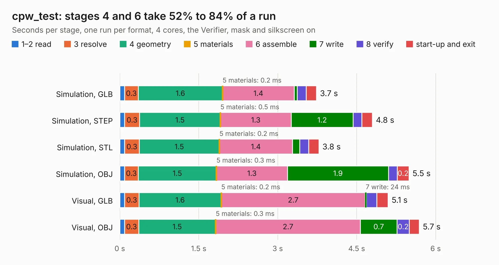

# 1552. cpw_test

Board 1,552 of the 3,132 of [Corpus Testing](../Corpus-Testing.md), on [Corpus Page 15](../CorpusTestingPages/Corpus-Testing-15.md#1552-cpw_test).

| Mode and format | 1–2 read | 3 resolve | 4 geometry | 5 materials | 6 assemble | 7 write | 8 verify | start-up and exit | Total |
|---|---:|---:|---:|---:|---:|---:|---:|---:|---:|
| Simulation, GLB | 90&nbsp;ms | 0.3 | 1.6 | 0.2&nbsp;ms | 1.4 | 58&nbsp;ms | 0.2 | 0.2 | 3.7 |
| Simulation, STEP | 90&nbsp;ms | 0.3 | 1.5 | 0.5&nbsp;ms | 1.3 | 1.2 | 0.2 | 0.2 | 4.8 |
| Simulation, STL | 92&nbsp;ms | 0.3 | 1.5 | 0.2&nbsp;ms | 1.4 | 0.1 | 0.2 | 0.2 | 3.8 |
| Simulation, OBJ | 90&nbsp;ms | 0.3 | 1.5 | 0.3&nbsp;ms | 1.3 | 1.9 | 0.2 | 0.2 | 5.5 |
| Visual, GLB | 89&nbsp;ms | 0.3 | 1.6 | 0.2&nbsp;ms | 2.7 | 24&nbsp;ms | 0.2 | 0.2 | 5.1 |
| Visual, OBJ | 89&nbsp;ms | 0.3 | 1.5 | 0.3&nbsp;ms | 2.7 | 0.7 | 0.2 | 0.2 | 5.7 |

<table align="center"><tr><td valign="top">

| Board | Repo: [loxodes/vna](https://github.com/loxodes/vna) Board: `cpw_test.kicad_pcb` |
|---|---|
| Folder | breakouts / ufl_test |
| Complexity | 133&nbsp;/&nbsp;1000 (size&nbsp;98, features&nbsp;35) |
| KESE&nbsp;features | through vias, filled zones |
| Tested | 9th November 2026 |
| Copper&nbsp;layers | 4 |
| File&nbsp;format | KiCad 4 (4) |
| Parts,&nbsp;tracks,&nbsp;vias | 2, 6, 6 |
| Triangles,&nbsp;simulation | 453,202 in 13 parts |
| Verifier | PASS in all six runs |

</td><td valign="top">

<table>
<tr><th>File type</th><th>File size</th><th>Peak memory used</th></tr>
<tr><th colspan="3" align="left">Simulation</th></tr>
<tr><td>GLB</td><td align="right">15&nbsp;MB</td><td align="right">322&nbsp;MB</td></tr>
<tr><td>STEP</td><td align="right">41&nbsp;MB</td><td align="right">362&nbsp;MB</td></tr>
<tr><td>STL</td><td align="right">23&nbsp;MB</td><td align="right">318&nbsp;MB</td></tr>
<tr><td>OBJ</td><td align="right">45&nbsp;MB</td><td align="right">356&nbsp;MB</td></tr>
<tr><th colspan="3" align="left">Visual</th></tr>
<tr><td>GLB</td><td align="right">6.0&nbsp;MB</td><td align="right">257&nbsp;MB</td></tr>
<tr><td>OBJ</td><td align="right">17&nbsp;MB</td><td align="right">256&nbsp;MB</td></tr>
</table>

</td></tr></table>

| Previous | Next |
|:---|---:|
| [1551. synth](b1551b_vna_synth.md) | [1553. usb_pd](b1553b_vna_usb-pd.md) |
