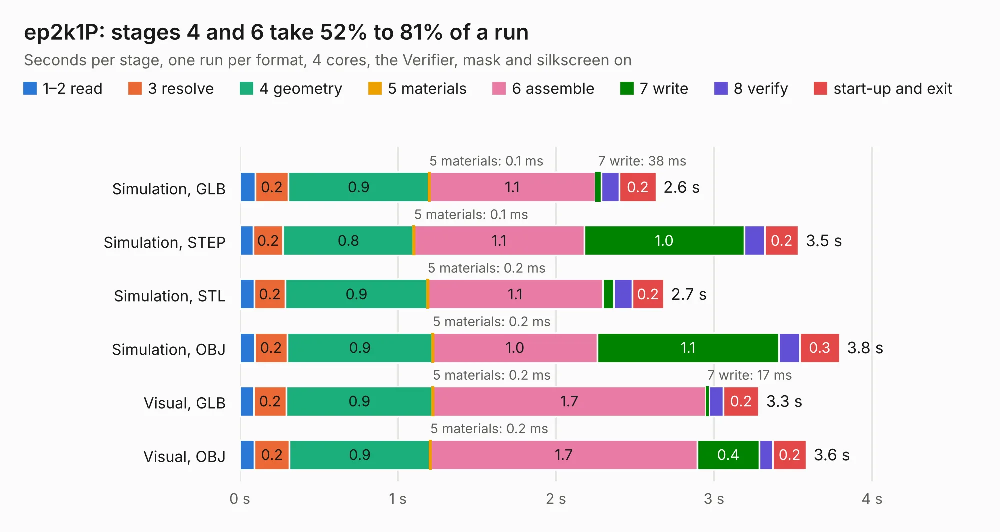

# 1553. ep2k1P

Board 1,553 of the 3,111 of [Corpus Testing](../Corpus-Testing.md), on [Corpus Page 15](../CorpusTestingPages/Corpus-Testing-15.md#1553-ep2k1p).

| Mode and format | 1–2 read | 3 resolve | 4 geometry | 5 materials | 6 assemble | 7 write | 8 verify | start-up and exit | Total |
|---|---:|---:|---:|---:|---:|---:|---:|---:|---:|
| Simulation, GLB | 98&nbsp;ms | 0.2 | 0.9 | 0.1&nbsp;ms | 1.1 | 38&nbsp;ms | 0.1 | 0.2 | 2.6 |
| Simulation, STEP | 85&nbsp;ms | 0.2 | 0.8 | 0.1&nbsp;ms | 1.1 | 1.0 | 0.1 | 0.2 | 3.5 |
| Simulation, STL | 91&nbsp;ms | 0.2 | 0.9 | 0.2&nbsp;ms | 1.1 | 69&nbsp;ms | 0.1 | 0.2 | 2.7 |
| Simulation, OBJ | 94&nbsp;ms | 0.2 | 0.9 | 0.2&nbsp;ms | 1.0 | 1.1 | 0.1 | 0.3 | 3.8 |
| Visual, GLB | 89&nbsp;ms | 0.2 | 0.9 | 0.2&nbsp;ms | 1.7 | 17&nbsp;ms | 91&nbsp;ms | 0.2 | 3.3 |
| Visual, OBJ | 93&nbsp;ms | 0.2 | 0.9 | 0.2&nbsp;ms | 1.7 | 0.4 | 86&nbsp;ms | 0.2 | 3.6 |

<table align="center"><tr><td valign="top">

| Board | Repo: [loxodes/vna](https://github.com/loxodes/vna) Board: `ep2k1P.kicad_pcb` |
|---|---|
| Folder | hardware / mm_reflectometer / evalboards / ep2k1P |
| Complexity | 243&nbsp;/&nbsp;1000 (size&nbsp;133, features&nbsp;110) |
| KESE&nbsp;features | through vias, rounded, trapezoid or chamfered pads, arc tracks, filled zones, stack-up, dielectric εr and tanδ, copper finish, mask and silkscreen colours |
| Tested | 9th November 2026 |
| Copper&nbsp;layers | 4 |
| File&nbsp;format | KiCad 6 (20201220) |
| Parts,&nbsp;tracks,&nbsp;vias | 4, 50, 33 |
| Triangles,&nbsp;simulation | 254,758 in 16 parts |
| Verifier | PASS in all six runs |

</td><td valign="top">

<table>
<tr><th>File type</th><th>File size</th><th>Peak memory used</th></tr>
<tr><th colspan="3" align="left">Simulation</th></tr>
<tr><td>GLB</td><td align="right">8.3&nbsp;MB</td><td align="right">238&nbsp;MB</td></tr>
<tr><td>STEP</td><td align="right">20&nbsp;MB</td><td align="right">257&nbsp;MB</td></tr>
<tr><td>STL</td><td align="right">13&nbsp;MB</td><td align="right">238&nbsp;MB</td></tr>
<tr><td>OBJ</td><td align="right">25&nbsp;MB</td><td align="right">238&nbsp;MB</td></tr>
<tr><th colspan="3" align="left">Visual</th></tr>
<tr><td>GLB</td><td align="right">3.0&nbsp;MB</td><td align="right">173&nbsp;MB</td></tr>
<tr><td>OBJ</td><td align="right">8.6&nbsp;MB</td><td align="right">173&nbsp;MB</td></tr>
</table>

</td></tr></table>

| Previous | Next |
|:---|---:|
| [1552. ecp5](b1552b_vna_ecp5.md) | [1554. fpc07181](b1554b_vna_fpc07181.md) |
