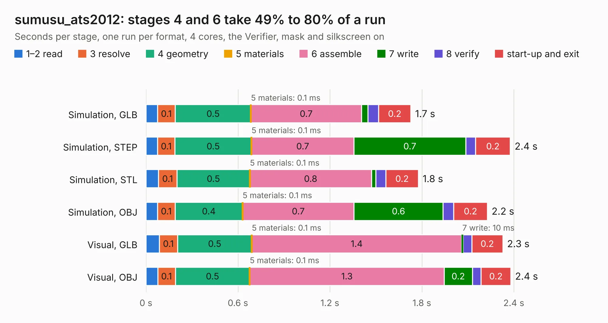

# 1556. sumusu_ats2012

Board 1,556 of the 3,109 of [Corpus Testing](../Corpus-Testing.md), on [Corpus Page 15](../CorpusTestingPages/Corpus-Testing-15.md#1556-sumusu_ats2012).

| Mode and format | 1–2 read | 3 resolve | 4 geometry | 5 materials | 6 assemble | 7 write | 8 verify | start-up and exit | Total |
|---|---:|---:|---:|---:|---:|---:|---:|---:|---:|
| Simulation, GLB | 75&nbsp;ms | 0.1 | 0.5 | 0.1&nbsp;ms | 0.7 | 41&nbsp;ms | 71&nbsp;ms | 0.2 | 1.7 |
| Simulation, STEP | 76&nbsp;ms | 0.1 | 0.5 | 0.1&nbsp;ms | 0.7 | 0.7 | 64&nbsp;ms | 0.2 | 2.4 |
| Simulation, STL | 81&nbsp;ms | 0.1 | 0.5 | 0.1&nbsp;ms | 0.8 | 28&nbsp;ms | 66&nbsp;ms | 0.2 | 1.8 |
| Simulation, OBJ | 75&nbsp;ms | 0.1 | 0.4 | 0.1&nbsp;ms | 0.7 | 0.6 | 70&nbsp;ms | 0.2 | 2.2 |
| Visual, GLB | 87&nbsp;ms | 0.1 | 0.5 | 0.1&nbsp;ms | 1.4 | 10&nbsp;ms | 56&nbsp;ms | 0.2 | 2.3 |
| Visual, OBJ | 77&nbsp;ms | 0.1 | 0.5 | 0.1&nbsp;ms | 1.3 | 0.2 | 57&nbsp;ms | 0.2 | 2.4 |

<table align="center"><tr><td valign="top">

| Board | Repo: [loxodes/vna](https://github.com/loxodes/vna) Board: `sumusu_ats2012.kicad_pcb` |
|---|---|
| Folder | hardware / mm_reflectometer / evalboards / sumusu_ats2012 |
| Complexity | 206&nbsp;/&nbsp;1000 (size&nbsp;111, features&nbsp;95) |
| KESE&nbsp;features | through vias, rounded, trapezoid or chamfered pads, filled zones, stack-up, dielectric εr and tanδ, copper finish, mask and silkscreen colours |
| Tested | 9th November 2026 |
| Copper&nbsp;layers | 4 |
| File&nbsp;format | KiCad 6 (20201220) |
| Parts,&nbsp;tracks,&nbsp;vias | 3, 7, 13 |
| Triangles,&nbsp;simulation | 140,684 in 15 parts |
| Verifier | PASS in all six runs |

</td><td valign="top">

<table>
<tr><th>File type</th><th>File size</th><th>Peak memory used</th></tr>
<tr><th colspan="3" align="left">Simulation</th></tr>
<tr><td>GLB</td><td align="right">4.6&nbsp;MB</td><td align="right">198&nbsp;MB</td></tr>
<tr><td>STEP</td><td align="right">12&nbsp;MB</td><td align="right">210&nbsp;MB</td></tr>
<tr><td>STL</td><td align="right">7.0&nbsp;MB</td><td align="right">197&nbsp;MB</td></tr>
<tr><td>OBJ</td><td align="right">14&nbsp;MB</td><td align="right">197&nbsp;MB</td></tr>
<tr><th colspan="3" align="left">Visual</th></tr>
<tr><td>GLB</td><td align="right">1.6&nbsp;MB</td><td align="right">166&nbsp;MB</td></tr>
<tr><td>OBJ</td><td align="right">4.6&nbsp;MB</td><td align="right">167&nbsp;MB</td></tr>
</table>

</td></tr></table>

| Previous | Next |
|:---|---:|
| [1555. mamx_011036](b1555b_vna_mamx-011036.md) | [1557. xx1000-qt](b1557b_vna_xx1000-qt.md) |
