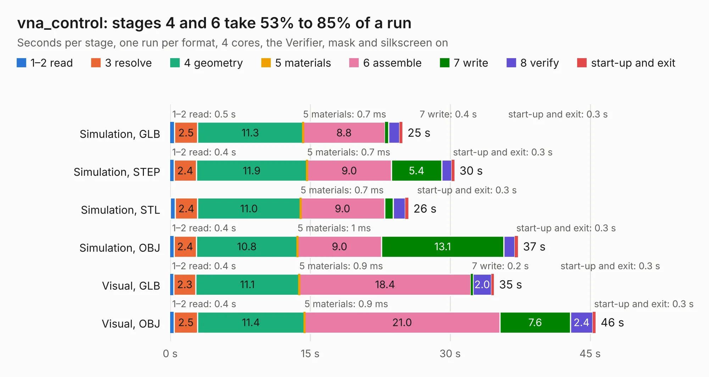

# 1557. vna_control

Board 1,557 of the 3,121 of [Corpus Testing](../Corpus-Testing.md), on [Corpus Page 15](../CorpusTestingPages/Corpus-Testing-15.md#1557-vna_control).

| Mode and format | 1–2 read | 3 resolve | 4 geometry | 5 materials | 6 assemble | 7 write | 8 verify | start-up and exit | Total |
|---|---:|---:|---:|---:|---:|---:|---:|---:|---:|
| Simulation, GLB | 0.5 | 2.5 | 11.3 | 0.7&nbsp;ms | 8.8 | 0.4 | 1.2 | 0.3 | 24.9 |
| Simulation, STEP | 0.4 | 2.4 | 11.9 | 0.7&nbsp;ms | 9.0 | 5.4 | 1.1 | 0.3 | 30.5 |
| Simulation, STL | 0.5 | 2.4 | 11.0 | 0.7&nbsp;ms | 9.0 | 0.9 | 1.3 | 0.3 | 25.5 |
| Simulation, OBJ | 0.4 | 2.4 | 10.8 | 1&nbsp;ms | 9.0 | 13.1 | 1.2 | 0.3 | 37.3 |
| Visual, GLB | 0.4 | 2.3 | 11.1 | 0.9&nbsp;ms | 18.4 | 0.2 | 2.0 | 0.3 | 34.7 |
| Visual, OBJ | 0.4 | 2.5 | 11.4 | 0.9&nbsp;ms | 21.0 | 7.6 | 2.4 | 0.3 | 45.6 |

<table align="center"><tr><td valign="top">

| Board | Repo: [loxodes/vna](https://github.com/loxodes/vna) Board: `vna_control.kicad_pcb` |
|---|---|
| Folder | hardware / archive / vna_r0 / vna_control |
| Complexity | 300&nbsp;/&nbsp;1000 (size&nbsp;245, features&nbsp;55) |
| KESE&nbsp;features | through vias, slotted holes, filled zones, curved board outline |
| Tested | 9th November 2026 |
| Copper&nbsp;layers | 4 |
| File&nbsp;format | KiCad 4 (4) |
| Parts,&nbsp;tracks,&nbsp;vias | 110, 1,091, 157 |
| Triangles,&nbsp;simulation | 2,132,360 in 102 parts |
| Verifier | PASS in all six runs |

</td><td valign="top">

<table>
<tr><th>File type</th><th>File size</th><th>Peak memory used</th></tr>
<tr><th colspan="3" align="left">Simulation</th></tr>
<tr><td>GLB</td><td align="right">74&nbsp;MB</td><td align="right">654&nbsp;MB</td></tr>
<tr><td>STEP</td><td align="right">276&nbsp;MB</td><td align="right">778&nbsp;MB</td></tr>
<tr><td>STL</td><td align="right">107&nbsp;MB</td><td align="right">662&nbsp;MB</td></tr>
<tr><td>OBJ</td><td align="right">225&nbsp;MB</td><td align="right">1.4&nbsp;GB</td></tr>
<tr><th colspan="3" align="left">Visual</th></tr>
<tr><td>GLB</td><td align="right">41&nbsp;MB</td><td align="right">922&nbsp;MB</td></tr>
<tr><td>OBJ</td><td align="right">124&nbsp;MB</td><td align="right">944&nbsp;MB</td></tr>
</table>

</td></tr></table>

| Previous | Next |
|:---|---:|
| [1556. switch_demod](b1556b_vna_switch-demod.md) | [1558. vna_demod](b1558b_vna_vna-demod.md) |
