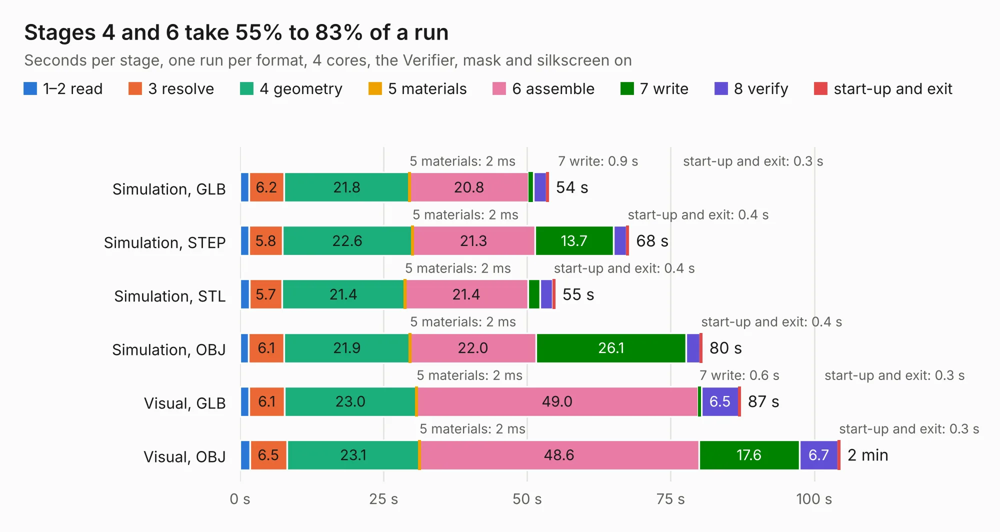

# 1559. [DFR1142]Lite Carrier for LattePanda Mu

Board 1,559 of the 3,103 of [Corpus Testing](../Corpus-Testing.md), on [Corpus Page 15](../CorpusTestingPages/Corpus-Testing-15.md#1559-dfr1142lite-carrier-for-lattepanda-mu).

| Mode and format | 1–2 read | 3 resolve | 4 geometry | 5 materials | 6 assemble | 7 write | 8 verify | start-up and exit | Total |
|---|---:|---:|---:|---:|---:|---:|---:|---:|---:|
| Simulation, GLB | 1.5 | 6.2 | 21.8 | 2&nbsp;ms | 20.8 | 0.9 | 2.2 | 0.3 | 53.7 |
| Simulation, STEP | 1.6 | 5.8 | 22.6 | 2&nbsp;ms | 21.3 | 13.7 | 2.3 | 0.4 | 67.7 |
| Simulation, STL | 1.6 | 5.7 | 21.4 | 2&nbsp;ms | 21.4 | 2.1 | 2.2 | 0.4 | 54.8 |
| Simulation, OBJ | 1.5 | 6.1 | 21.9 | 2&nbsp;ms | 22.0 | 26.1 | 2.4 | 0.4 | 80.5 |
| Visual, GLB | 1.6 | 6.1 | 23.0 | 2&nbsp;ms | 49.0 | 0.6 | 6.5 | 0.3 | 87.2 |
| Visual, OBJ | 1.7 | 6.5 | 23.1 | 2&nbsp;ms | 48.6 | 17.6 | 6.7 | 0.3 | 104.5 |

<table align="center"><tr><td valign="top">

| Board | Repo: [ltbrain/mubook](https://github.com/ltbrain/mubook) Board: `[DFR1142]Lite Carrier for LattePanda Mu.kicad_pcb` |
|---|---|
| Folder | hardware / v.1 |
| Complexity | 406&nbsp;/&nbsp;1000 (size&nbsp;286, features&nbsp;120) |
| KESE&nbsp;features | through vias, slotted holes, custom pads, rounded, trapezoid or chamfered pads, filled zones, copper drawings, curved board outline, stack-up, dielectric εr and tanδ |
| Tested | 9th November 2026 |
| Copper&nbsp;layers | 4 |
| File&nbsp;format | KiCad 9 (20241229) |
| Parts,&nbsp;tracks,&nbsp;vias | 273, 4,113, 1,035 |
| Triangles,&nbsp;simulation | 5,358,896 in 432 parts |
| Verifier | PASS in all six runs |

</td><td valign="top">

<table>
<tr><th>File type</th><th>File size</th><th>Peak memory used</th></tr>
<tr><th colspan="3" align="left">Simulation</th></tr>
<tr><td>GLB</td><td align="right">183&nbsp;MB</td><td align="right">1.5&nbsp;GB</td></tr>
<tr><td>STEP</td><td align="right">764&nbsp;MB</td><td align="right">2.2&nbsp;GB</td></tr>
<tr><td>STL</td><td align="right">268&nbsp;MB</td><td align="right">1.5&nbsp;GB</td></tr>
<tr><td>OBJ</td><td align="right">577&nbsp;MB</td><td align="right">3.5&nbsp;GB</td></tr>
<tr><th colspan="3" align="left">Visual</th></tr>
<tr><td>GLB</td><td align="right">118&nbsp;MB</td><td align="right">2.0&nbsp;GB</td></tr>
<tr><td>OBJ</td><td align="right">384&nbsp;MB</td><td align="right">2.5&nbsp;GB</td></tr>
</table>

</td></tr></table>

| Previous | Next |
|:---|---:|
| [1558. vna_r1_synth](b1558b_vna_vna-r1-synth.md) | [1560. Aleste520v4](b1560b_Aleste520ex_Aleste520v4.md) |
