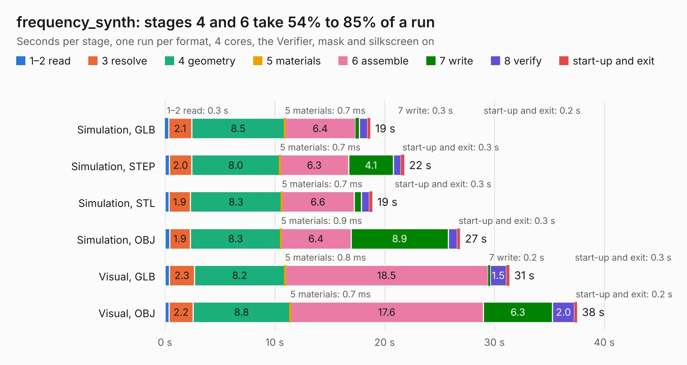

# 1560 frequency_synth

Board 1,560 of the 3,138 of [Corpus Testing](../Corpus-Testing.md), on [Corpus Page 15](../CorpusTestingPages/Corpus-Testing-15.md#1560-frequency_synth).

| Mode and format | 1–2 read | 3 resolve | 4 geometry | 5 materials | 6 assemble | 7 write | 8 verify | start-up and exit | Total |
|---|---:|---:|---:|---:|---:|---:|---:|---:|---:|
| Simulation, GLB | 0.3 | 2.1 | 8.5 | 0.7&nbsp;ms | 6.4 | 0.3 | 0.8 | 0.2 | 18.7 |
| Simulation, STEP | 0.4 | 2.0 | 8.0 | 0.7&nbsp;ms | 6.3 | 4.1 | 0.7 | 0.3 | 21.8 |
| Simulation, STL | 0.4 | 1.9 | 8.3 | 0.7&nbsp;ms | 6.6 | 0.7 | 0.7 | 0.3 | 18.9 |
| Simulation, OBJ | 0.4 | 1.9 | 8.3 | 0.9&nbsp;ms | 6.4 | 8.9 | 0.8 | 0.3 | 26.9 |
| Visual, GLB | 0.4 | 2.3 | 8.2 | 0.8&nbsp;ms | 18.5 | 0.2 | 1.5 | 0.3 | 31.4 |
| Visual, OBJ | 0.4 | 2.2 | 8.8 | 0.7&nbsp;ms | 17.6 | 6.3 | 2.0 | 0.2 | 37.5 |

<table align="center"><tr><td valign="top">

| Board | Repo: [loxodes/vna](https://github.com/loxodes/vna) Board: `frequency_synth.kicad_pcb` |
|---|---|
| Folder | hardware / archive / frequency_synth |
| Complexity | 297&nbsp;/&nbsp;1000 (size&nbsp;252, features&nbsp;45) |
| KESE&nbsp;features | through vias, filled zones, curved board outline |
| Tested | 9th November 2026 |
| Copper&nbsp;layers | 4 |
| File&nbsp;format | KiCad 4 (4) |
| Parts,&nbsp;tracks,&nbsp;vias | 159, 1,274, 215 |
| Triangles,&nbsp;simulation | 1,978,440 in 151 parts |
| Verifier | PASS in all six runs |

</td><td valign="top">

<table>
<tr><th>File type</th><th>File size</th><th>Peak memory used</th></tr>
<tr><th colspan="3" align="left">Simulation</th></tr>
<tr><td>GLB</td><td align="right">69&nbsp;MB</td><td align="right">670&nbsp;MB</td></tr>
<tr><td>STEP</td><td align="right">252&nbsp;MB</td><td align="right">878&nbsp;MB</td></tr>
<tr><td>STL</td><td align="right">99&nbsp;MB</td><td align="right">712&nbsp;MB</td></tr>
<tr><td>OBJ</td><td align="right">209&nbsp;MB</td><td align="right">1.4&nbsp;GB</td></tr>
<tr><th colspan="3" align="left">Visual</th></tr>
<tr><td>GLB</td><td align="right">42&nbsp;MB</td><td align="right">827&nbsp;MB</td></tr>
<tr><td>OBJ</td><td align="right">128&nbsp;MB</td><td align="right">936&nbsp;MB</td></tr>
</table>

</td></tr></table>

| Previous | Next |
|:---|---:|
| [1559 doubler_switch](b1559b_vna_doubler-switch.md) | [1561 trl_line](b1561b_vna_hardware-archive-oshpark-4layer-trl-cal-cap-0201_trl-line.md) |
