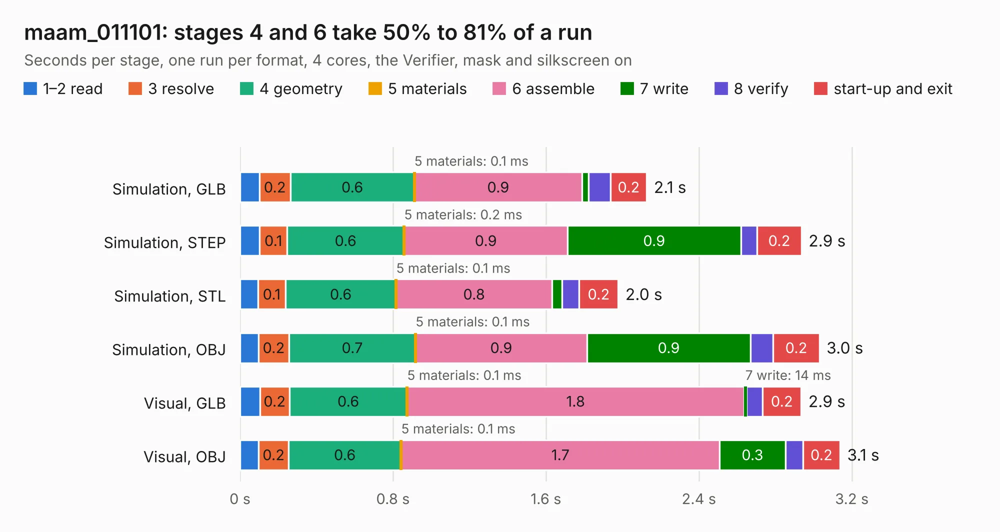

# 1561. maam_011101

Board 1,561 of the 3,117 of [Corpus Testing](../Corpus-Testing.md), on [Corpus Page 15](../CorpusTestingPages/Corpus-Testing-15.md#1561-maam_011101).

| Mode and format | 1–2 read | 3 resolve | 4 geometry | 5 materials | 6 assemble | 7 write | 8 verify | start-up and exit | Total |
|---|---:|---:|---:|---:|---:|---:|---:|---:|---:|
| Simulation, GLB | 0.1 | 0.2 | 0.6 | 0.1&nbsp;ms | 0.9 | 34&nbsp;ms | 0.1 | 0.2 | 2.1 |
| Simulation, STEP | 0.1 | 0.1 | 0.6 | 0.2&nbsp;ms | 0.9 | 0.9 | 85&nbsp;ms | 0.2 | 2.9 |
| Simulation, STL | 94&nbsp;ms | 0.1 | 0.6 | 0.1&nbsp;ms | 0.8 | 52&nbsp;ms | 90&nbsp;ms | 0.2 | 2.0 |
| Simulation, OBJ | 97&nbsp;ms | 0.2 | 0.7 | 0.1&nbsp;ms | 0.9 | 0.9 | 0.1 | 0.2 | 3.0 |
| Visual, GLB | 0.1 | 0.2 | 0.6 | 0.1&nbsp;ms | 1.8 | 14&nbsp;ms | 83&nbsp;ms | 0.2 | 2.9 |
| Visual, OBJ | 98&nbsp;ms | 0.2 | 0.6 | 0.1&nbsp;ms | 1.7 | 0.3 | 92&nbsp;ms | 0.2 | 3.1 |

<table align="center"><tr><td valign="top">

| Board | Repo: [loxodes/vna](https://github.com/loxodes/vna) Board: `maam_011101.kicad_pcb` |
|---|---|
| Folder | hardware / mm_reflectometer / evalboards / maam_011101 |
| Complexity | 222&nbsp;/&nbsp;1000 (size&nbsp;127, features&nbsp;95) |
| KESE&nbsp;features | through vias, rounded, trapezoid or chamfered pads, filled zones, stack-up, dielectric εr and tanδ, copper finish, mask and silkscreen colours |
| Tested | 9th November 2026 |
| Copper&nbsp;layers | 4 |
| File&nbsp;format | KiCad 6 (20210108) |
| Parts,&nbsp;tracks,&nbsp;vias | 8, 24, 16 |
| Triangles,&nbsp;simulation | 159,606 in 18 parts |
| Verifier | PASS in all six runs |

</td><td valign="top">

<table>
<tr><th>File type</th><th>File size</th><th>Peak memory used</th></tr>
<tr><th colspan="3" align="left">Simulation</th></tr>
<tr><td>GLB</td><td align="right">5.2&nbsp;MB</td><td align="right">199&nbsp;MB</td></tr>
<tr><td>STEP</td><td align="right">14&nbsp;MB</td><td align="right">214&nbsp;MB</td></tr>
<tr><td>STL</td><td align="right">8.0&nbsp;MB</td><td align="right">201&nbsp;MB</td></tr>
<tr><td>OBJ</td><td align="right">16&nbsp;MB</td><td align="right">198&nbsp;MB</td></tr>
<tr><th colspan="3" align="left">Visual</th></tr>
<tr><td>GLB</td><td align="right">2.1&nbsp;MB</td><td align="right">166&nbsp;MB</td></tr>
<tr><td>OBJ</td><td align="right">5.8&nbsp;MB</td><td align="right">167&nbsp;MB</td></tr>
</table>

</td></tr></table>

| Previous | Next |
|:---|---:|
| [1560. maam-011132](b1560b_vna_maam-011132.md) | [1562. mamx_011036](b1562b_vna_mamx-011036.md) |
