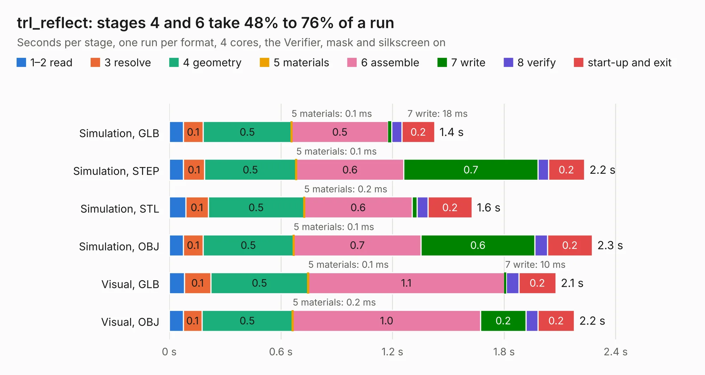

# 1561. trl_reflect

Board 1,561 of the 3,132 of [Corpus Testing](../Corpus-Testing.md), on [Corpus Page 15](../CorpusTestingPages/Corpus-Testing-15.md#1561-trl_reflect).

| Mode and format | 1–2 read | 3 resolve | 4 geometry | 5 materials | 6 assemble | 7 write | 8 verify | start-up and exit | Total |
|---|---:|---:|---:|---:|---:|---:|---:|---:|---:|
| Simulation, GLB | 75&nbsp;ms | 0.1 | 0.5 | 0.1&nbsp;ms | 0.5 | 18&nbsp;ms | 56&nbsp;ms | 0.2 | 1.4 |
| Simulation, STEP | 76&nbsp;ms | 0.1 | 0.5 | 0.1&nbsp;ms | 0.6 | 0.7 | 56&nbsp;ms | 0.2 | 2.2 |
| Simulation, STL | 88&nbsp;ms | 0.1 | 0.5 | 0.2&nbsp;ms | 0.6 | 26&nbsp;ms | 60&nbsp;ms | 0.2 | 1.6 |
| Simulation, OBJ | 75&nbsp;ms | 0.1 | 0.5 | 0.1&nbsp;ms | 0.7 | 0.6 | 68&nbsp;ms | 0.2 | 2.3 |
| Visual, GLB | 81&nbsp;ms | 0.1 | 0.5 | 0.1&nbsp;ms | 1.1 | 10&nbsp;ms | 68&nbsp;ms | 0.2 | 2.1 |
| Visual, OBJ | 75&nbsp;ms | 0.1 | 0.5 | 0.2&nbsp;ms | 1.0 | 0.2 | 65&nbsp;ms | 0.2 | 2.2 |

<table align="center"><tr><td valign="top">

| Board | Repo: [loxodes/vna](https://github.com/loxodes/vna) Board: `trl_reflect.kicad_pcb` |
|---|---|
| Folder | hardware / archive / oshpark_4layer_trl_cal / trl_reflect |
| Complexity | 84&nbsp;/&nbsp;1000 (size&nbsp;64, features&nbsp;20) |
| KESE&nbsp;features | filled zones |
| Tested | 9th November 2026 |
| Copper&nbsp;layers | 4 |
| File&nbsp;format | KiCad 4 (4) |
| Parts,&nbsp;tracks,&nbsp;vias | 1, 3, 0 |
| Triangles,&nbsp;simulation | 116,706 in 16 parts |
| Verifier | PASS in all six runs |

</td><td valign="top">

<table>
<tr><th>File type</th><th>File size</th><th>Peak memory used</th></tr>
<tr><th colspan="3" align="left">Simulation</th></tr>
<tr><td>GLB</td><td align="right">3.9&nbsp;MB</td><td align="right">186&nbsp;MB</td></tr>
<tr><td>STEP</td><td align="right">12&nbsp;MB</td><td align="right">190&nbsp;MB</td></tr>
<tr><td>STL</td><td align="right">5.8&nbsp;MB</td><td align="right">194&nbsp;MB</td></tr>
<tr><td>OBJ</td><td align="right">11&nbsp;MB</td><td align="right">184&nbsp;MB</td></tr>
<tr><th colspan="3" align="left">Visual</th></tr>
<tr><td>GLB</td><td align="right">1.7&nbsp;MB</td><td align="right">159&nbsp;MB</td></tr>
<tr><td>OBJ</td><td align="right">4.8&nbsp;MB</td><td align="right">159&nbsp;MB</td></tr>
</table>

</td></tr></table>

| Previous | Next |
|:---|---:|
| [1560. trl_line](b1560b_vna_hardware-archive-oshpark-4layer-trl-cal-trl-line_trl-line.md) | [1562. trl_line](b1562b_vna_hardware-archive-oshpark-4layer-trl-cal-trl-thru_trl-line.md) |
