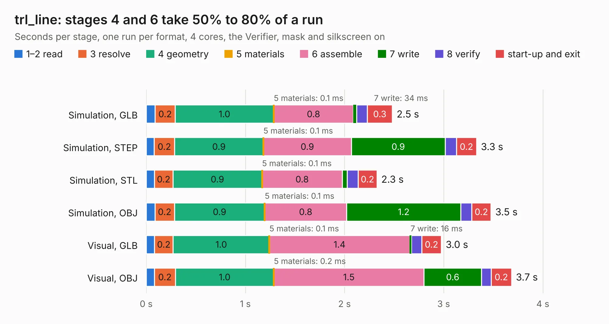

# 1563 trl_line

Board 1,563 of the 3,138 of [Corpus Testing](../Corpus-Testing.md), on [Corpus Page 15](../CorpusTestingPages/Corpus-Testing-15.md#1563-trl_line).

| Mode and format | 1–2 read | 3 resolve | 4 geometry | 5 materials | 6 assemble | 7 write | 8 verify | start-up and exit | Total |
|---|---:|---:|---:|---:|---:|---:|---:|---:|---:|
| Simulation, GLB | 90&nbsp;ms | 0.2 | 1.0 | 0.1&nbsp;ms | 0.8 | 34&nbsp;ms | 0.1 | 0.3 | 2.5 |
| Simulation, STEP | 81&nbsp;ms | 0.2 | 0.9 | 0.1&nbsp;ms | 0.9 | 0.9 | 0.1 | 0.2 | 3.3 |
| Simulation, STL | 83&nbsp;ms | 0.2 | 0.9 | 0.1&nbsp;ms | 0.8 | 49&nbsp;ms | 0.1 | 0.2 | 2.3 |
| Simulation, OBJ | 88&nbsp;ms | 0.2 | 0.9 | 0.1&nbsp;ms | 0.8 | 1.2 | 0.1 | 0.2 | 3.5 |
| Visual, GLB | 83&nbsp;ms | 0.2 | 1.0 | 0.1&nbsp;ms | 1.4 | 16&nbsp;ms | 0.1 | 0.2 | 3.0 |
| Visual, OBJ | 82&nbsp;ms | 0.2 | 1.0 | 0.2&nbsp;ms | 1.5 | 0.6 | 96&nbsp;ms | 0.2 | 3.7 |

<table align="center"><tr><td valign="top">

| Board | Repo: [loxodes/vna](https://github.com/loxodes/vna) Board: `trl_line.kicad_pcb` |
|---|---|
| Folder | hardware / archive / oshpark_4layer_trl_cal / shunt_0402 |
| Complexity | 136&nbsp;/&nbsp;1000 (size&nbsp;101, features&nbsp;35) |
| KESE&nbsp;features | through vias, filled zones |
| Tested | 9th November 2026 |
| Copper&nbsp;layers | 4 |
| File&nbsp;format | KiCad 4 (4) |
| Parts,&nbsp;tracks,&nbsp;vias | 5, 12, 2 |
| Triangles,&nbsp;simulation | 236,544 in 15 parts |
| Verifier | PASS in all six runs |

</td><td valign="top">

<table>
<tr><th>File type</th><th>File size</th><th>Peak memory used</th></tr>
<tr><th colspan="3" align="left">Simulation</th></tr>
<tr><td>GLB</td><td align="right">7.8&nbsp;MB</td><td align="right">232&nbsp;MB</td></tr>
<tr><td>STEP</td><td align="right">23&nbsp;MB</td><td align="right">239&nbsp;MB</td></tr>
<tr><td>STL</td><td align="right">12&nbsp;MB</td><td align="right">230&nbsp;MB</td></tr>
<tr><td>OBJ</td><td align="right">23&nbsp;MB</td><td align="right">232&nbsp;MB</td></tr>
<tr><th colspan="3" align="left">Visual</th></tr>
<tr><td>GLB</td><td align="right">3.4&nbsp;MB</td><td align="right">171&nbsp;MB</td></tr>
<tr><td>OBJ</td><td align="right">9.6&nbsp;MB</td><td align="right">172&nbsp;MB</td></tr>
</table>

</td></tr></table>

| Previous | Next |
|:---|---:|
| [1562 trl_line](b1562b_vna_hardware-archive-oshpark-4layer-trl-cal-cap-0402_trl-line.md) | [1564 trl_line](b1564b_vna_hardware-archive-oshpark-4layer-trl-cal-trl-line_trl-line.md) |
